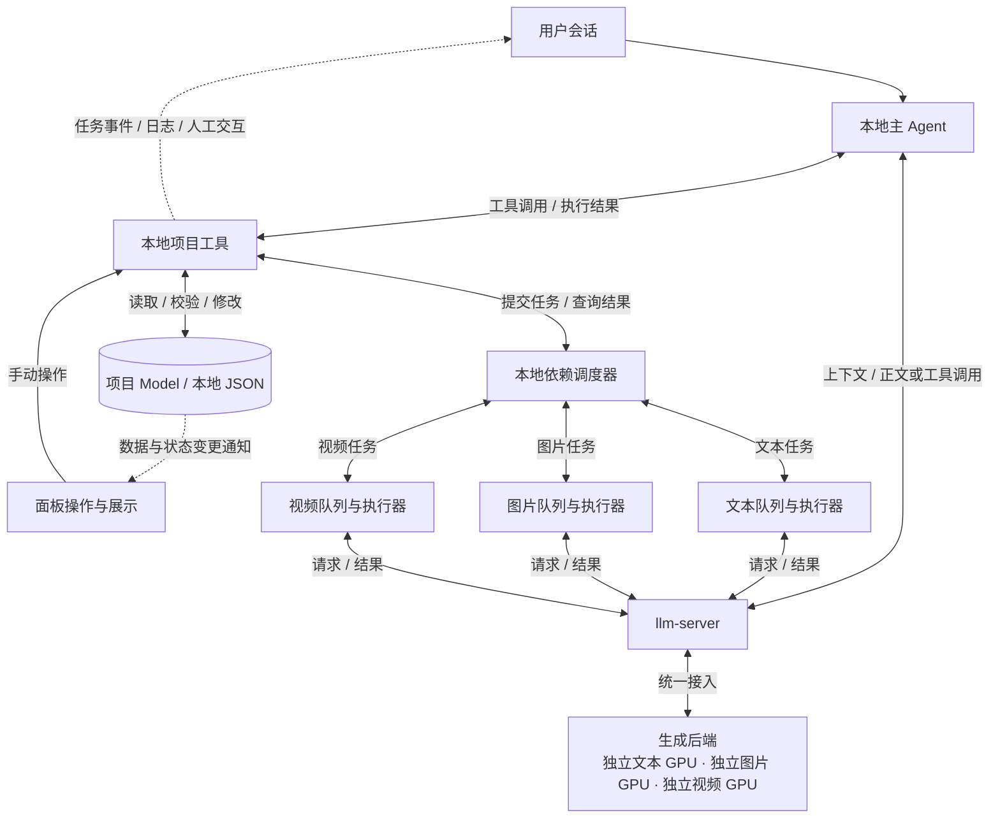

# 未来结构模式：本地项目 Model、工具执行与响应式面板

- 创建日期：2026-10-14。
- 定位：长期目标结构与阶段演进依据；供后续开发继续参考，不代表本文描述的能力均已实现。
- 本次范围：记录已确定的架构方向，不修改运行代码，不立即迁移业务逻辑。
- 当前推进方式：先从面板出发验证各阶段能力，再接入模型工具调用。
- 关联计划：[制作工作流节点对齐](1014-计划-制作工作流节点对齐.md)。节点业务规格继续以 [制作工作流](../../meiji/dev_docs/制作工作流.md) 为依据。

## 1. 目标与核心决策

将本地项目 JSON 及其关联素材理解为模型操作的工作对象，类似编码助手操作项目代码。用户提出需求，模型读取必要上下文、提出节点操作，本地业务程序校验并执行修改。

项目 Model 是本地业务数据与状态的唯一权威来源。会话和面板是两个操作入口，共用本地项目工具。模型通过工具读取、修改项目 Model，面板订阅 Model 的变化并响应式更新；模型不操作面板，也不能绕过业务校验直接修改数据库。

这里的项目 JSON 是模型可读取和提交修改的数据表示；项目 Model 及其持久化层负责实际保存，不要求迁移为 JSON 文件，也不要求把整个项目一次性发送给模型。

确定以下边界：

1. 用户项目、剧本、素材、正式成果和版本历史长期保存在用户侧。
2. 工作流依赖、提示词编排、输出校验和节点修改保留在 llm-dsh-plugins 本地后台。
3. 采用一个本地主 Agent，负责模型与工具之间的多轮调用循环；Harness／插件执行层优先复用已有能力。文本、图片、视频先采用独立队列和执行器，不因模型不同而增加三个自主子 Agent。
4. llm-server 统一提供文本、图片、视频生成服务，负责各生成后端的接入，不维护用户项目库，不接管制作业务规则。
5. 网页是操作与展示入口，内容、任务进度和状态由本地 Model 的变更驱动更新；后台任务不依赖某个面板页面持续打开。
6. 固定制作工作流由本地调度器执行，模型可选择业务操作，但不得跳过依赖、权限和验收规则。
7. 文本、图片、视频使用独立 GPU／后端，各自控制并发；不同剧集按节点就绪情况并行推进，同一节点按版本受控提交。
8. 面板发起的任务也进入关联会话的执行记录。非模型操作直接展示日志；模型任务展示推理、工具调用、人工交互和结束状态。展示由真实任务事件驱动，不为同步会话重复调用模型。

这是本轮确定的目标方向。此前讨论的“将完整制作流程放到远端 llm-server”属于另一种部署方案，不作为当前演进目标。

## 2. 目标结构



图保留主关系：顶部会话与面板是两个入口；主 Agent 通过本地项目工具操作 Model，Model 驱动面板更新。读取和直接修改无需进入生成队列；生成操作由本地调度器分发到三类执行器，状态与结果经统一项目工具写回 Model。生成、审核和重试是工具内部实现，不再在总图中展开为另一套执行体系。图中的工具到会话虚线表示本地后台汇集任务事件后投影到会话，不是把日志作为新用户消息再次发送给模型。

**模型与工具的循环**：本地 Agent 经 llm-server 请求模型 → 模型返回工具调用 → 本地工具读取或修改 Model → 执行结果返回 Agent → 再次请求模型，直到完成、失败或取消。

**面板的响应链**：工具更新项目内容或任务状态 → 本地持久化并发布变更 → 面板更新对应视图。面板手动操作也走同一套工具和 Model，不单独维护另一份业务真相。

文本、图片、视频统一经过 llm-server。Ollama 是文本推理后端，图片和视频使用各自的生成后端；不要求所有能力由 Ollama 提供。媒体统一接入尚未实施。

| 能力 | 归属 | 约束 |
|---|---|---|
| 项目管理、编辑、正式结果与历史 | 插件本地业务后台 | 项目 JSON 是业务数据模型；实际存储实现沿用项目规范，不要求改成 JSON 文件 |
| 面板、会话、进度和历史展示 | Harness 与插件界面 | 面板订阅本地 Model 变化，提交业务操作，不依赖模型回复来刷新数据 |
| 节点路由、输入输出契约 | 插件本地业务后台 | 面板和模型工具共用，不建立两套修改路径 |
| 节点提示词及生成、审核、按意见重新生成 | 插件提示词与参数编排模块 | 业务规则不迁到通用推理服务 |
| 依赖检查、任务调度、下游失效 | 插件本地调度器 | 按节点就绪情况跨集调度，管理业务依赖和冲突，不让主 Agent 猜测资源可用性 |
| 文本、图片、视频队列与执行器 | 插件本地后台 | 三类独立执行，复用节点逻辑；状态和结果统一写回 Model，不各自维护项目副本 |
| 工具定义、参数校验与执行 | 本地工具接入层及节点业务入口 | 工具接入层仅适配调用，业务规则仍在统一入口 |
| 模型与工具多轮循环 | 本地 Harness／插件执行层 | 优先复用已有能力，实施前确认是否需要新增 |
| 文本、图片、视频后端连接，部署默认参数、鉴权、超时、取消 | llm-server | 统一管理供应商凭据与协议适配，不解释项目、角色、剧集等业务结构 |
| 媒体生成任务提交、进度查询、结果获取 | llm-server | 关联供应商任务 ID；根据实际后端能力处理取消和恢复，不将停止本地轮询误报为远端生成已停止 |
| 图片／视频业务提示词、参考素材选择、成果归档 | 插件本地业务后台 | 向 llm-server 提供本次所需输入，领取结果后写入本地项目 |
| 推理排队、临时结果领取 | llm-server 的后续通用能力 | 如实施，只管理推理请求；不等同于项目工作流状态 |
| 文本推理 | Ollama | 返回正文或工具调用请求，不直接修改本地项目 |
| 图片与视频生成 | 各自生成后端 | 由 llm-server 接入，返回生成任务状态及成果 |

## 3. 两种入口共用本地项目工具

### 面板入口：当前优先验证

用户点击或编辑 → 调用本地项目工具 → 校验并修改 Model → 持久化并发布变更 → 面板自动更新。需要生成时，由工具内部组装参数、请求模型、校验／审核，再将结果写回 Model。

面板不保存独立的业务运行真相，不在 UI 中实现另一套生成、审核或重试规则。

### 会话入口：后续逐步开放

用户提出需求 → 本地 Agent 请求模型 → 模型通过工具读取节点 → 模型提交内容修改或请求生成 → 本地工具校验并修改 Model → 面板响应更新；工具执行结果同时返回 Agent，供模型决定继续或结束。

两类工具需要区分：

- 执行节点操作：例如生成大纲、重新生成某分镜。由节点已有流程组装提示词并执行。
- 提交节点内容：模型已经给出候选内容时，走统一校验和保存流程；不能直接覆盖数据库，也不应无条件再生成一遍。

每次生成必需且已知的资料，例如剧本、语言、规则、补充需求，应由业务后台直接组装。按需追加查询的资料才通过工具读取，避免为每个固定参数增加一次模型往返。

### 响应式更新约定

- 内容、版本和业务任务状态由本地 Model／持久化层统一维护。界面中的选中项、展开状态和未提交编辑草稿可以保留在前端，但不作为正式项目数据。
- 修改成功后发布带项目／节点标识和版本的变更。先保存成功再报告提交成功，失败不得展示为已保存。
- 面板初始化与重连时读取当前快照，再衔接订阅；具体协议需处理快照与订阅之间的变化，避免漏事件。
- 对重复或过期事件按版本处理；发现事件缺口时重新获取快照，不以收到所有事件作为唯一恢复手段。
- 长任务的排队、执行、失败、取消等进度同样写入本地业务状态，再通知界面；流式候选文本与已提交的正式内容明确区分。
- 面板关闭只解除 UI 订阅，不取消本地后台任务；用户明确停止才执行取消。
- 复用现有状态通知机制，具体采用事件总线、SSE 或其他传输方式实施前核实，不预设新框架。

例如用户要求“修改第二场对白”：模型读取节点版本，调用修改工具；工具校验并写入新版本，面板立即显示新对白，无需等待模型在会话中说“修改完成”。若用户同期手动编辑导致版本冲突，工具返回冲突，不覆盖新内容。

### 面板任务与会话联动

面板与会话展示同一任务的不同视图。点击面板操作时，本地后台记录发起来源、关联会话与业务任务 ID，在会话中创建任务记录；不先要求主 Agent 重新解释、确认或重新提交同一任务。关联会话随任务固定，切换页面或会话不能把事件错误地写入另一会话；无关联会话时的创建／选择规则需在接入时明确。

非模型操作和模型操作按实际执行步骤区分；一个任务可以包含两者，不因其中有 AI 步骤就让每条日志都经过模型。

| 实际阶段／事件 | 会话中的表现 | 是否需要新增模型调用 |
|---|---|---|
| 普通读取、保存、校验、下载等本地操作 | 工具／系统日志：操作对象、结果或错误 | 不需要 |
| 已提交但等待执行额度 | 排队中，显示任务和阶段 | 不需要 |
| 已开始模型请求，等待返回 | AI 思考中／正在生成；媒体任务显示图片或视频生成中 | 只执行任务本身的请求，不另发说明请求 |
| 模型返回工具调用 | 展示“AI 请求调用工具”，包含工具名、目标和可展示参数；随后更新为执行中、成功或失败 | 工具执行本身不需要；执行结果回传后，按任务需要继续原模型循环 |
| 模型输出正文 | 流式展示可展示内容，关联具体任务／步骤 | 不额外调用 |
| 缺少必要资料、需要用户选择或确认 | 会话内展示选择／意见输入卡片，任务进入等待人工输入 | 不靠模型反复轮询等待 |
| 超时、网络失败、工具错误或重试耗尽 | 展示真实错误及适用操作，如重试、修改输入、取消 | 不为解释错误自动新增推理 |
| 任务结束 | 展示成功、失败、取消、审核未通过或被替代等真实结论，并提供成果／节点入口 | 系统结束卡片不需要额外模型总结；已有模型最终回复可一并显示 |

“AI 思考中”是执行状态标签，不要求暴露模型内部思维过程，也不能把排队、网络故障或工具执行伪装成思考。上游未提供阶段细节时只展示已知的“等待模型响应”，不推断不存在的进度。

### 人工输入与继续执行

- 明确的资料缺口、权限确认、冲突或业务决策进入等待人工输入；响应慢本身不自动视为需要用户决策。
- 人工交互关联任务 ID、步骤 ID、交互 ID 和必要的输入版本，包含问题、选项／自由文本、可用操作及等待期限。
- 用户回复提交给原任务执行流程，不能当成无关联的新聊天任务；校验交互仍有效且未被处理后再继续。
- 工具需要的信息由工具接收后继续；确需模型理解的新意见，再加入原任务上下文发起下一轮推理。不得仅为“已收到意见”额外调用模型。
- 等待时保存恢复所需状态、释放本轮推理额度；不阻塞其他独立剧集和执行队列。
- 页面刷新后恢复待回答卡片；多处重复回答仅接受一次。任务已取消、结束或输入版本失效时，旧卡片不得再次启动执行。

### 事件、状态和结果一致性

本地后台统一汇集调度器、执行器、工具及 llm-server 的请求事件；llm-server 不负责用户会话和项目的映射。事件包含关联 ID、单任务递增序号、阶段、时间和展示摘要，字段协议实施前确定。

- 项目内容和业务状态以本地 Model 为准；会话是执行过程的投影，不维护第二套任务状态机。
- 执行事件和人工等待状态需要可恢复；页面订阅不是唯一事件接收方。重连按序号补齐，重复事件去重，缺口时重新获取任务状态。
- 同一任务在会话中按卡片或步骤分组更新，避免多集并发时混成无归属的日志；不要求不同任务之间建立虚假的全局顺序。
- 普通日志不默认进入模型上下文；下一轮仅回传必要的工具结果、错误和人工意见。
- 模型返回结束不等于业务成功。必须等校验、结果保存以及应完成的后续步骤确认后，发布任务最终结论；提交了远端媒体任务只能展示“已提交／生成中”。
- 业务提交成功后再发布成功通知；结合持久化任务状态和事件恢复机制，处理提交成功但通知丢失的情况。异常、取消或被替代的任务不得误报成功。
- 工具参数和错误摘要不得展示密钥等凭据；可访问成果仍受本地项目权限约束。

## 4. 项目修改规则

工具按业务语义设计，例如读取节点、查询相关角色、执行节点操作、提交候选内容。具体工具名和参数在接口实施阶段确定。

候选内容提交示意（非已上线协议）：

```json
{
  "node_id": "scene-002",
  "expected_version": 5,
  "content": {
    "剧情": "修改后的内容"
  }
}
```

- 模型只提交允许修改的内容字段；节点 ID、任务状态、版本和依赖由程序维护。
- 本地核验目标节点、内容类型、业务约束和调用权限。
- 写入前比较读取版本与当前版本；冲突时返回错误及重新读取的指引，不覆盖用户新修改。
- 成功写入后按现有业务规则保存版本、处理下游失效，发布 Model 变更；面板通过订阅更新，而不是由模型或工具直接操作 UI。
- 工具调用需要关联执行 ID，重复投递不得重复产生业务写入；具体去重机制实施前设计。
- 模型审核不替代确定性校验。例如字段合法性、段落覆盖、受保护角色是否遗漏，应由程序承担能明确判断的部分。
- 发布、删除、覆盖等操作按权限和产品规则执行；模型提出请求不自动等于获得授权。

## 5. 三类执行队列与多集并发

### 主 Agent 与执行器的边界

主 Agent 理解用户需求，通过工具读取项目、提交节点操作、查询任务或停止任务。它不需要在一次工具调用中阻塞等待整集制作完成；长任务可返回业务任务 ID，再查询进展。

三类执行器执行已确定的业务操作，负责相应提示词组装、生成、审核和按意见重新生成。它们不是三个自主决策的 Agent。只有以后某类任务确实需要独立规划、多工具探索和自主评估，才评估升级专业子 Agent；队列、工具、Model 和调度规则仍复用。

### 两层调度各管一件事

| 层级 | 调度依据 | 不负责什么 |
|---|---|---|
| 本地业务调度器 | 节点依赖、任务顺序、输入版本、业务取消及公平性；将就绪任务送入文本／图片／视频队列 | 不凭 GPU 利用率推测远端可同时执行多少请求 |
| llm-server 资源调度 | 按实际模型后端配置并发额度、排队和请求生命周期，统一约束所有调用方 | 不解析剧集依赖，不保存用户项目库，不决定修改哪个节点 |

本地控制在途任务数量，避免无界提交；llm-server 是各后端实际推理额度的统一执行边界。不能每个项目各自获得一整套独占额度，造成多个项目合计超限。

文本生成、文本审核及主 Agent 推理若使用同一文本后端，共用其并发额度；图片和视频使用独立后端，不占用文本额度。媒体任务需要文本模型审核时，该次审核也按文本请求排队。一次推理完成即释放对应资源额度，不在等待用户、工具或其他后端时持续占用该额度。

初始文本并发建议为 1，基于此前当前部署的测试结果；图片和视频并发分别经其实际后端压测确定，不在本文指定未经验证的数值。后续替换 GPU 或模型时重新验证。

### 跨集执行示例

| 同一时间的执行器 | 可执行的任务示例 | 前提 |
|---|---|---|
| 文本 | 第 3 集分镜文本 | 所需剧本和角色资料已就绪 |
| 图片 | 第 2 集镜头图片 | 对应文本和参考素材已就绪 |
| 视频 | 第 1 集镜头视频 | 所选视频模式要求的输入已就绪 |

按节点依赖放行，不要求整集全部完成后才能处理另一集。共享角色或素材节点属于真实依赖，未就绪时不能因跨集并发而跳过。某个任务失败只影响依赖它的任务，其他独立任务可以继续。

### 一致性与取消

- 每个业务任务关联项目、剧集／目标节点、操作类型、执行 ID，以及目标节点和所有相关输入的版本。
- 不同节点允许并发生成；同一节点的写入串行提交并检查版本。不能用多个执行器覆盖整份旧项目快照，否则会丢失其他节点的新结果。
- 返回时重新核验输入版本及任务是否已取消／被替代。过期结果保留为历史或候选并标明状态，不自动覆盖正式内容，也不自动触发下游。
- 一次结果提交中的内容、版本、状态及下游失效按一致的提交边界处理；提交成功后才通知面板。
- 重复投递与重复回调按执行 ID 去重；实际存储与幂等字段在实施计划中确定。
- 取消排队任务时不再提交后端；取消执行中任务时调用后端取消能力。后端不支持真正停止时，记录其能力限制并禁止迟到结果写入正式内容，不能声称远端已停止。
- 取消一个任务不停止其他独立剧集任务；用户明确取消整个工作流时，按该工作流范围停止调度和关联请求。

## 6. 数据与生命周期

### 本地长期保存

项目与剧本、角色和分镜、素材引用、工作流状态、执行历史、候选和正式版本，以及本地业务任务与远端推理请求的对应关系。

### llm-server 的边界

远端推理需要接收本轮必要内容，因此“项目库不放远端”不等于“内容不经过远端”。不应向 llm-server 发送与本轮无关的整个项目库。

如后续实现断线领取结果，可临时保存请求状态和响应，并定义确认领取、保留期限及清理机制。内存缓存不具备进程重启恢复能力；是否允许临时落盘、保存多久，实施前决定。服务日志避免记录剧本、完整提示词和生成正文。

图片与视频同样遵循临时执行数据边界：仅传递本次所需提示词、参考素材或可访问的授权地址。服务端可临时中转素材和成果，不建设用户素材库；本地文件路径不能直接作为远端可读取的地址。下载归档、临时文件清理、供应商结果地址过期和供应商留存策略需在媒体接入时明确。

### 不同中断的处理目标

| 场景 | 目标行为 |
|---|---|
| 网页刷新／关闭，本地后台仍运行 | 后台继续执行，重新打开页面后读取状态和结果 |
| 用户明确点击停止 | 本地停止后续调度，并取消对应的远端推理请求 |
| 本地后台重启 | 从持久化业务状态恢复；核对未完成推理，避免重复执行和重复落库 |
| llm-server 与客户端连接中断 | 当前实现会取消上游；未来若启用异步推理任务，应改为查询／订阅断开不取消任务 |
| llm-server 重启 | 根据持久化策略恢复记录；不能假定可以接回原 Ollama 输出流 |
| 用户电脑关机 | 本地流程暂停；即使远端单次推理完成，也不能假定本地工具和后续节点继续执行 |

若未来要求电脑关机后整条工作流仍运行，需要另行设计远端执行环境与数据访问方式，不在当前方案中默认为已支持。

## 7. 分阶段演进与验收

以下均为后续目标；本次仅建立文档，不据此标记代码已完成。

| 阶段 | 工作内容 | 验收条件 |
|---|---|---|
| A：面板逐节点验证 | 继续验证节点输入、生成、审核、重新生成、取消及保存行为 | 面板可完成节点操作；失败原因可见；正式结果与历史符合业务规则 |
| B：统一工具与响应式 Model | 面板操作与未来模型工具共用本地入口；统一 Model 写入与变更通知 | 无需打开页面也能修改节点；打开的面板自动更新；重连获取最新快照，不因旧事件回退状态 |
| B2：面板任务联动会话 | 本地任务事件同步为会话日志、模型阶段、工具卡片、人工交互和结束卡片 | 普通操作不产生模型请求；AI 阶段与真实执行一致；人工回复恢复原任务且不重复执行；刷新恢复记录；并发任务按 ID 分组；保存失败不报成功 |
| C：最小模型工具闭环 | 开放读取大纲与按意见修改大纲；接入工具调用及结果回传 | 模型能读取、提交修改、处理校验错误；修改后面板无需刷新即可更新；本地可查看版本；并发编辑不被覆盖 |
| D：恢复与请求关联 | 完善本地任务持久化；按需要增加 llm-server 异步推理查询及临时结果 | 刷新后恢复显示；重试不重复写入；取消、失联、重启有明确状态和处理 |
| D2：图片与视频统一接入 | 将插件直连媒体供应商的调用迁至 llm-server；业务编排与素材选择仍在本地 | 图片与视频均经 llm-server 提交、查询和领取；调用方不持有供应商凭据；失败、取消能力及结果归档有明确验证 |
| D3：三类队列与多集并发 | 独立文本／图片／视频执行器；本地依赖调度与服务端后端额度分离 | 三类任务可同时执行且各不超额；同类跨集任务按额度排队；依赖未就绪不运行；版本变化或取消后的迟到结果不覆盖 Model；其他节点结果不丢失 |
| E：扩展节点工具 | 从大纲扩展到角色、剧集、分镜和素材相关能力 | 各工具复用节点契约，权限、审核与依赖规则一致 |
| F：会话驱动制作 | 模型从用户意图选择已有操作，程序执行完整工作流 | 同一业务操作从面板或会话发起，结果、历史与失效规则一致 |

阶段 D2、D3 可在面板媒体能力验证稳定后推进，不必等待模型工具全部开放；D3 应覆盖主 Agent 与文本生成共用同一后端时的额度控制。实施时同步迁移调用方并删除被替代的直连路径，避免长期双轨。

阶段 C 的关键验证：当前 Qwen 部署是否能稳定输出工具调用、正确填写参数，并在收到工具错误后修正。普通文本生成成功不能作为工具能力验收证据。

## 8. 后续实施前的检查清单

1. 读取当前制作工作流规格与节点对齐计划，确认已完成能力和待处理缺陷。
2. 沿面板入口检查实际业务调用链，确认哪些逻辑已经在后台；不凭本文推断当前代码结构。
3. 检查 Harness 已提供的工具注册、执行循环、事件和会话恢复能力，避免重复实现。
4. 根据本次要推进的阶段制定单独实施计划，列出实际文件、接口、影响范围和验证标准。
5. 保留其他阶段正常工作的能力；需要替换实现时同步调用方和测试，不建立长期双轨业务逻辑。
6. 将实际验收证据写入对应实施记录，并更新本节后的进展；不把设计目标当成完成状态。

## 9. 决策状态与进展

- 已确定：面板任务按真实执行事件联动会话，普通日志不触发额外推理，模型任务支持状态展示与人工交互；项目 Model 为本地数据与状态的唯一权威来源；会话和面板共用项目工具；模型通过工具修改 Model，面板响应式更新；业务提示词留插件；文本／图片／视频均经 llm-server 接入。
- 当前路线：一个主 Agent、三类独立队列与执行器、统一项目 Model；继续从面板验证阶段能力，再接入会话驱动操作。三类后端不共用 GPU。
- 未确认：现有 Harness 的复用范围、工具协议的具体字段、项目版本与幂等机制的现状、响应式通知和重连机制的可复用范围、实际改动规模。
- 待实施时确定：临时推理数据是否落盘、保留时间、领取确认、服务重启恢复及工具调用预算。
- 改动量判断：架构方向预计为中等规模、可分阶段演进；未经代码专项调研，不作为工期承诺。
- 2026-10-14：建立本参考文档，仅文档变更。后续阶段尚未按本文专项验收。

- 2026-10-14 补充决策：未来图片与视频也纳入 llm-server；更新目标结构、媒体职责和阶段 D2，仅修改文档，未迁移运行代码。

- 2026-10-14 完善：以“模型调用本地工具修改 Model、面板订阅变化”为核心重写总图与入口说明；补充响应式更新、版本冲突和重连验收。审核与重试归入工具内部，未新增独立执行体系，未修改代码。

- 2026-10-14 并发设计：确认一个主 Agent＋文本／图片／视频独立队列与执行器；补充本地业务调度、服务端资源额度、多集并行和版本一致性规则。仅设计文档更新，尚未实施或验收该并发架构。

- 2026-10-14 会话联动：补充面板任务的日志、模型执行状态、工具调用、人工等待与最终结果展示；增加阶段 B2 与事件恢复验收。仅更新设计文档，尚未实现。
