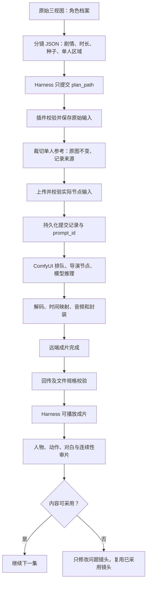

# 导演生产链路审计与修复顺序

更新：2026-09-09。范围：本机 Harness → dsh-elysium-tools → ComfyUI / MiniMax H3 → 成片回传。当前已暂停继续生成。

## 本轮修复结果

2026-09-09：用户授权执行未修复项。源码已补齐恢复绑定、停止状态、断点续传、校验文件复用，以及显式三视图输入约束。**未构建、未覆盖运行中的插件、未重启 Harness，未新增推理。**

- 恢复视频／图片任务：先启动原任务，再公开新调用绑定，避免卡片读到旧 failed 后停止轮询。
- 本地 worker 收到 SIGTERM／SIGINT：中断请求并保存 `LOCAL_WORKER_STOPPED`，保留原 prompt_id；查询发现进程已退出时报告 `WORKER_NOT_RUNNING`。未知进程身份不冒认停止，查询不改写历史记录。
- 远端成功单独记录 `remote_status`；本地回传失败显示“成片待回传”。停止会话等待仍不取消远端任务。
- 下载保存部分文件、ETag 和长度，使用 Range／If-Range 恢复；服务器返回完整文件则覆盖部分文件，范围不匹配拒绝拼接。无强 ETag 则重新下载。
- 已校验成片候选／镜头按来源、校验参数及 SHA256 复用。损坏文件不命中缓存；仍须所有镜头通过后才发布 final。
- 镜头新增 `image_role`：`character-sheet` 必须有 `image_path` 和 `image_crop`；`single-view`／`scene` 保持普通图片能力。未声明图片仍兼容旧请求，不声称能自动识别三视图。

**仍阻塞生产的两项：**

1. 实际读取已有对照 MP4，最终候选文件已通过规格及完整解码校验；下载镜头时 45 秒超时。传输期间队列查询 5 秒超时，传输前约 0.21 秒。服务器支持 Range 和强 ETag；断点恢复不能消除共用 SSH 隧道的阻塞。下一步需决定是否隔离传输连接／采用服务器文件传输路径，暂未改变部署结构。
2. 对照视频每秒取两帧，共 20 帧检查：约第 6 秒开始再次出现多个相同女主。与原镜头 prompt、seed 相同。**单人裁切不足以解决此镜头的人物重复，内容验收不通过。**需重新评估镜头首帧／参考方式后再做实验，未经用户决定不继续生产。

本轮完整测试 **99 项通过**；包括真实子进程停止、恢复不重复提交、旧失败绑定竞态、部分下载恢复、损坏缓存和 UI 文案。测试及源代码检查不能替代运行插件验收。

证据：`tests-audit-repairs.log`、`control-content-review.json`、`lingdian/control-single-person-review.png`（均在下述证据根目录）。审片是抽帧检查，未逐帧、未验收声音；已足以判定该镜头不合格。

## 1. 总体判断

核心问题不是“每个组件都坏了”，而是三处边界没有收好：

1. **输入边界**：聊天模型抄写长分镜会丢字段；角色三视图被当作整张推理参考，人物数量和布局可能进入生成画面。
2. **任务边界**：会话停止、后台 worker、远端推理和本地校验各有状态，界面容易把它们混成一个“成功／失败”。
3. **交付边界**：远端成片、网络回传、规格校验和内容验收没有清楚分层；服务器成功不等于本机可播放，更不等于剧情正确。

现有导演节点、模型推理、解码与编码已经实际执行成功，暂无证据要求换模型或重写引擎。先修复这些边界，再恢复批量制作。

## 2. 当前真实状态

| 项目 | 已确认结果 | 不能据此宣称 |
| --- | --- | --- |
| 《朱冠》《零点来信》第 1 集 | 各 60 秒；6 个镜头；插件规格及完整解码检查通过；Harness 卡片、播放和重新打开验证过 | 五集短剧完成；角色与对白已经人工验收 |
| 两部第 2 集 | 服务器已生成镜头及最终 MP4；本地回传曾阻塞／失败 | 本机交付完成 |
| 《零点来信》第 2 集内容 | 第 4 镜头出现多个相同女主；原分镜要求单人 | 仅因文件可解码就认定合格 |
| 单人裁切对照 | 插件生成 512×947 单人图；远端成功；本轮 final 候选下载及文件校验通过，但画面仍重复人物 | 角色一致性已解决；对照仍重复人物，内容验收失败，镜头归档未完成 |
| 停止状态 | 两个 Harness 批次及对照轮次已停止；最近查询远端队列为空；本轮运行的本地回传 worker 已停止 | 所有历史 status.json 都自动变成“已暂停” |

两部第 3–5 集没有提交。第 2–5 集的新裁切分镜仅准备在本地，未启动批量制作。

**注意：**被停止的 worker 可能留下 `running/inspect-output` 状态文件。这是待修复的状态衔接问题，不能通过手工改成 `succeeded` 掩盖。

## 3. 每个环节的问题与修复

下列源码路径相对 `dsh-elysium-tools/src/`。

| 环节 | 已发现问题与证据 | 修复方向 | 当前结论 |
| --- | --- | --- | --- |
| Harness 会话／工具发现 | 使用不存在的 `session.events`，文件工具未按预期暴露，模型绕去网页工具 | 使用官方 `snapshotEvents()`；核对会话真实工具列表 | 已修复，实际调用验证过 |
| 导演分镜交给工具 | 两次提交丢失全部镜头 prompt，并擅加 `in_point`，输入校验拒绝 | `plan_path` 读取完整 JSON；禁止模型重抄及覆盖字段；保存原文件哈希 | 已修复，六镜提示词及种子与执行图一致 |
| 角色档案 → 镜头参考 | 整张三视图包含三个角色视角；生成出现重复女主。裁切对照仍出现重复人物，整张三视图并非唯一原因 | 原图作档案；每镜用明确 `image_crop` 提取单人；保留来源和裁切哈希，禁止越界后退回整图 | 代码及真实推理已验证；本轮抽帧内容验收失败 |
| 参数校验 | 原校验只确认图片存在、类型有效，不能区分角色档案和单人参考 | 校验裁切字段、整数坐标及实际边界；分镜总时长、prompt、seed 保持不变 | 裁切及显式 image_role 契约已实现；不会自动识别任意图片中的人物数量 |
| 工作流选择／节点输入 | 单生成镜头选择 generate 模板，多镜头选择 director；容易把文件名当成是否用了导演节点的判断依据 | 同时检查模板名、实际 `MiniMaxH3Director/Guide` 节点、REF2VA 模式和参考图片输入 | 选择逻辑未发现错误；单镜对照也实际使用 Director 节点 |
| 上传与节点校验 | 整张三视图原先直接上传；全部节点定义一次并发读取，在本地隧道出现超时 | 只上传派生单人图；节点定义分批最多 4 个并发，仍校验全部节点 | 已实现；一次真实完整节点校验约 1.2 秒，不代表全部网络问题已解决 |
| ComfyUI 排队／提交 | 查询超时曾被当作生成失败；重提会产生重复推理风险 | 持久化提交意图及 prompt_id；超时核对原任务；明确失败后才允许用户指定恢复 | 原任务查询恢复已验证；不能把“没查到”直接解释为“没提交” |
| 工作流节点及执行引擎 | 已实际调度六镜头并返回 final；未发现引擎调度或节点连线错误 | 保持现有引擎；保留执行图和 history，定位到具体失败节点再修改 | 不换引擎、不做无证据重构 |
| 模型推理／内容 | 重复人物、表情与情节不符；首集出现未要求的字幕或聊天气泡；声线、对白和口型未逐句验收 | 单人输入先做单镜对照；之后检查人数、服装、动作、对白；不合格镜头单独返工 | 内容质量尚未闭环；seed、skill 和“只有一个人”都不是保证 |
| 解码、裁剪、转码、封装 | 已验证 24 fps 模型时间基准到 30 fps 交付，60 秒合片可解码；尚无本次可复现的解码错误 | 保持真实时间映射；继续检查视频／音轨时长和源帧数量 | 不为修复人物重复而修改 VAE 或 FFmpeg 参数 |
| 远端 → 本地回传 | 大文件传输期间，小查询也超时；新连接短请求正常；下载中断使远端成功、本地失败 | 分别记录远端成功和传输失败；优先恢复同一产物；评估控制请求与大文件传输隔离、断点或复用已验证文件 | 传输稳定性未解决；网络／SSH 具体瓶颈仍需定量定位，不能仅归因于 GPU |
| 插件文件校验／发布 | final 已下载校验后，仍等待所有镜头下载校验才发布；任一镜头失败，整张作品卡无法交付 | 保留严格规格检查；明确“成片可播放”和“全部镜头可复用”的区别，再决定是否分阶段发布 | 当前行为已确认；改变发布语义尚未实施 |
| Harness 恢复／展示 | `resumeVideoJob` 先绑定调用、再启动 worker；卡片若先读到旧 failed，轮询立即停止，出现“恢复中仍显示失败” | 恢复进入 queued/running 后再公开新调用绑定；测试首个状态读取与恢复启动的竞态 | 已修复调用顺序，回归测试通过；运行插件尚未更新 |
| 停止／继续 | 停止 Harness 等待不会自动取消远端推理；人工停止 worker 后状态可能仍 running | 明确“停止等待／暂停后续提交／取消排队／停止回传”；核对 worker 存活和远端历史；不伪报取消 | 已补本地停止／失活检测和远端成功标记；不调用全局 interrupt，运行插件尚未更新 |

## 4. 应当固定的流程

职责不能混淆：

- **聊天模型**负责理解创作意图和调用工具；不承担无损复制长 JSON、确认远端状态或鉴定视频质量的唯一责任。
- **Skill**说明什么时候使用角色档案、如何选择视角、何时停止；它不能代替参数校验、任务持久化或审片。
- **插件**负责读取、校验、参考图处理、工作流编排、任务关联和文件交付。
- **ComfyUI／模型**负责实际执行与生成；`history success` 只说明执行成功。
- **审片**决定内容是否采用；未审片保持 `human_review: not_run`。

三种输入要明确区分：人物三视图是角色档案；单人视角是身份参考；场景首帧是该镜头的具体构图。不能因为路径都叫 image_path，就认为这三类图片作用相同。

## 5. 已落地代码与尚未解决的问题

### 已落地

- `workflows/video-plan-file.js`：本地／SSH 分镜读取、素材快照和源哈希。
- `workflows/video-plan.js`、`workflow-generate-video.js`：新增每镜 `image_crop` 参数及校验。
- `workflows/video-reference.js`：FFprobe 检查边界，FFmpeg 裁切，保留原图，记录源与派生哈希，同一裁切复用。
- `workflows/video-execution.js`：生成派生参考后再上传并绑定节点；恢复仍使用保存的原请求与执行图。
- `functions/comfyui/client.js`：只读轮询超时继续核对原任务；节点定义最多 4 个并发。
- `tool-discovery.js`、`jobs/call-index.js`：使用真实 Harness 会话事件接口。
- `src/client/media/card.js`：已成功产物优先同源本地播放，远端 URL 作为回退。
- 随包 `creation-drama/SKILL.md` 和 README：明确三视图档案与单人推理参考的区别。

**实现边界：**目前是显式 `image_crop`，不会自动判断任意图片是不是三视图；如果调用方漏填，普通图片路径仍可进入工作流。不能把这称作“自动保证角色一致性”。本轮新增 character-sheet 显式契约，但不会无条件把所有图片按三等分裁切。

### 尚未解决

1. SSH 隧道大文件回传阻塞控制查询；断点与校验缓存已修，但网络隔离尚未实施。
2. 单人参考方案内容验收失败；重复人物、跨镜头一致性、对白和口型需重新评估。
3. final 仍等待全部镜头严格校验，分阶段发布未采用；本轮不改变交付契约。
4. 新源码尚未构建和应用到运行中的 Harness，需另行验证运行效果。

## 6. 修复顺序与放行条件

| 顺序 | 只做什么 | 放行条件 |
| --- | --- | --- |
| 1：任务状态 | 修复恢复绑定竞态；明确停止等待与远端状态；不新增生成任务 | 模拟旧 failed → queued → running → succeeded，卡片不冻结；停止后能准确说明远端是否仍执行 |
| 2：产物回传 | 使用现有 MP4 定位传输瓶颈，验证失败恢复；不消耗 GPU | 同一文件中断后可恢复；不重提 prompt；控制查询不被大文件长期阻塞；损坏文件不能发布 |
| 3：输入契约 | 明确角色档案必须选择单人区域；保留普通场景图能力 | 缺区域的已声明三视图在推理前拒绝；合法裁切可追溯，原图字节不变；恢复不改变原输入 |
| 4：现有对照审片 | 先读取这次已经生成的 10 秒视频，不再重跑 | 核对同一 seed／prompt，只变参考输入；检查全部时间段是否重复人物、动作是否符合要求 |
| 5：恢复生产 | 经用户决定后，一集一集推进，问题镜头局部返工 | 一集完成文件交付与内容审片后再进入下一集；不以“生成成功”批量放行 |

第 1–3 步先用本地测试、模拟服务和已有成片完成。改变发布语义、增加角色档案契约属于需要明确设计的事项；本审计只提出方案，不代表已实现或已批准重新生成。

## 7. 验证证据与限制

- 上一轮插件完整测试：**93 项通过、0 失败**；本轮为 **99 项通过、0 失败**；包括像素裁切、输入不变、不同视角不混用、越界拒绝和限流后仍校验全部节点。
- 上一轮裁切和限流代码已构建到本机 registry；本轮新增修复尚未构建和应用。
- 本轮不是完整端到端验收：对照 final 候选规格检查通过，镜头回传未完成，内容抽帧验收失败，未做浏览器播放验收。
- 单镜对照模板为 `workflow_generate_video`，实际节点仍为 `MiniMaxH3Director`、`MiniMaxH3DirectorGuide`、REF2VA；多镜整集使用 `workflow_director_video`。不混称模板文件名与实际导演节点。
- 本次未验证两插件独立安装、所有图片能力、全部模型版本及长时内存压力；不沿用旧报告的通过项充当本次证据。

证据根目录：`/Users/mac/.dsh/elysium/artifacts/drama-20260909/`。

| 证据 | 文件或任务标识 |
| --- | --- |
| 完整测试日志 | `tests-single-reference-final.log` |
| 暂停时任务快照 | `audit-stop-snapshot.json` |
| 重复女主截图 | `lingdian/ep02-contact.png`，下排前两格 |
| 首集检查 | `zhuguan/ep01-verification.json`、`lingdian/ep01-verification.json` |
| 单人对照 job_id | `672cc80b9459e7114eec87eaadbd5912` |
| 单人对照 prompt_id | `72cef6e5-bb7e-43a3-ba6f-668e178ab0a8` |
| 实际源图哈希 | `a6fd2b0e3365246ec9d59dde01a7127471c21703608eb2fa1088d14011aa7e3e` |
| 实际单人图哈希 | `59e5b1457981db56966398907352dd9f18999554037b0721719bcfa117153c8c` |

任务原始输入、实际工作流和参考来源记录在 `~/.dsh/elysium/tasks/jobs/<job_id>/`；服务器共享生产目录为 `/root/autodl-fs/productions/drama-20260909/`。原始素材、旧结果和失败证据保留，不用新版覆盖历史证据。

本文件是当前审计基线；[历史执行路径说明](tools-execution-chain.md) 和 [恢复操作说明](video-main-chain-recovery.md) 供实现导航，其中旧测试数量和旧部署结论不代表当前状态。
