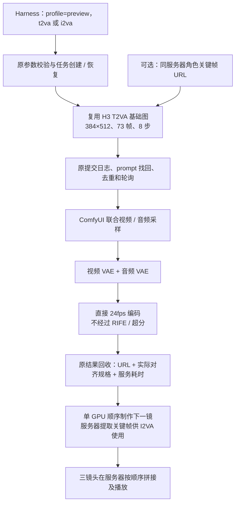

# AI 短剧快速预览流程

> 当前三档技能入口和完整调用链见 [视频创作三档入口与全链路](实施-视频创作三档入口与全链路.md)。本文保留预览专项验收记录。

2026-09-12 实施并完成有限验收。目标是缩短镜头迭代等待，允许降低规格，不是替代最终制作画质。

## 结果与样片

本轮保留现有 H3：两个不同提示词的验收都通过 90 秒服务器执行目标，第三镜也通过。只生成三次，全部用于样片；没有下载 LTX、其他模型或 LoRA，没有升级 CUDA/PyTorch，也没有调整 GPU 功率。

[播放《红信封》三镜头预览](https://36we4j3zo503js-8188.proxy.runpod.net/view?filename=the-red-envelope.mp4&subfolder=preview-drama&type=output)

剧情：两个成年虚构朋友在咖啡馆相见；林把红信封推给陈；陈抬头微笑回应。人物来自第一镜生成的画面，不使用真实人物身份。

| 镜头 | 内容与输入 | 服务器执行 | 本机执行链 | 实际输出 |
|---|---|---:|---:|---|
| 01，本轮首次 | 建立场景，T2VA | 32.224 秒 | 35.516 秒 | 384×512，73 帧，24fps，3.041667 秒 |
| 02，后续 | 女角色推信封，I2VA；复用第一镜 1.5 秒处角色图 | 30.531 秒 | 35.907 秒 | 同上 |
| 03，后续 | 男角色抬头回应，I2VA；复用第二镜最后一帧 | 29.824 秒 | 34.747 秒 | 同上 |

- **服务器生成累计：92.579 秒**；本机单镜执行链累计 106.170 秒；服务器拼接约 0.608 秒。
- **实际首镜服务器开始至成片写完：214.454 秒，约 3 分 34 秒**，含镜头间检查、关键帧准备及操作等待。累计计算时间不等于端到端墙钟时间。
- 成片：219 帧、24fps、9.125 秒，H.264 视频及原生音频拼接后的 AAC 音轨。
- ffprobe 核验三段规格和成片规格；成片完整 ffmpeg 解码通过；浏览器播放到结束。三镜均检查了开始、中间、结束画面，能看到视线、手部推信封及抬头回应等动作。
- 三次 history 均确认 `n105_104` 条件编码与 `n105_14` 采样未命中缓存，发生真实生成。
- 首次是**本轮首次执行**，不是容器冷启动。Loader 对象已有缓存，但每条不同提示词均重新编码；未测全新服务器启动、下载和首次加载成本。

## 验收附件怎么读

这 10 个 JSON 文件是本次三镜头样片的验收档案，不是 10 个视频，也不是 Harness 每次对话都必须读取的配置。视频和角色参考图保存在服务器上，文件中只记录它们的 URL。附件目录为 `docs/implement/implement-drama-preview/acceptance/`。

文件数量来自：**1 份总验收汇总 + 3 个镜头 × 每镜头 3 份记录 = 10 份**。

| 文件 | 通俗说明 | 什么时候看 |
|---|---|---|
| [acceptance.json](implement-drama-preview/acceptance/acceptance.json) | 整个样片的验收成绩单：三个镜头的耗时、实际规格、真实采样记录、视频链接，以及成片信息 | 想知道是否达标、用了多久、成片在哪里时，先看它 |
| [shot-01.request.json](implement-drama-preview/acceptance/shot-01.request.json) | 第一镜的创作要求：咖啡馆建立场景，使用文字生成视频 | 查看或参考第一镜的提示词 |
| [shot-01.api.json](implement-drama-preview/acceptance/shot-01.api.json) | 第一镜实际提交的 ComfyUI 节点图，包含模型、参数和节点连接 | 技术排查第一镜到底怎么生成 |
| [shot-01.receipt.json](implement-drama-preview/acceptance/shot-01.receipt.json) | 第一镜的执行回执：原请求、任务 ID 和返回结果 | 找回第一镜任务或查看输出链接 |
| [shot-02.request.json](implement-drama-preview/acceptance/shot-02.request.json) | 第二镜的创作要求：女角色推信封，使用第一镜提取的角色图作为起始画面 | 查看动作提示词和参考图 URL |
| [shot-02.api.json](implement-drama-preview/acceptance/shot-02.api.json) | 第二镜实际提交的 ComfyUI 节点图，包含图片输入连接 | 排查第二镜的参数和图生视频流程 |
| [shot-02.receipt.json](implement-drama-preview/acceptance/shot-02.receipt.json) | 第二镜的执行回执 | 找回第二镜任务或查看输出链接 |
| [shot-03.request.json](implement-drama-preview/acceptance/shot-03.request.json) | 第三镜的创作要求：男角色抬头微笑，使用第二镜最后一帧作为起始画面 | 查看反应镜头提示词和参考图 URL |
| [shot-03.api.json](implement-drama-preview/acceptance/shot-03.api.json) | 第三镜实际提交的 ComfyUI 节点图 | 排查第三镜的参数和执行流程 |
| [shot-03.receipt.json](implement-drama-preview/acceptance/shot-03.receipt.json) | 第三镜的执行回执 | 找回第三镜任务或查看输出链接 |

同一个镜头的关系是：`request` 说明“要生成什么”，插件把请求转换成 `api` 节点图并提交，`receipt` 记录“哪个任务执行了、返回了什么”；三个镜头完成后，`acceptance.json` 汇总验收结果。

**日常使用 Harness 不需要手动编辑这些文件。** 阅读本文的结果表和播放样片即可；需要查详细证据时，先看 `acceptance.json`，再按镜头查看请求和回执，只有排查节点参数时才需要看 `api.json`。API 文件是已执行工作流的快照，不是 ComfyUI 可视化编辑器的 UI 工作流文件，也不会随当前默认配置自动更新。

验收汇总中的 `server_ms` 是服务器执行毫秒数（除以 1000 得到秒），`local_chain_ms` 是本机插件任务链耗时；`real_sampling` 表示采样确实执行，`final.url` 是成片地址。`job_id` 是本机逻辑视频任务 ID，`prompt_id` 是 ComfyUI 一次执行的 ID。`wall_to_film_seconds` 包括镜头间检查和操作等待，不等于三个镜头的计算时间之和。

回执保留执行时的原始验证字段，其中 `not_run` 表示插件当时没有自动执行该项检查，不表示视频生成失败。后续文件解码、规格核对和人工观看的结论分别记录在验收汇总和本文，不回写成工具自动验证。

下方脚本示例使用 `request` 和 `receipt`：已有回执用于恢复或查询原任务，已完成任务不会重新生成。制作新镜头时应使用新的请求文件和回执路径，保留本次验收原件。删除这些附件不会影响 Harness 的日常生成，但会丢失本次验收证据和脚本找回任务的回执；它们也不包含模型、媒体文件或完整服务器备份。

## 入口：沿用原工具，仅切换 profile

在 Harness 中可要求：“使用 preview，生成约三秒短剧草稿。”导演、教学、自由模式的视频指令已补充该入口。

`workflow_generate_video` 文生视频：

```json
{
  "profile": "preview",
  "mode": "t2va",
  "prompt": "Two fictional adults meet at a cafe; one notices an envelope on the table."
}
```

图生视频：

```json
{
  "profile": "preview",
  "mode": "i2va",
  "first_frame": "https://36we4j3zo503js-8188.proxy.runpod.net/view?filename=characters.png&subfolder=preview-drama&type=output",
  "prompt": "The same adult woman slowly slides the red envelope toward the adult man."
}
```

- 省略 `profile` 或设置 `"standard"`，继续原五模式及原规格。预览目前只支持 `t2va` / `i2va`。
- 下一独立镜头使用新的生成调用；若会话中有未完成视频且用户确实要求另一个镜头，可显式使用 `new_video:true`。失败重试不得使用该开关。
- 失败只对对应 `job_id` 调用 `workflow_resume_video`。仍复用原 API 快照、提交日志、任务找回、去重和轮询逻辑，不重新生成其他镜头。
- 返回 `profile`、`specification`、`comfyui_prompt_id`、媒体服务器 URL；新版同时从 history 返回 `server_execution_ms`。规格是工作流确定的实际对齐规格；通用接口仍不声称每次做了文件完整解码。
- 没有给插件增加媒体上传、下载、保存方法。图片和视频使用同一服务器 `/view` URL；本轮关键帧提取及拼接通过 `ssh veo-comfyui` 在服务器执行。

也可用随项目附带的本机脚本调用同一任务实现：

```sh
COMFYUI_URL=https://36we4j3zo503js-8188.proxy.runpod.net \
node dsh-elysium-tools/scripts/preview-shot.mjs \
  docs/implement/implement-drama-preview/acceptance/shot-01.request.json \
  docs/implement/implement-drama-preview/acceptance/shot-01.receipt.json
```

回执存在时恢复/查询原 job；已完成的回执直接返回结果，不重新生成。新镜头使用新的请求文件及回执路径。回执绑定原请求，不能换提示词复用同一回执。

## 当前模型与参数依据

| 配置 | 实施值 |
|---|---|
| 主模型 | `10Eros_Max_h3_TURBO-hybrid_beta3_int8_convrot_skip_edges.safetensors` |
| 文本编码器 | 现有 Qwen3VL 32B NVFP4，不新增提示词增强 |
| 尺寸 | 384×512，宽高均满足节点的 32 像素约束 |
| 帧数 | 3×24=72，按 `17k+5` 向上对齐为 73 |
| 时长 / 输出帧率 | 73/24≈3.041667 秒；24fps，不补帧 |
| 采样 | 原 Euler / simple，8 步，denoise=1 |
| Shift | 原视频 6、音频 3 |
| 模型补丁 | 沿用原 Sol、融合调制、FFN 分块、Spectrum、DiffAid；未做底层调优 |
| 注意力 INT8 QK/PV | 均保持 false；不混淆主模型 INT8 与注意力开关 |
| 后处理 | 视频 VAE → H.264；跳过 RIFE 和未使用分支，无超分、额外精修 |
| 音频 | 保留联合采样及音频 VAE 解码，样片保留生成音轨；未新增配音系统 |

量化来源：[cicalooo 的 INT8 ConvRot 模型说明](https://huggingface.co/cicalooo/10Eros-Max-h3-int8-convrot)，明确转换自 TenStrip，skip-edges 版本保留边界块为 BF16。服务器 safetensors 元数据也标记为 H3 LoRA merge，但元数据本身不能证明具体融合配方或四步质量。

作者 [Beta3 时期说明](https://huggingface.co/TenStrip/10Eros-Max/blob/d973927444b0ffe18f4c9d9945e2d0ccec04bc29/README.md) 将它称为 hybrid，并描述其 Turbo 会影响图像参考起始；当时给出的 Beta3 建议为 multires/simple 或 er_sde/simple、6 步，不是明确四步支持。[当前说明](https://huggingface.co/TenStrip/10Eros-Max/blob/main/README.md) 的四步选项关联后续版本，不能套用到本机 Beta3。

**所以本轮按授权边界保留原 8 步配置，不凭 TURBO 文件名改四步，也不重复叠加 Turbo LoRA。** 该版本原始融合的精确配方/比例没有从服务器元数据确认。我们没有切换到作者其他版本。

现有节点允许 73 帧和上述尺寸，但节点提示的通常训练时长区间更长；低规格属于预览使用，能执行不代表训练分布内的最终质量保证。

## 工作流结构及代码



- [preview 配置](../../dsh-elysium-tools/src/workflows/profiles/preview.json)：独立小配置，不复制项目或原五套标准图。
- [预览图构建](../../dsh-elysium-tools/src/workflows/video-profile.js)：复用 T2VA 基础图，I2VA 只增加原生 LoadImage / first_frame；裁掉最终输出不依赖的分支。返回正确 API 图，不附带不匹配的原高清 UI 图。
- [工具入口](../../dsh-elysium-tools/src/workflows/workflow-generate-video.js)及[本机单镜脚本](../../dsh-elysium-tools/scripts/preview-shot.mjs)。
- 本次可复查的执行图：[镜头 01](implement-drama-preview/acceptance/shot-01.api.json)、[镜头 02](implement-drama-preview/acceptance/shot-02.api.json)、[镜头 03](implement-drama-preview/acceptance/shot-03.api.json)。它们是 API 快照，不是新增的一套独立服务。
- 原调用链和高清基线仍见 [服务器流程图](../research/调研-H3服务器执行流程与耗时.md)；原性能报告不覆盖、不改写。

## 冻结、发布与回滚

- 开工前本地冻结：`/Users/mac/.dsh/backups/preview-20260912-115540/`，包括原工作流/文档压缩包、Git HEAD、Git 状态和 SHA-256 清单。涉及的源/已安装预设原文另存其 `presets/` 子目录；未复制密钥。
- 服务器冻结：`/workspace/runpod-slim/ComfyUI/user/default/preview-backups/20260912-035623/`，保留当时工作流副本、队列和运行信息。主模型、ComfyUI 环境及启动参数未更改。
- 修改已测试、构建并打包到现有 registry；本机 web profile 原安装链接继续使用它。只重启本机 Harness，没有执行会连接其他主机的部署脚本，也未重启远程 ComfyUI。
- 最小回退：请求切回 `profile=standard`，无需还原整个项目。若需要撤回代码，按 manifest/备份逐文件还原本轮改动并重新构建，保留之后的用户修改，勿使用全仓库 reset/clean。
- 本轮验证：66 项 JavaScript 测试、2 项工作流 Python 测试、4 项预设测试通过；预设测试的 PyYAML 仅安装到本机 `/tmp/preview-test-deps`。标准五模式及提交找回/去重/重试测试通过；实际安装目录确认公开 preview 参数且能构建预览图，已完成镜头的回执恢复不会重生成。
- 本轮有限生成通过本机脚本调用同一插件任务链；没有额外让 Harness 的语言模型再生成一轮样片。自然语言选参稳定性未单独验收。

## 仍未验证的能力

1. **长期跨镜头人物一致性：**三镜头通过前镜关键帧接力，肉眼基本保持外观；未验证大幅转场、换角度、换服装或长剧情。Beta3 上游已提示参考图能力问题，不能据本样片宣称解决身份一致性。
2. **对白与口型：**样片提示词没有对白，保留音轨不代表对白正确或口型同步；未新增或验证配音系统。
3. **最终画质：**预览有低分辨率细节、手部和动作精度限制，不能替代成片渲染。未做原高清规格的统一画质对比。
4. **性能泛化：**90 秒目标在本轮三镜成立；没有测大量复杂提示词或冷启动，功率仍可能波动，不是 SLA。
5. **替代后端：**H3 已达标，因此没有下载/安装/测试 LTX；不能声称 LTX 兼容性已验证。

本轮到此停止选型和参数扫描，后续可以直接用 preview 推进故事分镜。


## 后续提速候选：288×384（2026-09-12，待用户确认）

**默认配置未改变。** `profile: "preview"` 仍为 384×512、73 帧、24fps、8 步、有声、无 RIFE。新增的低分辨率档只能显式选择，画质与动作是否可接受由用户确认后再决定是否设为默认。本轮只新增 **1 次**真实生成，没有用满两次额度，没有缩短时长、换模型、叠加 LoRA、安装框架或扫描参数。

### 为什么没有测试四步

重新核对 [INT8 转换作者说明](https://huggingface.co/cicalooo/10Eros-Max-h3-int8-convrot)、[Beta3 版本说明](https://huggingface.co/TenStrip/10Eros-Max/blob/d973927444b0ffe18f4c9d9945e2d0ccec04bc29/README.md)和[当前作者说明](https://huggingface.co/TenStrip/10Eros-Max/blob/main/README.md)：Beta3 当时推荐 multires/simple 或 er_sde/simple、6 步；当前四步建议对应后续 Beta5。没有找到当前 Beta3 INT8 权重明确支持四步的版本对应依据。因此四步支持记为“未确认”，不等同于证明四步绝对无法运行；本轮不冒充已支持，也不进行四步试跑，继续原 Euler/simple、8 步。

服务器实际文件仍为 `10Eros_Max_h3_TURBO-hybrid_beta3_int8_convrot_skip_edges.safetensors`，22,513,576,472 字节；头部元数据只说明 H3 LoRA merge，不能证明四步支持或准确融合比例。

### 本次怎么比较

复用用户任务 `6e050097ab7b37578357ff0e111dc53d` 的中文咖啡馆提示词、种子 `833238321491842`、模型、73 帧、24fps、8 步、音频及全部补丁。执行图比对确认只改变宽高和输出保存位置。服务器节点要求宽高为 32 的倍数，288×384 符合约束；可执行不等于低规格位于模型的典型训练分布内。

| 项目 | 已验证默认档 | 本次可选低分辨率档 |
|---|---:|---:|
| 尺寸 | 384×512 | 288×384 |
| 帧数 / 帧率 / 时长 / 步数 | 73 / 24fps / 3.041667 秒 / 8 | 相同 |
| 服务器执行 | 29.112 秒 | **19.354 秒** |
| 本机插件任务链 | 33.123 秒 | **34.938 秒** |
| 服务器计时外的任务链耗时 | 4.011 秒 | 15.584 秒 |
| 结果 | 已验证，继续保留 | 生成成功，待用户判断画质和动作 |

本次服务器比历史记录少 9.758 秒，约 **33.5%**，但本机任务链多 1.815 秒，**不能宣称本次用户等待时间也缩短了**。根据两端时间戳，候选约 12.252 秒发生在服务器开始前，3.332 秒发生在服务器完成后；前者包含本机准备、节点校验、请求传输和可能的排队，后者包含轮询及回收。这些子项未分别计时，不能直接把全部差值归为网络抖动。

这不是同期交替对照，不能把单次差值当成可保证的收益。候选执行期间采集到的 GPU 功率上限为 310W；历史 29.1 秒任务没有对应功率记录。两次都复用了部分 Loader 对象，候选的条件编码 `n105_104` 和采样 `n105_14` 均未命中缓存，没有为了绕过缓存修改提示词或种子。

### 本次阶段耗时

| 阶段 | 节点 | 约耗时 |
|---|---|---:|
| 文本条件编码与初始 latent 准备 | `n105_104` | 5.631 秒 |
| 引导器准备 | `n105_16` | 0.001 秒 |
| 视频与音频联合采样，含原补丁及重放 | `n105_14` | **7.859 秒** |
| 音频 VAE 解码 | `n105_23` | 0.439 秒 |
| 视频 VAE 解码 | `n105_10` | **4.937 秒** |
| MP4 编码封装至服务器完成 | `n126` | 0.480 秒 |

总时间取 ComfyUI history 的 `execution_start` 至 `execution_success`；节点时间取服务器本机 WebSocket 相邻 `executing` 事件接收时间，最后一个节点以 history 成功时间收尾，因此是含回调、加载和调度的近似墙钟时间，不是纯 GPU 内核计时。另有约 0.006 秒初始开销和舍入差异。本次联合采样约占总耗时 40.6%，不能沿用旧高清流程的 81.5%，也不能据此倒推出历史 29.1 秒任务的阶段比例。

### 视频与观察结果

- [播放低分辨率候选](https://36we4j3zo503js-8188.proxy.runpod.net/view?filename=final_00001-audio.mp4&subfolder=elysium%2Ff84e7f9938450877a83754e7b63e25b4%2Fpreview-low-resolution&type=output)。
- [播放原 384×512 对照视频](https://36we4j3zo503js-8188.proxy.runpod.net/view?filename=final_00001-audio.mp4&subfolder=elysium%2F6e050097ab7b37578357ff0e111dc53d%2Fpreview&type=output)。
- 候选任务 ID：`f84e7f9938450877a83754e7b63e25b4`；ComfyUI prompt ID：`4b81a04d-33f8-42f0-aedf-dd869f0e9829`。
- 服务器 ffprobe 确认 288×384、73 帧、24fps、3.041667 秒及 AAC 音轨；完整解码通过，浏览器播放至结束。
- 检查第 0、18、36、54、72 帧，能看到拿起信封、低头看、抬头微笑，人物和场景可辨认。观察到手指细节偏软；信封仍封着，没有表现出取出信纸阅读。这些是候选自身观察，未做同帧画质评分。
- 音轨不是全静音，均值约 -41.5dB、峰值约 -8.7dB；文件可解码不等于听感合格。主观音质、噪声和同步效果由用户播放确认，本轮未声称听感验收通过。

### 如何选择与恢复

在 Harness 中明确要求“使用低分辨率候选预览，288×384，保持三秒”。工具参数为：

```json
{
  "profile": "preview",
  "preview_variant": "low-resolution",
  "mode": "t2va",
  "prompt": "你的镜头描述"
}
```

省略 `preview_variant` 或设为 `default` 即回到已验证的 384×512 预览；省略 `profile` 则回到原 standard 工作流。候选也沿用原 I2VA 图构建入口，但本轮只实测了 T2VA，不能把本次结果视为低分辨率 I2VA 的实测证明。失败继续恢复原 `job_id`，不能通过改档位给原失败任务重新建视频。

低分辨率覆盖值在 [preview-low-resolution.json](../../dsh-elysium-tools/src/workflows/profiles/preview-low-resolution.json)，只设置宽高，其他设置继承原 preview。工具 schema 已增加显式选项，返回规格包含 `preview_variant`；默认调用结果保持原样。

本轮附件与前三镜验收分开，位于 `docs/implement/implement-drama-preview/candidate-low-resolution/`：

| 文件 | 用途 |
|---|---|
| [request.json](implement-drama-preview/candidate-low-resolution/request.json) | 本次候选提示词和所选档位 |
| [workflow.api.json](implement-drama-preview/candidate-low-resolution/workflow.api.json) | 实际候选节点图，便于核对只改了宽高 |
| [receipt.json](implement-drama-preview/candidate-low-resolution/receipt.json) | 原任务 ID 和生成结果，恢复时使用 |
| [measurement.json](implement-drama-preview/candidate-low-resolution/measurement.json) | 本次耗时、原始节点事件、媒体规格、缓存状态和观察结论 |

修改前备份位于 `/Users/mac/.dsh/backups/preview-candidate-20260912-130107/`，含原文件校验值和 29.1 秒任务证据。原 `preview.json` 内容未改。67 项 JavaScript 测试及 2 项工作流 Python 测试通过；构建和 registry 打包通过，已安装 registry 的 schema 与默认/候选图构建均核验。检查结束时本机 Harness 已由另一处在打包后启动，HTTP 返回预期的未登录 401，本轮没有启动重复实例；候选自然语言选参未另行实测。未新增第二次生成，未改变默认值，后续等待用户对候选效果的判断。
