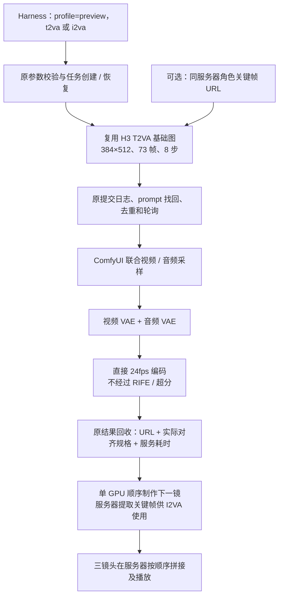

# AI 短剧快速预览流程

2026-09-12 实施并完成有限验收。目标是缩短镜头迭代等待，允许降低规格，不是替代最终制作画质。

## 结果与样片

本轮保留现有 H3：两个不同提示词的验收都通过 90 秒服务器执行目标，第三镜也通过。只生成三次，全部用于样片；没有下载 LTX、其他模型或 LoRA，没有升级 CUDA/PyTorch，也没有调整 GPU 功率。

[播放《红信封》三镜头预览](https://36we4j3zo503js-8188.proxy.runpod.net/view?filename=the-red-envelope.mp4&subfolder=preview-drama&type=output)

剧情：两个成年虚构朋友在咖啡馆相见；林把红信封推给陈；陈抬头微笑回应。人物来自第一镜生成的画面，不使用真实人物身份。

| 镜头 | 内容与输入 | 服务器执行 | 本机执行链 | 实际输出 |
|---|---|---:|---:|---|
| 01，本轮首次 | 建立场景，T2VA | 32.224 秒 | 35.516 秒 | 384×512，73 帧，24fps，3.041667 秒 |
| 02，后续 | 女角色推信封，I2VA；复用第一镜 1.5 秒处角色图 | 30.531 秒 | 35.907 秒 | 同上 |
| 03，后续 | 男角色抬头回应，I2VA；复用第二镜最后一帧 | 29.824 秒 | 34.747 秒 | 同上 |

- **服务器生成累计：92.579 秒**；本机单镜执行链累计 106.170 秒；服务器拼接约 0.608 秒。
- **实际首镜服务器开始至成片写完：214.454 秒，约 3 分 34 秒**，含镜头间检查、关键帧准备及操作等待。累计计算时间不等于端到端墙钟时间。
- 成片：219 帧、24fps、9.125 秒，H.264 视频及原生音频拼接后的 AAC 音轨。
- ffprobe 核验三段规格和成片规格；成片完整 ffmpeg 解码通过；浏览器播放到结束。三镜均检查了开始、中间、结束画面，能看到视线、手部推信封及抬头回应等动作。
- 三次 history 均确认 `n105_104` 条件编码与 `n105_14` 采样未命中缓存，发生真实生成。
- 首次是**本轮首次执行**，不是容器冷启动。Loader 对象已有缓存，但每条不同提示词均重新编码；未测全新服务器启动、下载和首次加载成本。

机器可读的 [验收记录](implement-drama-preview/acceptance/acceptance.json)、三条请求和原始回执都保留在 `implement-drama-preview`。回执保留执行时的原始验证字段，后续人工/文件检查单独记录，不回写伪装成工具自动验证。

## 入口：沿用原工具，仅切换 profile

在 Harness 中可要求：“使用 preview，生成约三秒短剧草稿。”导演、教学、自由模式的视频指令已补充该入口。

`workflow_generate_video` 文生视频：

```json
{
  "profile": "preview",
  "mode": "t2va",
  "prompt": "Two fictional adults meet at a cafe; one notices an envelope on the table."
}
```

图生视频：

```json
{
  "profile": "preview",
  "mode": "i2va",
  "first_frame": "https://36we4j3zo503js-8188.proxy.runpod.net/view?filename=characters.png&subfolder=preview-drama&type=output",
  "prompt": "The same adult woman slowly slides the red envelope toward the adult man."
}
```

- 省略 `profile` 或设置 `"standard"`，继续原五模式及原规格。预览目前只支持 `t2va` / `i2va`。
- 下一独立镜头使用新的生成调用；若会话中有未完成视频且用户确实要求另一个镜头，可显式使用 `new_video:true`。失败重试不得使用该开关。
- 失败只对对应 `job_id` 调用 `workflow_resume_video`。仍复用原 API 快照、提交日志、任务找回、去重和轮询逻辑，不重新生成其他镜头。
- 返回 `profile`、`specification`、`comfyui_prompt_id`、媒体服务器 URL；新版同时从 history 返回 `server_execution_ms`。规格是工作流确定的实际对齐规格；通用接口仍不声称每次做了文件完整解码。
- 没有给插件增加媒体上传、下载、保存方法。图片和视频使用同一服务器 `/view` URL；本轮关键帧提取及拼接通过 `ssh veo-comfyui` 在服务器执行。

也可用随项目附带的本机脚本调用同一任务实现：

```sh
COMFYUI_URL=https://36we4j3zo503js-8188.proxy.runpod.net \
node dsh-elysium-tools/scripts/preview-shot.mjs \
  docs/implement/ai-drama-preview/acceptance/shot-01.request.json \
  docs/implement/ai-drama-preview/acceptance/shot-01.receipt.json
```

回执存在时恢复/查询原 job；已完成的回执直接返回结果，不重新生成。新镜头使用新的请求文件及回执路径。回执绑定原请求，不能换提示词复用同一回执。

## 当前模型与参数依据

| 配置 | 实施值 |
|---|---|
| 主模型 | `10Eros_Max_h3_TURBO-hybrid_beta3_int8_convrot_skip_edges.safetensors` |
| 文本编码器 | 现有 Qwen3VL 32B NVFP4，不新增提示词增强 |
| 尺寸 | 384×512，宽高均满足节点的 32 像素约束 |
| 帧数 | 3×24=72，按 `17k+5` 向上对齐为 73 |
| 时长 / 输出帧率 | 73/24≈3.041667 秒；24fps，不补帧 |
| 采样 | 原 Euler / simple，8 步，denoise=1 |
| Shift | 原视频 6、音频 3 |
| 模型补丁 | 沿用原 Sol、融合调制、FFN 分块、Spectrum、DiffAid；未做底层调优 |
| 注意力 INT8 QK/PV | 均保持 false；不混淆主模型 INT8 与注意力开关 |
| 后处理 | 视频 VAE → H.264；跳过 RIFE 和未使用分支，无超分、额外精修 |
| 音频 | 保留联合采样及音频 VAE 解码，样片保留生成音轨；未新增配音系统 |

量化来源：[cicalooo 的 INT8 ConvRot 模型说明](https://huggingface.co/cicalooo/10Eros-Max-h3-int8-convrot)，明确转换自 TenStrip，skip-edges 版本保留边界块为 BF16。服务器 safetensors 元数据也标记为 H3 LoRA merge，但元数据本身不能证明具体融合配方或四步质量。

作者 [Beta3 时期说明](https://huggingface.co/TenStrip/10Eros-Max/blob/d973927444b0ffe18f4c9d9945e2d0ccec04bc29/README.md) 将它称为 hybrid，并描述其 Turbo 会影响图像参考起始；当时给出的 Beta3 建议为 multires/simple 或 er_sde/simple、6 步，不是明确四步支持。[当前说明](https://huggingface.co/TenStrip/10Eros-Max/blob/main/README.md) 的四步选项关联后续版本，不能套用到本机 Beta3。

**所以本轮按授权边界保留原 8 步配置，不凭 TURBO 文件名改四步，也不重复叠加 Turbo LoRA。** 该版本原始融合的精确配方/比例没有从服务器元数据确认。我们没有切换到作者其他版本。

现有节点允许 73 帧和上述尺寸，但节点提示的通常训练时长区间更长；低规格属于预览使用，能执行不代表训练分布内的最终质量保证。

## 工作流结构及代码



- [preview 配置](../../dsh-elysium-tools/src/workflows/profiles/preview.json)：独立小配置，不复制项目或原五套标准图。
- [预览图构建](../../dsh-elysium-tools/src/workflows/video-preview.js)：复用 T2VA 基础图，I2VA 只增加原生 LoadImage / first_frame；裁掉最终输出不依赖的分支。返回正确 API 图，不附带不匹配的原高清 UI 图。
- [工具入口](../../dsh-elysium-tools/src/workflows/workflow-generate-video.js)及[本机单镜脚本](../../dsh-elysium-tools/scripts/preview-shot.mjs)。
- 本次可复查的执行图：[镜头 01](implement-drama-preview/acceptance/shot-01.api.json)、[镜头 02](implement-drama-preview/acceptance/shot-02.api.json)、[镜头 03](implement-drama-preview/acceptance/shot-03.api.json)。它们是 API 快照，不是新增的一套独立服务。
- 原调用链和高清基线仍见 [服务器流程图](../research/调研-H3服务器执行流程与耗时.md)；原性能报告不覆盖、不改写。

## 冻结、发布与回滚

- 开工前本地冻结：`/Users/mac/.dsh/backups/preview-20260912-115540/`，包括原工作流/文档压缩包、Git HEAD、Git 状态和 SHA-256 清单。涉及的源/已安装预设原文另存其 `presets/` 子目录；未复制密钥。
- 服务器冻结：`/workspace/runpod-slim/ComfyUI/user/default/preview-backups/20260912-035623/`，保留当时工作流副本、队列和运行信息。主模型、ComfyUI 环境及启动参数未更改。
- 修改已测试、构建并打包到现有 registry；本机 web profile 原安装链接继续使用它。只重启本机 Harness，没有执行会连接其他主机的部署脚本，也未重启远程 ComfyUI。
- 最小回退：请求切回 `profile=standard`，无需还原整个项目。若需要撤回代码，按 manifest/备份逐文件还原本轮改动并重新构建，保留之后的用户修改，勿使用全仓库 reset/clean。
- 本轮验证：66 项 JavaScript 测试、2 项工作流 Python 测试、4 项预设测试通过；预设测试的 PyYAML 仅安装到本机 `/tmp/preview-test-deps`。标准五模式及提交找回/去重/重试测试通过；实际安装目录确认公开 preview 参数且能构建预览图，已完成镜头的回执恢复不会重生成。
- 本轮有限生成通过本机脚本调用同一插件任务链；没有额外让 Harness 的语言模型再生成一轮样片。自然语言选参稳定性未单独验收。

## 仍未验证的能力

1. **长期跨镜头人物一致性：**三镜头通过前镜关键帧接力，肉眼基本保持外观；未验证大幅转场、换角度、换服装或长剧情。Beta3 上游已提示参考图能力问题，不能据本样片宣称解决身份一致性。
2. **对白与口型：**样片提示词没有对白，保留音轨不代表对白正确或口型同步；未新增或验证配音系统。
3. **最终画质：**预览有低分辨率细节、手部和动作精度限制，不能替代成片渲染。未做原高清规格的统一画质对比。
4. **性能泛化：**90 秒目标在本轮三镜成立；没有测大量复杂提示词或冷启动，功率仍可能波动，不是 SLA。
5. **替代后端：**H3 已达标，因此没有下载/安装/测试 LTX；不能声称 LTX 兼容性已验证。

本轮到此停止选型和参数扫描，后续可以直接用 preview 推进故事分镜。
