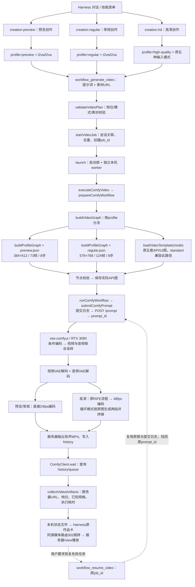

# 视频创作三档入口与全链路

2026-09-12：将原 `creation-video` 替换为预览创作、常规创作、高清创作三个 Harness 技能；三档共用现有插件、ComfyUI 服务、任务恢复和作品卡。本文是实施说明，已有预览性能证据见 [快速预览验收](实施-AI短剧快速预览.md)。

## 1. 用户怎么使用

在 Harness 中选择教学、自由或导演 preset，刷新页面并新建对话，在 `/` 技能菜单选择对应技能，也可以直接说“使用预览创作/常规创作/高清创作生成……”。

| 中文用途 | Harness 技能名称及命令 | 工具 profile | 配置 |
|---|---|---|---|
| 预览创作 | `creation-preview` / `/creation-preview` | `preview` | 384×512，73 帧，24fps，约 3.04 秒，8 步，有声，无 RIFE |
| 常规创作 | `creation-regular` / `/creation-regular` | `regular` | 576×768，124 帧，24fps，约 5.17 秒，8 步，有声，无 RIFE |
| 高清创作 | `creation-hd` / `/creation-hd` | `high-quality` | 原生规格五套工作流，各自保留模型、尺寸、时长、步数和 RIFE，48fps 输出 |

Harness 原生技能名要求 kebab-case，因此菜单命令使用英文标识，描述和技能正文使用上述中文名称。它们不是教学/自由/导演三种协作人格；同一种人格可以选择任意创作档。通用的 `elysium-standard` preset 保持原样，不新增创作技能。

兼容约定：旧工具调用省略 `profile` 或传 `standard` 时继续原生规格流程，**standard 不是新常规档 regular**。三个技能都必须显式传档位。原技能目录及本机已安装副本已移除；旧聊天历史文本不删除。

低分辨率候选仍属于预览：只有显式传 `preview_variant: "low-resolution"` 才使用 288×384，其余规格不变；默认 384×512 未被替换。`preview_variant` 不能用于常规或高清。

## 2. 三条完整执行路径



三条路径的区别只在技能选择、profile 校验和图构建；提交、去重、恢复、轮询和媒体展示不复制。

### 技能与安装位置

源目录为 `harness/.agent-presets/<preset>/skills/`，其中 `<preset>` 为 `elysium-director`、`elysium-teaching`、`elysium-free`。每套目录包含：

```text
skills/
├── creation-preview/SKILL.md
├── creation-regular/SKILL.md
└── creation-hd/SKILL.md
```

本机安装位置为 `~/.dsh/.agent-presets/<preset>/skills/`。各 preset 的 `agent.cordis.yml` 通过 `skill-filesystem.customSkillDirs` 加载该目录，`rules.md` 引导模型先加载对应技能。此次同时更新源与已安装文件，保留其他 persona、配置和全局技能隔离设置。

### 代码入口与职责

| 环节 | 代码 | 作用 |
|---|---|---|
| 技能入口示例 | [导演预览技能](../../harness/.agent-presets/elysium-director/skills/creation-preview/SKILL.md)、[常规技能](../../harness/.agent-presets/elysium-director/skills/creation-regular/SKILL.md)、[高清技能](../../harness/.agent-presets/elysium-director/skills/creation-hd/SKILL.md) | 选择档位、整理提示词、遵守恢复和交付规则 |
| 插件注册 | [src/index.js](../../dsh-elysium-tools/src/index.js) | 在 Harness 注册原生成/恢复工具和媒体路由 |
| 工具参数 | [workflow-generate-video.js](../../dsh-elysium-tools/src/workflows/workflow-generate-video.js) | 公开 profile、mode、素材和候选选项 |
| 参数约束 | [video-plan.js](../../dsh-elysium-tools/src/workflows/video-plan.js) | 拒绝不支持的档位组合与素材参数 |
| 任务创建与恢复 | [video-jobs.js](../../dsh-elysium-tools/src/workflows/video-jobs.js) | 保留会话关联、同一逻辑视频和恢复语义 |
| 本机执行 | [video-execution.js](../../dsh-elysium-tools/src/workflows/video-execution.js) | 执行阶段、有限网络重连、状态持久化 |
| 三档分流 | [video-graph.js](../../dsh-elysium-tools/src/workflows/video-graph.js) | preview/regular 走配置图；high-quality/standard 走原模板 |
| 配置图构建 | [video-profile.js](../../dsh-elysium-tools/src/workflows/video-profile.js) | 从原 T2VA 图覆盖尺寸/帧数/步数，I2VA 添加首帧，裁去 RIFE 等无依赖分支 |
| 配置文件 | [preview.json](../../dsh-elysium-tools/src/workflows/profiles/preview.json)、[regular.json](../../dsh-elysium-tools/src/workflows/profiles/regular.json) | 分别定义预览和常规固定规格 |
| 高清模板 | [templates/minimax-h3](../../dsh-elysium-tools/src/workflows/templates/minimax-h3) | 原五套模板仍是原生流程事实源，不另外复制高清模板 |
| 提交与找回 | [comfy-execution.js](../../dsh-elysium-tools/src/workflows/comfy-execution.js)、[comfy-submission.js](../../dsh-elysium-tools/src/jobs/comfy-submission.js) | 保存执行快照、记录提交、断线找回原任务 |
| API与轮询 | [client.js](../../dsh-elysium-tools/src/functions/comfyui/client.js) | 校验节点、POST /prompt、GET /history 与 /queue、构造 /view URL |
| 结果返回 | [video-artifacts.js](../../dsh-elysium-tools/src/workflows/video-artifacts.js) | 返回真实档位，修正所有配置图被固定标记为 preview 的问题 |
| 媒体路由与作品卡 | [media-jobs.js](../../dsh-elysium-tools/src/http/media-jobs.js)、[card.js](../../dsh-elysium-tools/src/client/media/card.js) | 原任务状态展示、302媒体跳转、播放与重连 |

预览/常规不携带过时的高清 UI 图；已保存任务继续复用原 API 快照，配置变化不改写旧任务。

## 3. 输入模式与服务器执行

| 输入模式 | 必需素材 | 预览/常规 | 高清 |
|---|---|---|---|
| t2va | 无，只有提示词 | 支持 | 支持 |
| i2va | first_frame | 支持 | 支持 |
| fl2va | first_frame、last_frame | 不支持，拒绝而非静默降级 | 支持 |
| fl2va-loop | first_frame、last_frame | 不支持 | 支持 |
| r2va | reference_image_1、reference_image_2 | 不支持 | 支持 |

素材必须是已配置 ComfyUI 的 `/view` URL。插件不上传、下载或保存媒体文件；模型与视频文件都留在服务器。

预览与常规的服务器主要节点为：`n105_13` 文本编码器 → `n105_104` 条件/latent 准备 → `n105_14` 联合采样 → `n105_10` 视频解码及 `n105_23` 音频解码 → `n126` H.264/AAC MP4。实际音视频解码先后由依赖调度决定，不表示双分支并行。

两档均保留现有 H3 TURBO-hybrid Beta3 INT8、Euler/simple 8 步、原 Sol/FFN/Spectrum/DiffAid 补丁及联合音频计算；不是四步蒸馏或新增加速框架。宽高按 32 对齐，帧数按 `17k+5` 对齐：3 秒请求得到 73 帧，5 秒请求得到 124 帧。

高清各模板保留原差异：

| mode | 模板配置 | 采样与特殊步骤 |
|---|---|---|
| t2va | 864×1184，请求10秒 | H3 Beta3 INT8，8步；243生成帧，RIFE后485帧/48fps |
| i2va | 864×1184，请求5秒 | H3 Beta3 INT8，8步；图片输入经过原尺寸节点 |
| fl2va | 864×1184，请求10秒 | H3 Beta3 INT8，8步，首尾帧约束 |
| fl2va-loop | 864×1184，两个请求5秒片段 | 每段8步，按原图拼接与插帧 |
| r2va | 1184×864，请求5秒 | 原 `minimax_h3_ref2va_pruned_nvfp4_convrot_int8.safetensors`，res_multistep/simple 20步 |

上述尺寸是模板配置；涉及图片的尺寸节点可能按输入处理，不能把配置值伪称为每次媒体实测值。高清当前返回模板来源和服务器产物描述，没有新增远程 ffprobe 服务；预览/常规返回图构建确定的对齐规格，自动完整解码仍不声称已运行。

## 4. 工具调用与恢复

```json
{"profile":"preview","mode":"t2va","prompt":"成年角色在咖啡馆拿起信封，抬头微笑。"}
```

```json
{"profile":"regular","mode":"t2va","prompt":"成年角色在咖啡馆拿起信封，抬头微笑。"}
```

```json
{"profile":"high-quality","mode":"t2va","prompt":"成年角色在咖啡馆拿起信封，抬头微笑。"}
```

图片输入在对应请求中增加 first_frame 等服务器 URL；不传任意 width、duration 或 steps。

失败恢复只用 `workflow_resume_video({"job_id":"原任务ID"})`。网络查询失败不新建视频；丢失 POST 返回先查队列/历史中的 `elysium_job_id`；无法确认则停止；服务器明确失败后的授权恢复可产生新 prompt_id，但保留原逻辑 job_id 和作品卡。不能通过切换档位恢复原任务。制作一个明确的新镜头才使用新生成调用；必要时显式 `new_video=true`。

## 5. 本轮验证与性能边界

- 69 项 JavaScript 测试、2 项工作流 Python 测试、4 项 preset 测试通过。
- 使用已安装 Harness 的原生 FileSystemSkillProvider，分别验证源 preset 和本机已安装副本：三套创作 preset 均可发现并加载恰好三个技能，没有旧 creation-video，参数档位与技能匹配。
- 五种 high-quality 图逐一与旧 standard 比对，API 图和 UI 图一致；默认 preview 图规格、音频和低分辨率候选保留。
- 常规档真实验收结果如下；只新增一次生成，预览和高清复用已有证据，不再重复生成。

| 常规档验收项 | 结果 |
|---|---|
| job_id | `07702fdc5a1f9c995def6b5b7eb7193c` |
| ComfyUI prompt_id | `46724583-c912-4c2b-81b1-1f16c7087200` |
| 实际媒体规格 | 576×768、124帧、24fps、5.166667秒、H.264视频与AAC音轨 |
| 服务器执行 | **61.931秒** |
| 本机任务链 | **71.634秒**，包括准备、校验、提交、等待和回收 |
| 条件准备 / 联合采样 | 约5.021秒 / **40.943秒** |
| 音频解码 / 视频解码 / 编码 | 约0.517秒 / **13.634秒** / 1.805秒 |
| 真实执行 | 条件节点n105_104、采样节点n105_14均未命中缓存 |
| 文件与播放 | 服务器ffprobe核对规格、完整ffmpeg解码通过，浏览器播放至结束 |

[播放本轮常规创作视频](https://36we4j3zo503js-8188.proxy.runpod.net/view?filename=final_00001-audio.mp4&subfolder=elysium%2F07702fdc5a1f9c995def6b5b7eb7193c%2Fregular&type=output)。使用此前咖啡馆提示词及原种子，未额外修改参数清缓存；保留Loader缓存，不代表冷启动性能。五个时间点可见拿起信封、低头看、展开并抬头微笑；展开时信封形状变化明显，手部细节与主观音质由用户判断。本轮不宣称画质已获用户认可。

总服务器耗时来自history起止时间，节点耗时来自服务器本机WebSocket相邻executing事件，包含模型调度和回调；最后节点以history成功时间收尾，属于近似墙钟时间。此结果是单次必要验收，不是三档同规格性能对照，也不是速度保证。

本轮验收附件保存在 `docs/implement/creation-modes/acceptance/`：[request](creation-modes/acceptance/regular.request.json) 是创作要求，[receipt](creation-modes/acceptance/regular.receipt.json) 是任务和结果回执，[API](creation-modes/acceptance/regular.api.json) 是实际执行图，[measurement](creation-modes/acceptance/regular.measurement.json) 是媒体规格与阶段计时。它们用于复查，不是日常 Harness 必需输入。

## 6. 部署、回退与未验证项

修改前备份：`~/.dsh/backups/creation-modes-20260912-131214/`，包含原工作流代码、源 preset、已安装 preset 和相关测试。保留已有未提交修改，不提交或重置仓库。只使用 `ssh veo-comfyui`，不操作其他主机；不升级模型、CUDA 或 PyTorch。

构建命令：`pnpm --dir dsh-elysium-tools build`、`pnpm --dir dsh-elysium-tools package:registry`。本机 web profile 的已有安装链接继续指向本项目 registry；技能源和本机副本同步更新。本轮已重启本机 Harness，使工具 schema 生效；没有运行会连接其他主机的通用部署脚本。实际浏览器教学会话的 `/` 菜单已显示三个新技能及中文描述，没有旧 creation-video；没有修改用户输入或额外提交聊天生成。

要使用原流程，传 `profile=standard`；要使用已验证的快速档，传 `profile=preview`。需要完整撤回本轮变更时，按备份逐文件恢复、重新构建并重启本机 Harness，不覆盖之后的用户修改。

自然语言选择技能的稳定性、常规 I2VA 画质、高清五模式本轮逐一真实生成、跨镜头长期人物一致性、对白口型均未完成专项验收。高清不是新增超分，不承诺1080p/4K或实时速度；常规档也不套用预览90秒目标。
