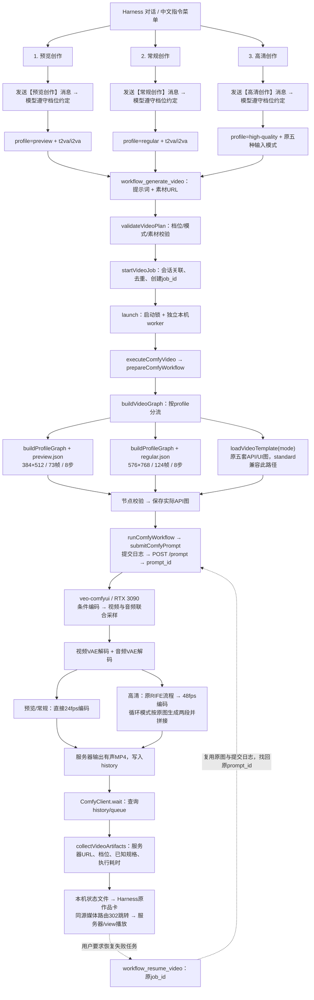

# 视频创作三档入口与全链路

2026-09-12：将原 `creation-video` 替换为预览创作、常规创作、高清创作三个 Harness 中文输入指令；三档共用现有插件、ComfyUI 服务、任务恢复和作品卡。本文是实施说明，已有预览性能证据见 [快速预览验收](实施-AI短剧快速预览.md)。

## 1. 用户怎么使用

刷新 Harness 页面，在输入框输入 `/`，菜单顶部的“创作指令”按以下顺序显示。点击只进入对应输入状态；填写人物、场景、动作后发送，才开始处理请求。也可以输入 `/预览创作 创作内容` 等中文指令。

| 顺序 | 指令 | 菜单核心描述 | 工具 profile | 配置 |
|---|---|---|---|---|
| 1 | `/预览创作` | 快速看构图和动作，生成约 3 秒预览 | `preview` | 384×512，73 帧，24fps，约 3.04 秒，8 步，有声，无 RIFE |
| 2 | `/常规创作` | 清晰度与速度兼顾，单次生成视频，时长按需 | `regular` | 576×768，24fps，8 步，有声，无 RIFE；默认请求 5 秒，可通过 duration_seconds 指定时长，按 H3 节点范围校验；15 秒请求为 362 帧，约 15.08 秒 |
| 3 | `/高清创作` | 更高分辨率，适合正式制作，等待较长 | `high-quality` | 原生五套工作流，保留各自规格、步数和 RIFE，48fps 输出 |

三个指令由工具插件统一提供，不依赖教学/自由/导演人格，也不需要加载技能。加载工具插件的通用人格同样可用。菜单只显示中文名称和用途，内部 profile 保留用于工具调用。原 `creation-video` 及 `creation-preview`、`creation-regular`、`creation-hd` 技能源目录和本机已安装副本均已移除，旧聊天历史不删除。

兼容约定：省略 `profile` 或传 `standard` 继续原生流程，**standard 不是常规档 regular**。指令只选择本次档位，不能覆盖用户“不要生成”等限制。参考图使用服务器作品 URL，不通过指令上传图片。

低分辨率候选仍属于预览：只有显式传 `preview_variant: "low-resolution"` 才使用 288×384，其余规格不变；默认 384×512 未被替换。`preview_variant` 不能用于常规或高清。

## 2. 三条完整执行路径



三条路径的区别只在指令选择、profile 校验和图构建；提交、去重、恢复、轮询和媒体展示不复制。

### 指令实现与安装位置

客户端通过 Harness 原生 `inputTriggers.registerSource` 注册 `/` 输入源，分组名“创作指令”、排序值 `-100`，候选数组固定为预览、常规、高清。点击返回 `CommandClaim`，仅切换输入模式；提交时使用当前会话的 `conversation.send` 发送 `【对应中文档位】` 与用户正文。

服务端 `system-prompt/assemble` 注入统一创作约定，将三个标记分别映射到生成工具的 `preview`、`regular`、`high-quality` 参数。档位选择仍由模型依照指令调用工具，并非服务端强制重写参数。咨询、文字修改和明确“不生成”的测试不应调用生成工具。

这是原生**客户端输入指令**，不是 Host 的 `dsh-commands` 注册项：当前 Host 指令名只接受 ASCII，列表按名称排序且没有中文显示名或自定义顺序。实现未修改 Harness 核心，也未注册重复的英文指令。会话保存普通带标记消息及后续工具记录，不产生 Host `command/run`、`command/done` 生命周期记录。

源规则位于 `harness/.agent-presets/<preset>/rules.md`，本机副本位于 `~/.dsh/.agent-presets/<preset>/rules.md`。三套创作人格的旧技能目录已删除，其余人格与技能隔离配置保持不变。客户端与服务端实现随工具插件构建到 registry，本机 web profile 继续使用该 registry 链接。

### 代码入口与职责

| 环节 | 代码 | 作用 |
|---|---|---|
| 中文输入指令 | [creation-commands.js](../../dsh-elysium-tools/src/client/creation-commands.js) | 中文名称、核心说明、固定顺序、选中及发送行为 |
| 档位约定 | [creation-instructions.js](../../dsh-elysium-tools/src/creation-instructions.js) | 将中文消息标记映射到 profile，遵守不生成、素材及恢复限制 |
| 插件注册 | [src/index.js](../../dsh-elysium-tools/src/index.js) | 在 Harness 注册原生成/恢复工具和媒体路由 |
| 工具参数 | [workflow-generate-video.js](../../dsh-elysium-tools/src/workflows/workflow-generate-video.js) | 公开 profile、mode、素材和候选选项 |
| 参数约束 | [video-plan.js](../../dsh-elysium-tools/src/workflows/video-plan.js) | 拒绝不支持的档位组合与素材参数 |
| 任务创建与恢复 | [video-jobs.js](../../dsh-elysium-tools/src/workflows/video-jobs.js) | 保留会话关联、同一逻辑视频和恢复语义 |
| 本机执行 | [video-execution.js](../../dsh-elysium-tools/src/workflows/video-execution.js) | 执行阶段、有限网络重连、状态持久化 |
| 三档分流 | [video-graph.js](../../dsh-elysium-tools/src/workflows/video-graph.js) | preview/regular 走配置图；high-quality/standard 走原模板 |
| 配置图构建 | [video-profile.js](../../dsh-elysium-tools/src/workflows/video-profile.js) | 从原 T2VA 图覆盖尺寸/帧数/步数，I2VA 添加首帧，裁去 RIFE 等无依赖分支 |
| 配置文件 | [preview.json](../../dsh-elysium-tools/src/workflows/profiles/preview.json)、[regular.json](../../dsh-elysium-tools/src/workflows/profiles/regular.json) | 分别定义预览和常规固定规格 |
| 高清模板 | [templates/minimax-h3](../../dsh-elysium-tools/src/workflows/templates/minimax-h3) | 原五套模板仍是原生流程事实源，不另外复制高清模板 |
| 提交与找回 | [comfy-execution.js](../../dsh-elysium-tools/src/workflows/comfy-execution.js)、[comfy-submission.js](../../dsh-elysium-tools/src/jobs/comfy-submission.js) | 保存执行快照、记录提交、断线找回原任务 |
| API与轮询 | [client.js](../../dsh-elysium-tools/src/functions/comfyui/client.js) | 校验节点、POST /prompt、GET /history 与 /queue、构造 /view URL |
| 结果返回 | [video-artifacts.js](../../dsh-elysium-tools/src/workflows/video-artifacts.js) | 返回真实档位，修正所有配置图被固定标记为 preview 的问题 |
| 媒体路由与作品卡 | [media-jobs.js](../../dsh-elysium-tools/src/http/media-jobs.js)、[card.js](../../dsh-elysium-tools/src/client/media/card.js) | 原任务状态展示、302媒体跳转、播放与重连 |

预览/常规不携带过时的高清 UI 图；已保存任务继续复用原 API 快照，配置变化不改写旧任务。

## 3. 输入模式与服务器执行

| 输入模式 | 必需素材 | 预览/常规 | 高清 |
|---|---|---|---|
| t2va | 无，只有提示词 | 支持 | 支持 |
| i2va | first_frame | 支持 | 支持 |
| fl2va | first_frame、last_frame | 不支持，拒绝而非静默降级 | 支持 |
| fl2va-loop | first_frame、last_frame | 不支持 | 支持 |
| r2va | reference_image_1、reference_image_2 | 不支持 | 支持 |

素材必须是已配置 ComfyUI 的 `/view` URL。插件不上传、下载或保存媒体文件；模型与视频文件都留在服务器。

预览与常规的服务器主要节点为：`n105_13` 文本编码器 → `n105_104` 条件/latent 准备 → `n105_14` 联合采样 → `n105_10` 视频解码及 `n105_23` 音频解码 → `n126` H.264/AAC MP4。实际音视频解码先后由依赖调度决定，不表示双分支并行。

两档均保留现有 H3 TURBO-hybrid Beta3 INT8、Euler/simple 8 步、原 Sol/FFN/Spectrum/DiffAid 补丁及联合音频计算；不是四步蒸馏或新增加速框架。宽高按 32 对齐，帧数按 `17k+5` 对齐：3 秒请求得到 73 帧，5 秒请求得到 124 帧。

高清各模板保留原差异：

| mode | 模板配置 | 采样与特殊步骤 |
|---|---|---|
| t2va | 864×1184，请求10秒 | H3 Beta3 INT8，8步；243生成帧，RIFE后485帧/48fps |
| i2va | 864×1184，请求5秒 | H3 Beta3 INT8，8步；图片输入经过原尺寸节点 |
| fl2va | 864×1184，请求10秒 | H3 Beta3 INT8，8步，首尾帧约束 |
| fl2va-loop | 864×1184，两个请求5秒片段 | 每段8步，按原图拼接与插帧 |
| r2va | 1184×864，请求5秒 | 原 `minimax_h3_ref2va_pruned_nvfp4_convrot_int8.safetensors`，res_multistep/simple 20步 |

上述尺寸是模板配置；涉及图片的尺寸节点可能按输入处理，不能把配置值伪称为每次媒体实测值。高清当前返回模板来源和服务器产物描述，没有新增远程 ffprobe 服务；预览/常规返回图构建确定的对齐规格，自动完整解码仍不声称已运行。

## 4. 工具调用与恢复

```json
{"profile":"preview","mode":"t2va","prompt":"成年角色在咖啡馆拿起信封，抬头微笑。"}
```

```json
{"profile":"regular","mode":"t2va","prompt":"成年角色在咖啡馆拿起信封，抬头微笑。"}
```

```json
{"profile":"high-quality","mode":"t2va","prompt":"成年角色在咖啡馆拿起信封，抬头微笑。"}
```

图片输入在对应请求中增加 first_frame 等服务器 URL；不传任意 width、duration 或 steps。

失败恢复只用 `workflow_resume_video({"job_id":"原任务ID"})`。网络查询失败不新建视频；丢失 POST 返回先查队列/历史中的 `elysium_job_id`；无法确认则停止；服务器明确失败后的授权恢复可产生新 prompt_id，但保留原逻辑 job_id 和作品卡。不能通过切换档位恢复原任务。制作一个明确的新镜头才使用新生成调用；必要时显式 `new_video=true`。

## 5. 本轮验证与性能边界

- 中文指令改造后：80 项测试通过；构建与 registry 打包通过。
- 原生 FileSystemSkillProvider 验证源与已安装三套创作 preset 均不再提供四个已停用技能。指令测试覆盖顺序、筛选、选中不发送、空输入/图片拒绝、消息标记及失败传播。
- 实际浏览器菜单显示三条中文名称及说明，顺序正确，旧英文技能入口消失；逐一点击后均仅进入中文输入状态。在独立教学会话连续发送三次“只验证指令，不调用任何工具，不生成视频”，分别收到“预览创作”“常规创作”“高清创作”，界面显示 3 轮、3 步 LLM，无工具调用。本轮不新增 GPU 生成，不据此声称重新验收了视频画质或完整生成链；此项与下述此前真实视频验收分开记录。
- 五种 high-quality 图逐一与旧 standard 比对，API 图和 UI 图一致；默认 preview 图规格、音频和低分辨率候选保留。
- 此前常规档真实验收结果如下；当时只新增一次生成，预览和高清复用已有证据，不再重复生成。

| 常规档验收项 | 结果 |
|---|---|
| job_id | `07702fdc5a1f9c995def6b5b7eb7193c` |
| ComfyUI prompt_id | `46724583-c912-4c2b-81b1-1f16c7087200` |
| 实际媒体规格 | 576×768、124帧、24fps、5.166667秒、H.264视频与AAC音轨 |
| 服务器执行 | **61.931秒** |
| 本机任务链 | **71.634秒**，包括准备、校验、提交、等待和回收 |
| 条件准备 / 联合采样 | 约5.021秒 / **40.943秒** |
| 音频解码 / 视频解码 / 编码 | 约0.517秒 / **13.634秒** / 1.805秒 |
| 真实执行 | 条件节点n105_104、采样节点n105_14均未命中缓存 |
| 文件与播放 | 服务器ffprobe核对规格、完整ffmpeg解码通过，浏览器播放至结束 |

[播放本轮常规创作视频](https://36we4j3zo503js-8188.proxy.runpod.net/view?filename=final_00001-audio.mp4&subfolder=elysium%2F07702fdc5a1f9c995def6b5b7eb7193c%2Fregular&type=output)。使用此前咖啡馆提示词及原种子，未额外修改参数清缓存；保留Loader缓存，不代表冷启动性能。五个时间点可见拿起信封、低头看、展开并抬头微笑；展开时信封形状变化明显，手部细节与主观音质由用户判断。本轮不宣称画质已获用户认可。

总服务器耗时来自history起止时间，节点耗时来自服务器本机WebSocket相邻executing事件，包含模型调度和回调；最后节点以history成功时间收尾，属于近似墙钟时间。此结果是单次必要验收，不是三档同规格性能对照，也不是速度保证。

本轮验收附件保存在 `docs/implement/creation-modes/acceptance/`：[request](creation-modes/acceptance/regular.request.json) 是创作要求，[receipt](creation-modes/acceptance/regular.receipt.json) 是任务和结果回执，[API](creation-modes/acceptance/regular.api.json) 是实际执行图，[measurement](creation-modes/acceptance/regular.measurement.json) 是媒体规格与阶段计时。它们用于复查，不是日常 Harness 必需输入。

## 6. 部署、回退与未验证项

三档工作流原备份：`~/.dsh/backups/creation-modes-20260912-131214/`；中文指令改造前备份：`~/.dsh/backups/creation-commands-20260912-134629/`，保存当时源码、源与已安装 preset 及本文。保留已有未提交修改，不提交或重置仓库。

构建命令：`pnpm --dir dsh-elysium-tools build`、`pnpm --dir dsh-elysium-tools package:registry`。已同步本机 preset 并重启本机 Harness，刷新页面即可加载新客户端。此次指令改造未连接远端、未更换模型或修改生成配置，也未运行通用部署脚本。

要使用原流程，传 `profile=standard`；要使用已验证的快速档，传 `profile=preview`。需要完整撤回本轮变更时，按备份逐文件恢复、重新构建并重启本机 Harness，不覆盖之后的用户修改。

自然语言选择档位的稳定性、常规 I2VA 画质、高清五模式本轮逐一真实生成、跨镜头长期人物一致性、对白口型均未完成专项验收。高清不是新增超分，不承诺1080p/4K或实时速度；常规档也不套用预览90秒目标。
