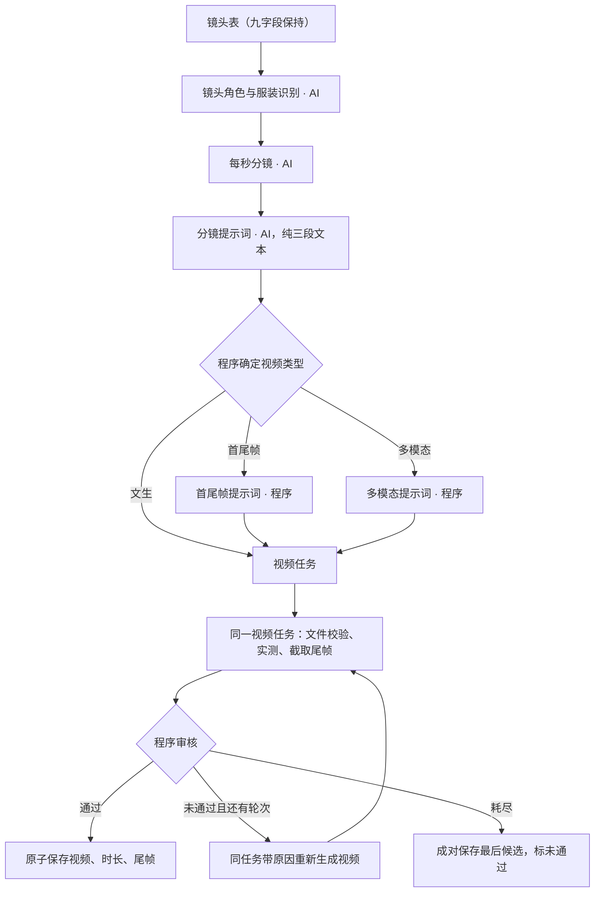

# 镜头级节点对齐开发计划

- 类型：节点重构与新节点设计，拟采用完整开发流程。
- 目标：在已完成的项目级、剧集级执行链上，对齐逐镜的角色与服装识别、每秒分镜、分镜提示词、请求编排、视频及尾帧后处理。
- 当前阶段：**只完成调研与开发设计，未开始代码实施。**本文中的新增字段、业务类型、步骤和迁移均为待实施方案，不表示当前程序已支持。
- 用户已明确选择：新增一个独立的 AI 识别任务，产生本镜出镜角色与服装绑定；不把绑定加入镜头表九字段，也不塞入每秒分镜的生成返回。
- 待用户决定：无。其余内容是依据当前文档和执行链形成的开发设计，正式实施时按下文同步规格与代码。
- 接续：[剧集级计划](1013-计划-剧集级节点对齐.md)、[剧集级实施记录](../implement/1013-实施-剧集级节点对齐.md)。保留英文 Model、项目 JSON 层级、任务组和唯一 TaskService 入口；当前数据库为 v5。
- 非目标：不重写项目/剧集节点，不恢复本集资产，不实现自由模式，不接入 ComfyUI，不修改上游 Harness，不增加未经网关文档声明的参数。本轮不修改业务代码、正式结构文档、YAML 或运行数据，不启动收费生成任务。

## 1. 依据与职责

| 依据 | 本计划读取的内容 |
|---|---|
| [制作工作流](../../meiji/dev_docs/制作工作流.md) | 逐镜顺序、三种视频类型、任务组、尾帧归属和失败处理 |
| [step_model](../../meiji/dev_docs/step_model.md) | 节点/任务/步骤状态、重试轮次、历史不可变、继续与人工操作 |
| [project_detail](../../meiji/dev_docs/project_detail.json) | 镜头、分镜、提示词、视频和尾帧的字段 |
| [每秒分镜](../../meiji/dev_docs/dots/镜头-每秒分镜.md) | 逐秒动作、运镜、空间、音频、交接及 ±5 秒程序审核 |
| [文生视频提示词](../../meiji/dev_docs/dots/镜头-文生视频提示词.md) | 英文画面描述、原语言对白、三段返回及 AI 审核 |
| [首尾帧与多模态提示词](../../meiji/dev_docs/dots/镜头-首尾帧与多模态提示词.md) | 类型判定、程序编排、互斥请求和图片绑定 |
| [视频](../../meiji/dev_docs/dots/镜头-视频.md) | 生成、文件校验、截帧、程序审核、候选保存及下游 |
| [下游接入接口文档](../../下游接入接口文档.md) 第 7–9 节 | JSON 字段、素材互斥、图片数量、异步任务、下载和错误处理 |
| [开发指引](../../.agents/meiji-dev.md) | 唯一写入口、版本迁移、测试和运行约束 |

正式实施先同步工作流、新节点 dots、step_model、project_detail 和对应 Model，再同步 YAML、执行器和界面。本文是开发计划，不能作为运行时配置读取。

## 2. 目标节点与执行顺序



每个可执行节点对应一个任务，多轮生成和审核仍是同一任务的步骤。独立点击创建 `single` 组；成片提交创建 `episode-film` 组。尾帧是视频产物和后处理步骤，不再是可提交任务。

| 节点 | 拟用 business_type | 保存位置（相对 shot） | 审核 | 最多修订 |
|---|---|---|---|---|
| 角色与服装识别（新增） | `shot-characters` | `character_binding` | 程序→AI，共用轮次；结构/引用解析属于协议校验 | 2 |
| 每秒分镜 | `seconds` | `seconds_storyboard` | 程序→AI，共用轮次 | 2 |
| 分镜提示词 | `storyboard` | `text_to_video_prompt` | AI | 2 |
| 首尾帧提示词 | `first-last-frame-prompt` | `first_last_frame_prompt` | 无；程序前置与执行校验 | 0 |
| 多模态提示词 | `multimodal-prompt` | `multimodal_prompt` | 无；程序前置与执行校验 | 0 |
| 视频 | `video` | `video`，同时写 `actual_duration_seconds`、`last_frame` | 程序 | 2 |

两种程序提示词在界面上属于同一编排阶段，运行时用两个固定业务键和固定字段定位，只创建本次适用的一种。不能让同一任务的 `nodeOf` 随类型变化漂移到另一个对象。`video_generation_type` 继续是派生资料字段，没有独立节点状态。

## 3. 节点一：镜头角色与服装识别（新增）

### 3.1 前置条件

目标镜头属于本集，镜头表当前有效，九字段齐全。读取项目角色目录及服装文字，不要求图片已生成，也不把项目摘要作为前置。目录尚无某个重要角色时不能把该人物悄悄当作无人镜头；由语义审核指出资料缺口，不自动建角色卡。

本节点只识别项目角色库中实际可见的人物。静默但可见的人物必须包含；仅声音、仅提及、已离场而不在本镜的人物不进入图像绑定。普通未建卡背景人物的动作仍留在镜头正文，不新增人物卡或借用其他人物的参考图。

### 3.2 生成规则

- 按本镜首次可见的顺序列出角色，同一角色只绑定一次，不改镜头的剧情和人物。
- 服装依据本镜明确描述；明确连续场景可以参考上一镜已确认的穿着。若读取上一镜绑定，将其 ID、内容和成功 hash 纳入依赖。没有有效前镜资料时明确资料未提供，不把它当成已确认的空服装。
- 项目角色 `costumes: []` 时返回空服装编号，后续使用未绑定服装的定妆照；不补写衣服颜色、材质或款式。
- 目录有服装但本镜及连续性资料无法确定穿着时，仍保留已识别的人物，服装编号留空，表达“服装未决”。这与目录本身为空的合法空服装不同；即使目录只有一套，也不能仅凭数量认定本镜穿着。不得选数组第一套或用隐式默认掩盖不确定性；可由用户在此节点人工明确绑定。
- 只使用目录已有编号，程序映射内部 ID 并检查人物、服装归属。AI 不猜 UUID。

### 3.3 生成返回结构

```json
{
  "characters": [
    { "character_number": "C01", "costume_number": "C01-01" }
  ]
}
```

编号格式沿用程序实际提供的目录，示例不构成新的编号规则。没有需绑定的可见项目角色时返回 `characters: []`；`costume_number: ""` 可以表达目录无服装，或有服装但尚未确定。两者都可保存，是否通过由审核区分。非法 JSON、未知的非空编号、跨角色服装属于不可保存协议，任务 failed、保留旧内容；合法候选的漏人、误纳仅提及者、穿着依据错误属于 AI 审核问题，进入修订。

### 3.4 审核规则

程序先检查绑定完整性：角色目录 `costumes: []` 且空服装通过；目录有服装而候选服装为空，判 rejected，原因明确到人物及缺少的穿着依据。可保存的未决候选进入修订，不能因空 ID 提前 failed，也不能在耗尽后丢掉已识别人物。

AI 再核对是否遗漏可见主角色、错误纳入仅声音或提及者、误认相似人物、编造服装，以及角色/穿着与剧情和连续性依据是否一致。不审核参考图片是否已经生成，不把目录服装为空本身判错。程序和 AI 共用最多两次带原因修订；人工放行也必须先满足程序完整性规则。

### 3.5 审核返回结构

```json
{ "是否通过": true, "原因": "" }
```

不通过时原因必须具体且非空。修订输入含镜头、目录、最新候选和本轮原因。

### 3.6 保存与下游

新增 `character_binding: { node_state, characters }`，行内容为 `{ character_id, costume_id }`。`characters: null` 表示尚无产出，数组（包括 `[]`）表示已有候选/结果。这样无需查历史即可区分“没识别”和“确认没有绑定角色”。

此对象替换裸 `on_screen_characters`，不维护两份绑定。成功后影响每秒分镜、类型判定及实际使用图片的编排/视频；拒绝候选按统一规则正式保存、保留原成功 hash、不主动更新下游。只有当前有效的绑定才能用于类型判定，rejected 的空数组不能使视频降级为文生。

## 4. 节点二：每秒分镜

### 4.1 前置条件

镜头表及本镜角色识别当前有效；正文、景别、钩子、衔接、锚点和音频安排齐全。识别结果为有效空数组也允许继续。角色图或定妆照未生成不阻断文本节点。

### 4.2 生成规则

保留镜头表全部动作、场景、情绪、限定描述和原台词，只细化为逐秒的动作、运镜、空间、音频、交接。普通秒一格，不能把整镜写成一个节拍。参考时长作为目标提供，不把 ±5 的允许误差写成生成指令。

钩子亚秒采用**拆分该秒**的确定含义：例如用 `2.0–2.5s`、`2.5–3.0s` 替代 `2–3s`，不再同时保留重叠的整秒格。连续覆盖从 0 到终点 T；不能把重叠格相加得到虚假的总时长。实施阶段同步修正 dots 中“追加一格”的歧义。

### 4.3 生成返回结构

继续使用现有 `storyboard[]`，每项包含 `time_range/action/camera/space/audio/handoff/dialogue`。不向本返回增加角色识别数组。

输入提供含 `id/number/name` 的项目角色身份目录，包含本镜仅声音而未进入图像绑定的人物。AI 的 `speaker_id` 只能从目录照抄已有 ID；未建卡人物和独立旁白留空，`speaker_name` 保留原台词称谓。程序检查非空 ID 存在及归属，不再仅凭姓名覆盖已给出的 ID；原称谓与现姓名不同是否仍指同一角色，由语义审核判断。这样角色改名但 ID 不变时，已有对白身份不会丢失；不新增别名 Model，也不要求模型猜 UUID。

### 4.4 程序审核

可解析的时间段必须正向，从 0 连续且不重叠；普通秒/钩子拆分粒度按上述规则检查。覆盖总时长以终点 T 计算，要求 `abs(T - shot.duration_seconds) <= 5`。例如参考 10 秒：5、10、15 通过，4、16 未通过。

这些可修订的时间线业务问题进入程序 review，不在最终 `assertOutput` 中用“必须等于参考时长”抛成 failed。字段类型或无法解析的协议错误仍 failed。人工编辑继续沿用结构校验约定，不暗中扩大人工放行的含义。

### 4.5 AI 审核与返回结构

检查事实完整性、逐秒可表演性、交接、人物/服装、嘴部开合、对白和声音一致性；判断哪些亚秒属于钩子。不重复要求时长精确相等。审核返回为 `{ "是否通过": boolean, "原因": string }`，与程序审核共用两次修订。

### 4.6 保存与下游

合法候选在两类审核耗尽时也保存进正式 `seconds_storyboard`，状态 rejected、原因非空，旧成功 hash 保留。依赖镜头九字段、镜头表成功 hash、本镜绑定及其成功 hash，以及实际用于对白映射的角色身份目录；不依赖图片。成功后影响本镜分镜提示词。

## 5. 节点三：分镜提示词

### 5.1 前置条件

镜头表、本镜每秒分镜和角色识别均有效。参考图片、上一镜尾帧不属于本节点前置，也不进入其生成提示。

### 5.2 生成规则

只把已通过的每秒分镜转写为英文画面描述，保留原语言对白、歌词和画面文字。对白用 `<d>`，使用跨镜一致的 `(S#)`；无切镜不添加切点，不新增定妆照标签或尾帧对齐指令。

说话人标签由程序提供确定映射，不由本次 AI 自行排序，也不因当前出镜名单减少而重编号：

- 已建卡人物以 `speaker_id` 定位，稳定角色编号对应标签，如 `C01 → (S1)`；姓名改变不改标签。
- 未建卡声源以规范化原称谓（Unicode NFC、去首尾空白）为身份，生成独立命名空间的稳定标签，例如 `(S_Ua17c62…)`，摘要使用该称谓的 SHA-256 前 16 位十六进制。与数字角色标签互不混用；同一投影出现摘要相同但身份不同则报错，不混绑。新增其他声源不重排已有标签，不新增持久化映射表。原称谓不得为空；资料不能证明两个称谓为同一人时，不由程序猜测合并。

输入给出标签与角色/原称谓对照，AI 只照用。实施时同步 dots 的 `(S#)` 表述，允许未建卡声源标签；用同名跨镜、角色改名但 ID 不变、新增其他声源、仅声音及旁白用例验证。只有本镜实际使用的身份与标签进入本节点依赖，不因其他镜新增声源使已完成视频全部过期。

已通过的每秒分镜可能在参考时长 ±5 秒内，但视频请求使用镜头参考值 D。为防止“参考 10 秒、时间线 15 秒、切点写到第 14 秒”超出请求窗口，**程序在本节点输入投影中统一时间坐标**：原终点为 T 时，各时间边界按 `t' = t × D / T` 等比例映射到 `[0, D]`。T=D 时原样传入；同一边界只计算一次，保留首尾和严格顺序，不因展示舍入产生重叠或零长度。

只调整本次提示的时间坐标，不修改正式 `seconds_storyboard`，不删减、合并或换序任何动作、对白和切镜；AI 直接转写程序提供的映射后时间线，不再自行凑时长。生成和 AI 审核读取同一份时间投影，切点以该窗口为准，剧情完整性仍逐条对照原分镜；自由文本内的“第14秒”等调度时点也需按投影转写，不能只改 `time_range` 而照抄旧时点。剧情事实明确要求的等待时间、说话时间不能被当作调度坐标缩短；若在目标窗口内无法自然完成，由语义审核给出具体问题并按本节点轮次处理，不改上游来掩盖不可承载的剧情。此设计需在实施阶段同步替换 dots 的“不改时间线”表述，明确保持事件和相对顺序、允许程序统一时间坐标。

这里没有新增误差审核门槛，也没有撤销上一节点的 ±5 秒容差；视频请求仍为参考 D，实测视频仍按第 7 节程序审核，不能对生成后的视频变速绕过审核。

### 5.3 生成返回结构

```text
integrated_multimodal_description:
overall_soundscape:
non_diegetic_music:
```

三段顺序固定，不接受标题前后附带解释或额外第四段。画面段必须非空；环境声段按 dots 概括、全静音写 `N/A`；无配乐也明确写 `N/A`，不靠空字符串表达。保持现有英文三字段 Model。

### 5.4 审核规则

只有 AI 审核，无程序时长审核。检查英文画面描述、原台词与 `<d>`、说话人一致性、三段职责、时间线、无新增事实及无图片/尾帧编排。项目输出语言为中文不能导致英文画面描述被拒绝。

### 5.5 审核返回结构与保存

返回 `{ "是否通过": boolean, "原因": string }`。修订模板同时带原每秒分镜、上述统一时间投影、真实参考值、最后三段候选与本轮原因。耗尽保存三段和 rejected 原因，成功更新依赖 hash，影响适用的程序编排或文生视频。依赖包含实际使用的分镜及成功 hash、参考 D、时间投影规则版本、身份/标签映射，保证规则变化后旧提示过期。

## 6. 节点四：首尾帧/多模态请求编排（程序）

### 6.1 前置与类型判定

由同一个程序判定函数读取**已通过的角色绑定**及按 sequence 排序后的镜头位置：

| 条件 | video_generation_type | 后续 |
|---|---|---|
| 至少一个已绑定的可见项目角色 | 多模态 | 创建/执行多模态提示词任务 |
| 无绑定角色，且不是排序后的首镜 | 首尾帧 | 创建/执行首尾帧提示词任务 |
| 无绑定角色，且是排序后的首镜 | 文生 | 不创建程序编排任务，视频直接读取三段 |

未识别的 null 不是无角色。缺图片或尾帧时前置失败，不改选另一类型绕过。这里的“有角色”指需绑定项目人物图的角色，未建卡背景人物仍由正文表现。

类型写入必须有实际执行入口：绑定通过后及组内进入视频分支前，在 Model 事务中统一计算和写入；独立编排/视频的前置再次核对。不能只把计算放在一个文生永远不会创建的编排任务里。类型变更检查视频依赖；非适用编排保留旧内容但不得继续作为有效输入。

### 6.2 首尾帧编排规则

- 必须非首镜；前一镜视频和尾帧均当前有效，文件可读。不能仅看尾帧历史状态 generated。
- 三段原文前增加 dots 规定的首帧对齐行，`input_reference` 使用前镜尾帧 data URL。
- 本镜视频尚未生成，不发送本镜 `last_frame`；不发送任何 reference 数组。

### 6.3 多模态编排规则

- 按绑定顺序，为每个角色使用角色图及本镜对应定妆照，两者都要，不再二选一。
- `costumes: []` 使用 `costume_id: ""` 的定妆照，不能退回仅角色图；有服装使用绑定服装的定妆照。
- 同一图片去重，最多 9 张；超限直接说明角色、图片数量，不截掉角色或悄悄减少参考图。
- 图片必须属于项目、当前有效、可读取和解码。使用 PNG/JPEG/WebP data URL，不接受外部 HTTP 地址。
- 不读取上一镜尾帧，不写开场帧对齐，不发送 `input_reference/last_frame/reference_videos/reference_audios`。

### 6.4 生成返回结构

沿用对应 dots 的 JSON：共同字段为 `model/prompt/seconds/size`，首尾帧另有 `input_reference`，多模态另有 `reference_images: string[]`。model 按当前约定使用 `elysium-video`，请求 seconds 为本镜 4–15 整数参考值；画幅使用规定映射。

持久化 `reference_images` 与 dots 统一为 data URL 字符串数组，不再按 `{address}` 对象校验；只修改该字段的契约，不影响其他图片引用 Model。首帧持久化也是 data URL。任务提示详情记录原始编排结构，图片数据展示按现有脱敏/缩略规则，不把凭据写入项目。

### 6.5 审核、保存与下游

无 AI 调用、无审核步骤、无自动修订；结构、素材和协议错误在前置/执行时 failed，保留旧请求。成功写入对应固定节点和成功 hash。文生界面显示“无需编排”，不新增 skipped 节点状态，不创建空任务。

依赖必须包括实际读取的三段及成功 hash、本镜参考时长、画幅、类型与绑定；首尾帧另含前镜 ID、尾帧地址/成功 hash及前镜有效性；多模态另含所用角色图、定妆照地址/成功 hash。图片变化不使无关文生/首尾帧分支过期，尾帧变化不使文生/多模态分支过期。

## 7. 节点五：视频（包含尾帧后处理）

### 7.1 前置条件

分镜提示词有效，绑定及程序判定的类型有效。按本次类型读取唯一请求：文生直接三段；首尾帧/多模态要求对应编排当前有效。发送前复查实际文件和材料依赖，避免“编排时可读、提交时已失效”。

### 7.2 生成规则与步骤

首次：`precheck → generate → postprocess → review(程序)`。

修订：`revise → postprocess → review(程序)`，最多两轮；不复用上轮尾帧。新增 `postprocess` 步骤名称为“校验视频并提取尾帧”，负责媒体完整解码、最终文件实测、截取并校验尾帧。每轮都在同一视频任务中完整记录。

请求只发送对应类型允许字段。初次生成使用已编排三段；自动修订/用户带意见修改在本次 prompt 的独立意见区块附加本轮原因，三段源正文不被覆盖。不得增加网关不支持的 `reason` 字段，也不得借视频修订重跑文本节点。视频 YAML 只负责本节点生成/修订说明，不再重复拼图、读前镜文本或决定类型。

### 7.3 生成返回结构

网关仍返回异步任务，程序沿用提交、轮询和下载接口。生成步骤记录远端 ID 和候选视频；后处理得到 `{ address, actual_duration_seconds, last_frame_address }`，这是程序内部候选，不是要求 AI 返回的新 JSON。

新增候选文件可以留在媒体存储，但在候选视频与尾帧都完成校验前，不覆盖项目正式地址。网络、下载、视频不可读或截帧失败是 failed，不当作“时长未通过”反复付费重试；取消或服务重启后的晚到结果不能提交。

### 7.4 程序审核

按当前视频 dots 的项目规则：实测时长与镜头参考值差不超过 5 秒，且实测值处于 4–15 秒范围。比较 FFprobe 实测值，展示/写入累计字段时再保留一位小数；不要用先四舍五入来放宽边界。

网关文档写请求允许 1–15 秒，并说明 `17k+5` 帧数会产生时长偏移；这不能证明其实际视频总在 4–15 秒。实施时把 dots 中“服务支持 4–15”改为“本项目审核范围 4–15”，不擅自放宽项目规则，也不裁剪、变速视频来掩盖审核失败。端点量化行为列入真实接口验收；若要放宽实测硬边界，需要另行修改规格。

### 7.5 AI 审核与审核返回

无 AI 审核。程序 review 返回统一的 `{ "是否通过": boolean, "原因": string }`，原因含参考时长、实测值和违反的范围。无可用产物的文件错误不伪装成审核拒绝。

### 7.6 原子保存与失败状态

- 通过：同一 Model 事务写视频、实测时长、对应尾帧，视频及尾帧状态 generated；先记录视频成功 hash，再按视频地址与成功 hash记录尾帧产物 hash；更新剧集实际时长累计和下游。
- 时长审核耗尽：成对保存最后视频与它的尾帧、实测时长，两者均 rejected、记录原因，保留原成功 hash，不主动传播。不能形成“新视频＋旧的有效尾帧”。
- 网络/文件/截帧失败或取消：正式视频、尾帧和实测值保持原有配对，视频任务结算实际失败状态。消费尾帧还必须要求所属视频当前有效，因此不能在视频失败后使用旧 generated 尾帧冒充本轮结果。
- `last_frame` 保留为视频产物对象及其状态；从可执行节点注册中删除 `tail`，不再单独排队、生成、导入或人工放行尾帧。视频排队状态不伪装为另一个尾帧任务。
- 人工导入步骤固定为 `precheck → manual_edit → postprocess`，无 review。地址导入与上传都必须完成同样的文件校验、实测和截帧，然后成对提交；不能沿用地址导入提前返回的路径。导入不调用 AI、不自动收费修订，继续遵循既有结构/媒体完整性校验口径，不新增人工导入的时长门槛。
- 人工导入不要求角色识别、每秒分镜、提示词已生成，允许当前视频类型为空。仅 AI 生成前置强制这些上游有效；导入按当前资料记录依赖 hash，完整媒体可用于合片，不能保存成功却被消费校验间接阻断。后续上游资料变化仍按依赖使其过期。
- 视频无 AI 审核，不提供可绕过程序拒绝的人工放行按钮。

### 7.7 下游

影响本集合片；只有下一镜采用首尾帧时才影响其首尾帧编排和视频。末镜无下一镜。类型为文生/多模态的下一镜不因前尾帧改变而重新生成文本或视频。剧集实际时长继续累计当前正式镜头视频实测值，不被合片长度覆盖。

## 8. 任务组、继续与界面

### 8.1 成片组的分支安排

绑定是新 AI 结果，不能提交时按旧数组提前固定视频类型。拟保留整组的稳定骨架任务：`shot-characters → seconds → storyboard → video`，按所选镜头排序建立；generate 跳过有效节点，并模拟上游将造成的失效，regenerate 重跑所选范围。

只在绑定有效、进入该镜视频分支时，向同组视频之前插入适用的程序编排任务；文生不插入。若 storyboard 因有效而跳过，队列挑选视频前也必须经过同一分支安排入口，不能漏建编排。

插入入口在 `#loop` 选中 video、但尚未把它标成 running 之前；事务结束后重新选队首，不能在已经 running 的视频 precheck 中插入前置任务。插入发生在 Model 事务内，只调整尚未开始的排队任务的 `group_seq/queue_order`，保持组内顺序连续、适用编排先于视频、后组不抢跑；已开始及终态记录不改。SQLite 的 `(group_id,group_seq)` 唯一约束要求先倒序移动受影响排队行，再插入新行，不能按当前数组顺序直接 upsert，也不能删除重建历史。每个 video 在本组本次执行最多插入一次适用 pack；regenerate 不能因队列再次选中视频而反复插入已经完成的 pack，generate 可以复用当前有效编排。组继续也经过同一入口。保留现有组字段，不另建“计划任务表”或第二套执行器。

生成请求和新插入分支均检查目标冲突；对同镜尚未物化的两种潜在编排也应识别成片组占用，避免独立提交穿插。绑定失败时骨架后续任务作废；分支前置失败时其后续同样作废。组状态在插入事务完成后聚合，不能中途显示全部完成。

### 8.2 继续

保留旧终态，从停点新建组。新流程组必须按当前适用分支核对剩余任务，不能直接复制一个已不适用的旧编排类型。分支未改变时继续失败节点及剩余骨架；若停点之前的前置已失效或类型已改变，明确提示从成片 generate 按当前资料补齐，不静默重跑已成功部分。

旧版本剩余任务含已移除的 tail 时不沿用旧链继续；旧组可查看，界面说明使用新成片生成入口补齐。不能为兼容旧继续保留一个隐藏 tail 执行分支。当前所有视频有效后追加唯一合片的逻辑保留，合片失败仍只继续合片。

### 8.3 面板与会话

- 显示识别节点的角色/服装和失败原因；null 显示 AI生成，数组包括空数组显示重新生成。
- 依次展示识别、每秒分镜、分镜提示词、适用编排、视频。文生显示编排无需执行；程序节点按钮为“生成编排/重新编排”，不叫 AI生成、不提供 AI 审核或普通文本编辑。
- 视频卡展示视频、实测时长、尾帧和各步骤结果，不再展示独立尾帧操作卡。
- 单节点的重新生成/按意见修订只提交该节点任务；当前视频按钮提交整镜 episode-film 的行为需拆开。另保留“生成本镜/重新生成本镜”和整集成片组入口，明确范围。
- 操作仍位于标题下一行，生成/重新生成互斥；失败原因弹框、节点原因、任务历史保持一致。
- 会话沿用现有三个工具和 submit/submit-group，不新建写入通道。程序编排使用已有 submit 加新 business key。旧 tail 仍在历史筛选中显示，但不可新建或继续旧执行链。

上述能力约束也在服务契约校验：拒绝程序编排的 manual_edit/override、视频 override 和新 tail 命令，不能仅隐藏面板按钮。

## 9. Model、依赖与数据库迁移

### 9.1 固定结构

| 位置/类型 | 目标 |
|---|---|
| `shot.character_binding` | 新增 `character_binding_model.js`，包含 node_state、nullable characters 数组；复用/对齐现有角色服装绑定行 Model |
| `shot.on_screen_characters` | 被新节点替代，删除旧字段及读写路径，不双写 |
| 每秒分镜、三段提示词 | 保持现有主体结构；目录限制说话人 ID，程序校验并提供稳定标签映射 |
| `multimodal_prompt.reference_images` | 按 dots 明确为 data URL string[]，只对这个路径调整验证 |
| `last_frame` | 保留 address/node_state，作为 video 产物；不再映射可执行 tail 业务 |
| 步骤枚举 | 新增 postprocess，更新 Model、名称、契约、schema CHECK 和历史展示 |
| 任务组 | 保留现有字段；按需插入分支，不能在任务中另存一套项目节点内容 |

`characters:null` 必须是明确的 nullable-array 校验，不能利用 `typeof null === "object"` 放过任意对象。每项校验归属、唯一性；成功或 rejected 的候选必须为数组。

### 9.2 依赖传播

| 变化 | 应检查的链 | 不应附带的依赖 |
|---|---|---|
| 本镜九字段或角色/服装文字变化 | 绑定→每秒分镜→分镜提示词→适用编排→视频/尾帧→合片 | 不重做项目人物提取 |
| 身份/对白映射资料变化 | 实际读取的每秒分镜、分镜提示词及下游 | 未读取的图片状态 |
| 所绑定人物图片变化 | 多模态编排→视频及首尾帧后继、合片 | 文生/首尾帧镜头的图片依赖 |
| 前镜尾帧变化 | 下一镜为首尾帧时的编排、视频 | 下一镜文生、多模态和文本转写 |
| 参考时长或画幅变化 | 实际读取 seconds/size 的编排和视频；时长还影响文本链 | 无关图片和摘要 |
| 镜头删除/重排 | 重新计算首镜、前镜关系、类型及条件依赖；检查合片 | 不能只按旧前驱数组下标继续 |

仍读取上游保存 hash；上游失效须继续传播，即使保留内容/hash未变。queued 的恢复快照同步过期。删除服装如按现有删除规则进行了默认重绑，新绑定节点必须过期，不能把程序重绑当作 AI 已审核；重绑后的图片和编排依赖也要检查。

### 9.3 v5→v6 一次性迁移

新增步骤枚举和绑定节点属于结构/语义变更，使用 v6 事务迁移，不用启动兼容代码。升级前快照备份，失败整体回滚。

1. 迁移执行早于 repository.open 后的 TaskService.recover。先按旧字段结算未完成 tail：queued 恢复旧快照，running 结算不可续跑状态；未完成任务/步骤作废。已终态历史不改。
2. 旧非空 on_screen_characters 搬入新绑定候选并标 expired；旧空数组转为 null/empty，不伪造“AI 已确认无人”。移除裸数组。保留项目、剧集、镜头 ID及媒体地址。
3. 旧程序编排字段按新 Model 转换并标过期；非空的旧 `{address}` 图片引用以及旧首帧本地引用，由存储迁移层检查项目路径、读取和解码后转为合法 data URL，不能在共享 Model 里做文件 I/O。任何待转换引用缺失、越界、格式错误或无法读取时，**整次升级失败并回滚**，错误明确到项目/镜头/字段，不清空旧请求。这包括只有项目 Model 中存在、没有历史任务记录的旧内容；不能靠“历史里应该有”假定其已保存。
4. 按新依赖使相关文本、编排、视频/尾帧及合片过期，保留内容、旧成功 hash和实测值；同步其他 queued 任务的恢复快照，避免 runtime 后续恢复成 generated。
5. 扩展历史业务及 previous_node_state 的只读校验以保留旧 tail；历史任务、组、步骤的 ID、名称、prompt/result、终态不改，新命令拒绝 tail。
6. 同步旧 v1–v4 迁移中的 on_screen_characters/tail 逻辑，按明确版本中间结构转换到 v6；旧迁移不得调用已经移除的当前业务注册。覆盖所有受支持版本连续升级，不只测 v5。

不为缺图片的历史请求在迁移中调用 AI、下载外部素材或删除用户文件。引用无法转换时仍可从原库和 before-v6 备份恢复；需先恢复文件或由用户明确处理旧数据，再执行升级，不在运行时增加新旧请求双轨。

## 10. 当前差异与源码证据

以下行号为调研时位置，实施以符号定位。路径相对仓库根目录。

| 证据 | 当前情况 | 需要的改变 |
|---|---|---|
| `meiji/shared/models/shot_model.js:11`；`server/handlers/media-handler.js:152` | 裸 on_screen_characters 被读取，没有独立识别任务写入链 | 新绑定节点、固定 Model、AI 识别与统一读取方 |
| `meiji/shared/node-definitions.js:90–130` | seconds 无程序审核；video 无审核/修订；tail 独立；缺编排业务 | 补新业务、正确审核配置和 video 后处理 |
| `meiji/shared/node-state.js:68–76` | seconds 最终检查要求严格等于镜头时长 | 程序 ±5 审核，允许保存拒绝候选 |
| `meiji/dev_docs/in_puts/seconds-generate.yaml:12`、`seconds-review.yaml:12` | 允许整镜一个节拍、不按每秒 | 对齐逐秒及钩子拆秒规则 |
| `meiji/dev_docs/in_puts/seconds-regenerate.yaml:57`、`storyboard-regenerate.yaml:33` | 没有注入最新候选 | 使用 promptValues 已提供的基稿与当前审核原因 |
| `meiji/dev_docs/in_puts/storyboard-generate.yaml:7–29`、`storyboard-review.yaml:8–24` | 混入图片/尾帧规则，英文与项目语言矛盾 | 纯三段英文转写，图片编排后移 |
| `meiji/server/handlers/content.js:41–46`、`:68–71` | 三段前附加文本被忽略，身份按姓名回填但提示协议不清晰 | 严格结构、目录 ID 校验和候选保存一致 |
| `meiji/server/flow/tasks/precheck.js:92–112` | 当前镜头必需字段未单独检查，后镜统一依赖前尾帧 | 精确前置和按类型条件依赖 |
| `meiji/server/handlers/media-handler.js:152–210` | 人物图/服装图二选一，后镜总读取尾帧，生成时临时拼请求 | 角色图＋定妆照，固定程序编排，严格互斥请求 |
| `meiji/server/flow/tasks/task-service.js:206–213`、`:527–576` | 固定 seconds/storyboard/video/tail；修订后直接 review | 新骨架/分支插入，每轮 postprocess，候选成对结算 |
| `meiji/server/data/model-repository.js:138`、`:168`；`sqlite-store.js:209` | 组序号必须连续；终态不可变；按数组 upsert 会遇插入重排约束 | 仅排队行安全原子重排，保护历史 |
| `meiji/shared/project_contract.js:40–66` | reference_images 按对象数组；nullable 缺路径级约束 | 对齐字符串数组及新 binding nullable 类型 |
| `meiji/client/task-panel.js:61–67`、`:169`、`:269` | 空数组被当没内容；视频按钮重跑整镜；所有 rejected 显示放行 | 合法空绑定、节点与组动作分开、按节点能力显示 |
| `meiji/shared/models/migrate_project_model.js:184`、`:270`；`task_contract.js:195` | 旧迁移依赖旧字段及 tail；历史快照仍受当前业务限制 | 版本明确的 v6 迁移及只读历史契约 |

只读内存验证已复现：5 秒参考、连续 0–6s 内容被现检查拒绝；seconds/storyboard 修订渲染中找不到传入候选；缺景别/钩子的当前镜头仍可通过现前置。这里记录问题证据，不作为实施后的测试结果。

## 11. 验收标准与调研判定

“已确认”表示规格/断点已有依据，**所有实施验收仍待执行**。

| AC | 输入/状态 → 可观测结果 | 调研判定 |
|---|---|---|
| AC-01 | 对镜头提交识别 → 独立 AI 任务/组；镜头表仍九字段，seconds 返回不增加绑定 | 用户已确认独立节点；代码待新增 |
| AC-02 | 静默可见、仅声音、仅提及、空衣服、多套不明确 → 绑定/拒绝原因符合第 3 节，不凭空补衣服 | 规则已明确；模型语义未验收 |
| AC-03 | null、[]、非空合法绑定及失败保留旧数组 → 服务与面板正确区分首次/重新生成；未知/跨角色编号失败 | 已确认当前裸数组与空产出判定不足 |
| AC-04 | 参考 10 秒，时间线 5/10/15 → 程序通过；4/16、倒序/断档/重叠 → 审核修订 | 已确认现代码精确相等冲突 |
| AC-05 | 程序拒绝→AI 拒绝→通过 → 最多三轮生成，每轮带最新候选及当前原因；耗尽保存 rejected | 已确认复用执行器基础，需接入 seconds |
| AC-06 | 普通秒、钩子拆秒及整镜一格 → 前两者连续覆盖，整镜一格不冒充逐秒；无损保留剧情/音频 | 模板与 dots 冲突已确认；语义未验收 |
| AC-07 | 中文项目、改名但ID不变、跨镜同称谓及新增其他声源 → 英文画面、原语言对白、三段、稳定身份标签，无图片/尾帧指令；其他声源不重排已有标签 | 模板冲突已确认；映射待实现 |
| AC-08 | 识别结果与排序首镜变化 → 类型按表确定；未识别不误判文生，文生没有编排任务 | 当前缺类型写入/编排注册已确认 |
| AC-09 | 三种类型请求 → 各自只有允许字段；多模态同时用角色图和正确定妆照，最多九张 | 当前媒体链与文档差异已确认 |
| AC-10 | 图片/尾帧缺失、损坏、越界或过期 → 前置 failed、没有视频 HTTP；不能降级绕过 | 原有媒体校验可复用，分支需改 |
| AC-11 | 视频首次及两次修订 → 每轮生成、后处理、程序审核同属一个任务，无 tail 子任务 | 当前独立 tail 与无重试已确认 |
| AC-12 | 实测落在 ±5 且 4–15 → 通过；超差耗尽 → 视频/尾帧成对 rejected，原因与实测保存 | dots范围已确认；端点量化真实行为未验收 |
| AC-13 | 网络/解码/截帧失败、取消、重启后晚到 → 旧媒体配对不被部分覆盖，无额外收费修订 | 原子提交与保护待补回归 |
| AC-14 | 前镜尾帧/人物图片/类型变化 → 只使实际依赖分支过期，queued 快照同步，拒绝候选不主动传播 | 当前统一尾帧依赖冲突已确认 |
| AC-15 | generate/regenerate、多个单镜组、跳过 storyboard、分支重复触发 → 顺序正确、无漏建/重复，组与节点冲突一致 | 静态计划缺分支已确认；插入事务待实现 |
| AC-16 | 新组失败继续、类型变更、旧 tail 剩余链 → 新任务不复活旧任务，不能运行旧 tail；原因明确 | 当前按旧成员复制存在缺口 |
| AC-17 | 所有同集组结束且全部视频有效 → 最后组唯一合片；合片失败只继续合片 | 剧集级已实现，需保持回归 |
| AC-18 | 单节点修订、整镜重跑、程序卡、视频尾帧展示 → 作用范围明确、按钮互斥、失败原因可见 | UI实际行为差异已确认 |
| AC-19 | v1–v5 升级/重开/故障回滚 → 有备份、旧终态逐字段不变、旧 tail 不复活、绑定不伪造通过 | v6方案已制定；迁移待实施 |
| AC-20 | 隔离真实样例走三种视频类型 → 请求、媒体、实测、尾帧和合片可核验，第一集语义完整 | 未验收；上轮文本请求曾502，本轮未重试 |
| AC-21 | 同一可解析的断档/超差 seconds 候选 → manual_edit 仅结构校验；override 必须通过程序时间线审核；非法格式两者均失败 | 人工职责已明确；需补服务回归 |
| AC-22 | 上传/地址导入且 AI 上游为空 → 无模型调用，后处理成功才成对提交，可合片；程序编排编辑/放行、视频放行、新 tail 均被服务拒绝 | 原有人工口径保持；后处理与能力校验待实现 |
| AC-23 | 参考 D=10、通过的时间线 T=15 含第14秒切点 → 输入投影切点为 28/3 秒，事件不丢，原分镜不改，提示与视频请求同为10秒窗口 | 时间坐标冲突已确认；投影与语义待验收 |

## 12. 分阶段实施与验证

### 阶段 0：同步规格和固定 Model

修改工作流、step_model、project_detail；新增 `dots/镜头-角色与服装识别.md`，同步四个现有镜头 dots 中的时长职责、钩子拆秒、说话人标签、时间坐标投影、编排和候选尾帧规则。同步 `shared/models/character_binding_model.js`、`shot_model.js`、`step_model.js`、相关行模型及 `shared/project_contract.js`；不只改说明 JSON。→ AC-01、03、07、08、11、12、19、23

验证：字段路径、nullable、业务类型、三种分支和来源逐一核对；模型/契约用例拒绝未知字段及非法引用。正式镜头表仍是九字段。

### 阶段 1：落地识别与两类文本节点

修改 `shared/node-definitions.js`、`node-state.js`、`task_contract.js`，`server/flow/tasks/precheck.js`，`server/handlers/{text-handler,content,handler-registry}.js`。新增 `in_puts/shot-characters-{generate,review,regenerate}.yaml`；对齐六份 seconds/storyboard YAML，补候选、绑定完整性程序审核、时间线、说话人映射和纯文本职责；storyboard 生成/审核共用程序计算的时间坐标投影。→ AC-01–07、21、23

验证：新增 `stage05-shot-characters.test.js`、`stage05-seconds-review.test.js`、`stage05-storyboard-inputs.test.js`；回归文本任务和人工任务。覆盖合法无人、服装空数组、单套/多套但穿着未决、静默/声音/提及、错编号、连续性、±5边界、混合审核轮次及 manual_edit/override 的校验边界。

### 阶段 2：类型判定与程序编排

新增具体的 `server/handlers/video-prompt-handler.js`，复用现有媒体读取/校验，不创建泛化编排框架。登记两个固定业务，补生成请求的结构校验及 Model 保存；共享纯类型判定放在实际调用双方需要的共享模块。修改 `server/gateway/model-gateway.js` 的视频提交入口，使其发送已经确定的白名单请求，沿用现有鉴权、trace、轮询和下载。→ AC-08–10

验证：新增 `stage06-video-prompts.test.js`，用真实临时图片与 mock HTTP 检查请求字段、两张图、空服装、9张边界、无混用和失败零调用。生成/修订请求都覆盖三种类型。

### 阶段 3：视频任务与尾帧原子产出

修改 `shared/task-plan.js`、`task-labels.js`、`server/flow/tasks/task-service.js::#run`，让初次、每轮修订及人工导入都经过 postprocess；候选在后处理后正确合并。修改 `media-handler.js`、`handler-registry.js`、`content.js::commitContent`，复用 `extract-video-tail.js`，新增视频程序审核，人工导入不加 review。删除本次被替代的 tail 执行分支，同步 `video-{generate,regenerate}.yaml` 的职责。→ AC-11–13、22

验证：新增 `stage06-video-task.test.js`，真实 FFmpeg 短片测试视频/尾帧对应关系、时长、每轮后处理、拒绝成对保存；模拟文件损坏、截帧失败、取消、迟到响应。分别测试地址/上传导入、AI 上游为空、可合片及禁用命令被服务拒绝；不调用模型且成对保存，不用缩放视频时间绕过审核。

### 阶段 4：编组、依赖和所有调用方

修改 `task-service.js::command/#loop/#derived`、`model-repository.js::validateSnapshot/checkHistory` 和 `sqlite-store.js::write`，实现仅排队任务的事务内分支插入及顺序约束。更新 `shared/node-dependencies.js` 的绑定、两种 pack、视频及尾帧产物条件依赖；同步 `app-runtime.js` 的资料/画幅修改、`deletion-handler.js`、集合身份逻辑和所有原数组读取方。→ AC-14–17

验证：扩展 `stage03-expiration`、`stage04-film-pipeline/task-groups/history-groups`、`stage06-deletion`；测试 storyboard 跳过、类型切换、序号唯一冲突回滚、跨组排队、未物化分支冲突、旧组继续以及唯一合片。

### 阶段 5：v6 迁移及重启恢复

修改 `server/data/schema.sql`、`sqlite-store.js`、版本明确的 `shared/models/migrate_project_model.js` 和历史 task/step 契约；按第 9.3 节完成旧引用转换，不能转换则整体回滚。所有版本过渡在备份后同一事务执行，保留用户数据与终态历史。→ AC-19

验证：扩展 `stage02-sqlite/storage/commit-recovery`，包含有内容旧库、未完成 tail、其他 queued 快照、缺失旧引用、升级中途异常、重开幂等以及 v1–v5 全路径。不能只测试新建空库。

### 阶段 6：面板、会话与集成验收

修改 `client/{task-panel,project-ui,content-forms,history-ui}.js`、`tools/task-tools.js`、`skills/session/panel.md` 与开发指引，准确展示新节点和当前支持能力。无需新增 HTTP 写入口。→ AC-18、20

验证：扩展 stage07 DOM/API/按钮/历史用例，新增 `stage08-shot-nodes.test.js` 覆盖识别→逐秒→提示词→三种分支→视频/尾帧→合片与持久化重开。面板和会话同输入走相同任务链。

## 13. 风险与执行验证要求

本地 GitNexus 仓库 `llm-dsh-plugins`、分支 `meiji4`、HEAD `e733fe8`；调研开始时 CLI 索引与 229 个已覆盖文件匹配。MCP 有缓存元数据差异，调用关系仅作定位，已用实际源码校正；图谱流程枚举本身存在预算边界，未列出不表示无影响。

| 符号 | 调研 impact | 影响 |
|---|---|---|
| TaskService | HIGH；21个直接调用、2条流程、4个模块 | 分支、重试、后处理、组继续和队列 |
| commitContent | CRITICAL；19个直接调用、5条流程、5个模块 | 候选/正式保存与原子媒体配对；另有16处函数值引用，统计为下界 |
| dependencyHash | CRITICAL；6个直接调用、16条流程、5个模块 | 条件依赖、资料变化、过期与迁移 |

实施前对最终目标重新运行 impact，涉及公共状态、契约、存储和历史，不能只测视频 happy path。

1. 重新记录 `cd meiji && npm test` 的实施基线。上一轮为 290 通过、0失败/取消/跳过，仅作历史记录，不算本轮验收。
2. 每阶段运行对应新增及相关用例，完成后运行全量回归；比较通过、失败、cancelled、skipped，不得新增失败。
3. 网关协议先用 mock HTTP，媒体完整性用隔离真实 FFmpeg 文件。协议成功不等于模型语义成功。
4. 真实验收单独记录三种类型的小样例及现有武松剧本第一集；所需参考图按当前真实流程准备，不测试后续集。接口故障时记录状态码和服务端原因，停止无意义重试，不为跑通增改未知参数。上轮最小文本请求为502，本轮未调用，不能假定服务已恢复。
5. 验收需核对四个视频时长端点/容差边界、人物一致性、原对白、尾帧配对和落库重开；未拿到真实产物时明确未验收。
6. 实施完成才重启 Harness 走查新节点；当前只写计划不重启。代码收尾检查差异、凭据、调用方遗漏，执行 GitNexus detect-changes 并集中更新索引。

## 14. 本轮文档验证

- 已分别复核文本、媒体、Model/迁移/界面的设计，补齐服装未决候选、稳定说话人身份、时间坐标、地址/上传导入、旧引用转换失败回滚及服务能力校验。
- 本计划 11 个、本轮更新的开发指引 8 个本地文档链接均可解析；章节代码围栏闭合，无行尾空白。
- `git diff --check` 通过；新建计划文件另行检查格式。工作区已有的业务代码改动与文档删除未被本轮覆盖，本轮只新增本计划并在 `.agents/meiji-dev.md` 增加设计入口。
- 所有 AC 均为后续实施验收项，尚未验收。本轮未运行业务测试、未调用真实 AI、未修改数据库、未重启 Harness，也未更新代码图谱。
