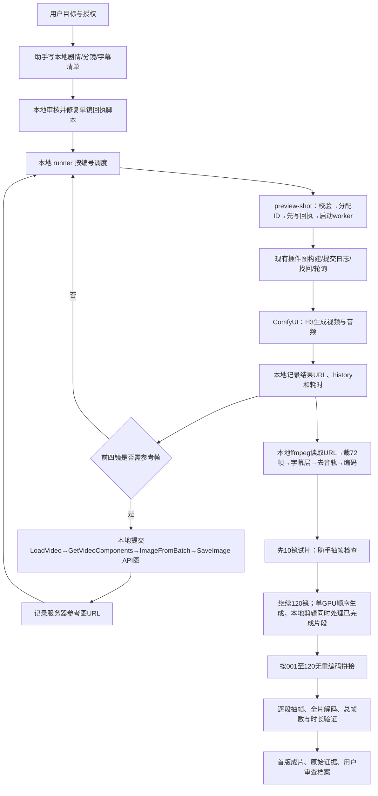

# 产品001：《第三杯咖啡》首版审查档案

> **产品编号 P001｜版本 V1-20260912｜状态：技术制作完成，待用户产品审查。**
>
> 用户将本片指定为本项目第一次、第一个产品。此前三镜头样片和单镜性能测试作为技术探索，不替代本片的产品里程碑。本档案记录这一版已经发生的事实，不代表正式上线、商业交付或用户认可画质。

## 1. 从这里开始审查

1. [播放六分钟首版成片](../../out/third-cup-preview/第三杯咖啡-六分钟预览.mp4)。静音、中文字幕，建议首次连续观看并记录无法理解或明显出戏的时间点。
2. 阅读本文“计划与实际差异”和“验收边界”，了解这一版能证明什么。
3. 对照 [问题清单与审查结论](third-cup-v1/问题清单与审查结论.md)，决定哪些问题必须修、哪些可接受。
4. 使用 [120镜逐镜审查表](third-cup-v1/逐镜审查表.md)定位片段，填写自己的意见。每镜均链接本地带字幕片段及原始回执。
5. 需要技术证据时再看 [原始验收](../implement/third-cup-preview/acceptance-120.json)、[实际执行清单](../implement/third-cup-preview/执行清单.md)、[冻结清单](third-cup-v1/冻结清单.json)。无需先读数百份 JSON。

**记录口径：**“事实”来自文件、回执、history、源码或本次对话；“观察”来自助手抽帧检查；“判断/建议”是解释或下一步选项。所有用户审查栏保持待填写，不由助手代签。

## 2. 产品目标与受众

| 项目 | 首版定义 |
|---|---|
| 产品形式 | AI生成的六分钟竖屏爱情短剧预览 |
| 主题 | 三位成年虚构人物的三角恋；女主最终选择自己的生活 |
| 作品名称 | 《第三杯咖啡》 |
| 主要用途 | 验证本项目能否完成一段完整剧情的分镜、生成、回收、剪辑与交付；供用户审查产品效果 |
| 使用档位 | preview 默认档；不启用常规、高清或低分辨率候选 |
| 首版取舍 | 接受低规格、短镜头、静音字幕；优先完成可审查的流程预览 |
| 尚未证明 | 商业可用性、观众留存、批量成本、稳定人物身份、精准表演、对白口型、正式画质 |
| 决策者 | 用户；助手完成制作、自检和记录，用户决定是否通过产品审查 |

本次没有进行真实观众测试、投放、商业发布或收入验证。名称“产品001”标记项目里程碑，不是这些商业结果的证明。

## 3. 故事、角色与结构

林夏准备去另一座城市工作，在咖啡馆告别。前任陈默赶来挽回，多年朋友周予也坦白心意。两人的挽留引发冲突，林夏指出：他们都在问她选谁，却没问她想去哪。结尾以一句收件人不明的咖啡邀约留白。

| 角色 | 设定 | 视觉辨识方式 | 实际限制 |
|---|---|---|---|
| 林夏 | 28岁，女主，准备外地就职 | 齐肩黑发、米色风衣、奶油色内搭 | 同锚点近景基本可辨，未证明换装、大角度、异地场景身份稳定 |
| 陈默 | 30岁，前任，习惯替她安排未来 | 短直发、深灰西装、浅灰衬衫 | 部分反应表情偏微笑，站坐关系不够连续 |
| 周予 | 29岁，咖啡馆老板，多年暗恋 | 微卷黑发、白衬衫、深蓝围裙 | 靠服装和环境辅助区分，未做独立人脸一致性评分 |

| 成片时间 | 镜头 | 段落 | 剧情作用 |
|---|---|---|---|
| 00:00–01:00 | 001–020 | 最后一次见面 | 建立人物、离开意图、前任出现 |
| 01:00–02:00 | 021–040 | 安排好的未来 | 旧合照与挽留，揭示关系旧问题 |
| 02:00–03:00 | 041–060 | 第三杯咖啡 | 周予表白，三角关系明朗 |
| 03:00–04:00 | 061–080 | 两种挽留 | 两人争执，林夏打断 |
| 04:00–05:00 | 081–100 | 她想去的地方 | 女主说明选择，两人开始理解 |
| 05:00–06:00 | 101–120 | 第三杯以后 | 告别、清晨、消息留白 |

详细动作和生成提示词保留在 [制作分镜表](../implement/third-cup-preview/分镜表.md)与 [manifest](../implement/third-cup-preview/manifest.json)。对白在字幕中跨相邻镜头持续；全片63条字幕，不是每三秒强制更换一句。

## 4. 需求、授权与计划变更

| 阶段 | 已记录的要求/决定 | 实际处理 |
|---|---|---|
| 用户提出产品 | 预览模式、六分钟、三角恋爱情主题 | 规划120个约三秒镜头，六段剧情 |
| 用户授权 | 写入本地计划，完整审核流程、修复后实施 | 编写计划与制作脚本，审核回执、重试、排序、时长、字幕与输出 |
| 用户纠正执行边界 | 本地项目、本地执行；只在排错修复及监控日志时SSH | 制作只用本地脚本调用HTTP API和本地ffmpeg；没有通过SSH执行提帧/剪辑/字幕脚本 |
| 时长自审 | 120×73帧会得到365秒 | 每镜裁为72帧，120×72/24=360秒 |
| 身份自审 | 逐镜随机生成容易换脸 | 前四镜建立场景和三位角色锚点，后116镜引用相应参考图 |
| 制作位置调整 | 原计划提到服务器处理提帧与拼接 | 提帧改为本地提交已有ComfyUI节点图；剪辑和字幕改成本地独立脚本 |
| 声音决定 | 允许静音字幕预览，不新增配音系统 | 保留原联合音频计算，最后本地去掉音轨；未做逐镜主观听感筛选 |
| 试片门槛 | 先10镜/30秒自检，再全片 | 助手判断基本可辨和动作存在后继续；不是用户亲自批准了试片画质 |
| 用户本次要求 | 指定为首个产品，详细记录供审查 | 建立本审查档案、逐镜表、问题清单和本地冻结归档 |

开工阶段SSH只读查看了主机、磁盘、GPU、队列和ffmpeg是否存在。没有因此启动另一主机，没有部署新模型、服务、配音系统或升级CUDA/PyTorch。

## 5. 实际完整流程与人工介入

**本次不是Harness对话端到端自主制片验收。** 实际调度入口是 [本地runner](../../runpod/scripts/third-cup-preview.mjs)，调用现有插件实现；并未让Harness语言模型在一次对话里完成剧本、120镜调度和剪辑。中文“预览创作”指令的UI测试属于此前工作，不能拿来替代本片端到端对话证据。

助手人工完成了剧情和提示词编写、实现脚本、观察试片、决定继续、逐段抽帧检查和报告。自动完成的是固定清单顺序执行、回执复用、原任务恢复机制、生成结果回收、字幕叠加、裁切、拼接和技术检查。单GPU一次只执行一个生成镜头；本地剪辑与后续生成有时间重叠。

## 6. 模型、参数与素材来源

| 项目 | 执行证据对应值 |
|---|---|
| GPU | veo-comfyui：RTX 3090 24GB；未更换硬件 |
| 主模型文件 | `10Eros_Max_h3_TURBO-hybrid_beta3_int8_convrot_skip_edges.safetensors` |
| 文本编码器文件 | `qwen3vl_32b_heretic_minimax_h3_nvfp4.safetensors` |
| 视频VAE / 音频VAE | `minimax_h3_video_vae_fp16.safetensors` / `minimax_h3_audio_vae_fp32.safetensors` |
| 主采样器 / scheduler | Euler / simple，8步，denoise=1 |
| 档位 | preview默认；未启用low-resolution变体 |
| 图构建规格 | 384×512、73帧、24fps，约3.041667秒 |
| 后处理 | 无RIFE、无超分、无额外精修；本地裁切、字幕、H.264编码 |
| 参考策略 | 4次T2VA（场景、林夏、陈默、周予），116次I2VA |
| 参考帧来源 | 对前四镜各取第36帧；保持四个固定锚点，不逐镜接力累积漂移 |
| 音频 | 模型仍联合生成并解码音频，最终本地明确删除音轨 |
| 最终规格 | 384×512、24fps、8640帧、360.000秒、单视频流 |

[anchors.json](../implement/third-cup-preview/anchors.json)保留四张参考图URL及来源任务。角色来自本次生成的虚构画面，没有导入真实演员身份素材。每镜实际工作流和种子等参数以对应history中的API图为准；没有声称所有镜头用了同一个种子。

模型文件名在执行图中可核对；本次归档没有打包模型权重，也没有重新获取其二进制SHA-256，不能仅凭文件名证明未来服务器上的文件与本次完全一致。现有补丁随原图继承，具体节点参数保存在history，不用“INT8”“Turbo”等名称推导不存在的性能保证。

## 7. 时间线、性能与成本口径

以下均为2026-09-12北京时间；准确时间来源于本地attempts、回执与验收文件记录。

| 时间/阶段 | 事实 |
|---|---|
| 14:04:57 | 第一镜本地开始调用 |
| 前4镜 | 建立锚点；服务器累计125.939秒 |
| 前10镜 | 30秒试片；服务器累计296.208秒，助手自检后继续 |
| 全片运行 | 120个唯一job、120个唯一生成prompt，120次生成调用，零次生成失败重试 |
| 15:12:13 | 最后一镜本地任务链完成 |
| 15:12:20 | 本地六分钟成片技术验证完成 |

| 指标 | 实际数值 | 不应如何解释 |
|---|---:|---|
| 服务器生成累计 | 3155.783秒，52分35.783秒 | 不是从写计划开始的交付耗时；不包含参考帧API任务 |
| 单镜平均 / 中位数 | 26.298秒 / 25.845秒 | 不保证下一批相同速度，不是冷启动成绩 |
| 单镜最短 / 最长 | 23.468秒 / 39.932秒 | 没有做多轮重复性能测试 |
| 本地任务链累计 | 3763.490秒，62分43.490秒 | 已包含服务器等待，不能再加服务器累计 |
| 首次提交至成片验证 | 4043.458秒，67分23.458秒 | 不含此前写剧本、改脚本和之后整理审查档案的人力时间 |
| 并行剪辑进程墙钟时长 | 3585.472秒 | 主要包含等后续片段的时间，不是纯剪辑计算时间 |
| 成片大小 | 30,976,621字节，约31MB | 不含原片、参考图、过程剪辑和归档的存储占用 |

按顺序各段服务器累计：第一段556.250秒、第二段523.250秒、第三段519.213秒、第四段523.662秒、第五段513.188秒、第六段520.220秒。每段成片60秒、20镜。

本地任务链与服务器累计相差约607.707秒，包含准备、校验、网络、提交、轮询与回收；没有分别完整计时，不能全部归因于网络。端到端与本地链累计相差约279.968秒，包含检查/锚点/间隔等重叠和等待，也不能当作某一个纯阶段。

**费用未核实：**没有读取本轮账单、Pod实际计费时长、GPU小时单价、存储费、电费或人工成本。因此没有“本片实际花费多少钱”的结论。52.6分钟GPU执行不等于计费52.6分钟；Pod可能在生成前后仍运行。需要另行按账单和启停时间结算。

本次没有完整逐节点耗时采样，不能给出每镜文本编码、联合采样、音视频解码、编码的精确拆分；不套用此前任务的阶段占比。

## 8. 修复、遇到的问题与处理结果

| 项目 | 发现与处理 | 证据强度 |
|---|---|---|
| 回执中断窗口 | 原脚本先启动再写回执；现改为先保存身份再启动、原子写回执、同一回执互斥 | 源码审核与回归测试；本片未故意注入宕机 |
| 不同请求误复用 | 回执绑定原请求，不允许换提示词复用 | 回归测试通过 |
| 已完成任务重复生成 | 已完成回执读取原成功结果 | 回归测试与分阶段继续运行的真实记录 |
| 顺序与时长 | 按数字编号001–120；每镜72帧 | 逐镜计数、成片8640帧、360秒 |
| 中文字幕依赖 | 本机ffmpeg无subtitles/drawtext；使用Unicode字体生成字幕层，通过overlay叠加 | 成片和抽帧可见；无新增配音或加速框架 |
| 服务器内存 | 当时API报告总约54GB、可用约11GB；避免整片帧批次在服务器拼接 | 制作改成本地逐段编码；未做OOM压力实验 |
| HTTP读取探索 | 旧读取方式访问 object_info 返回403；改用项目既有 Node fetch 成功 | 本地准备阶段工具结果；不是视频生成失败 |
| SSH探索 | 非PTY调用不适配网关，改用可用连接只读检查后退出 | 未用来执行制作；不是生成重试 |
| 预览检查时序 | 曾在30秒试片文件未写完时尝试抽帧，文件不存在；等待剪辑完成后重试检查成功 | 属本地查看时序错误，未新增GPU任务 |
| 内容质量 | 道具、肢体、表情与光线问题保留并列明 | 助手抽帧观察，待用户审查；未宣称已修复 |

**零次生成失败不等于全程零问题。** 本片未实际经历网络断线后恢复、服务器执行失败恢复或进程强杀后的恢复演练。恢复代码和部分回归测试存在，不能据这次零失败运行证明所有异常场景都已验收。

当时记录的测试为80项通过；此次归档保留原测试日志。该记录不代表在今天之后的任何代码版本上重新运行了同一组测试。

## 9. 验收矩阵

| 审查项 | 当前结论 | 根据/边界 |
|---|---|---|
| 六分钟长度、尺寸、帧率 | 技术通过 | ffprobe实际成片360秒、384×512、24fps、8640帧 |
| 120镜顺序、独立任务 | 技术通过 | 清单、拼接列表、120个唯一job与生成prompt |
| 真实采样 | 有执行证据 | 120份history采样节点存在、未命中该节点缓存、执行成功；不是GPU硬件级追踪 |
| 文件可解码 | 技术通过 | 每个剪辑片段和完整成片解码检查 |
| 原始每镜73帧 | 工作流/结果已核对 | 本地裁后72帧实际解码计数；没有另做120份原始文件逐份完整帧数计数 |
| 字幕显示 | 助手观察基本可读 | 中文字形、位置与时间线可见；措辞、节奏和体验待用户审查 |
| 三角恋剧情成立 | 助手判断基本可理解 | 没有观众理解测试，留白结尾是否有效由用户决定 |
| 动作发生 | 助手抽帧观察可见 | 每镜0/1/2秒抽帧，不是逐帧主观评分 |
| 人物一致性 | 局部可辨，能力未充分验证 | 固定服装/发型/场景参考辅助；没有长期、多角度身份验收 |
| 道具、手部、表演、光线 | 存在已知缺陷 | 详见问题清单，不标记质量通过 |
| 对白配音和口型 | 未交付/未验证 | 成片无音轨；嘴部自发运动不代表同步 |
| Harness对话全自动制片 | 未验收 | 本片由本地脚本调度，助手人工规划及审核 |
| 播放体验 | 文件完整性通过，用户体验待审 | 成片已通过本地文件入口提供；未记录用户播放器连续观看结果 |
| 发布、商业使用、观众效果 | 未进行 | 无发布记录、收入、投放或观众数据 |
| 产品最终验收 | **待用户决定** | 助手不代填“通过” |

## 10. 缺陷定位、保留理由与后续决策

问题清单给出编号、时间位置、影响和建议处理方式；建议优先级不是用户已经批准的修复任务。此次冻结后不再自动改首版、重生镜头或切换模型。

高关注点：02:03–02:06（第42镜）画外手臂重复；05:03–05:06与05:18–05:21（第102/107镜）多杯外带咖啡；第二分钟部分受伤/迟疑表情偏微笑；最后一分钟清晨与原咖啡馆锚点明暗跳变；出发未完整呈现登车。普遍问题还有景别重复、初始姿态重置、道具数量/形状漂移。

当时保留这些问题的理由是：预览目标允许降低质量；人物和动作基本可辨；避免无限挑片和扩大GPU测试。但这是制作取舍，不意味着缺陷已被用户接受。用户可决定：接受首版作为里程碑、要求定点修订，或退回重做叙事/视觉方案。

## 11. 冻结、证据与重现边界

- [冻结清单](third-cup-v1/冻结清单.json)包含归档地址、归档SHA-256、每个成员文件的路径/大小/SHA-256和校验数量。首版成片SHA-256为 `e7150aa366b54ef9c454b3f72b6e7147d4ee653cfed846c47403d913bac8cd0c`。
- 本地归档位于 `out/product-001-v1-freeze/product-001-third-cup-preview-v1.tar.gz`，保存生成证据、成片与中间片段/抽帧、执行脚本、相关源码和原运行/测试日志；原件不移动、不删除。
- 归档时逐个读取归档成员并对照哈希，不只是检查压缩包文件存在。本次1082个成员均通过校验，归档117,637,050字节（约118MB）。[打开本地冻结归档](../../out/product-001-v1-freeze/product-001-third-cup-preview-v1.tar.gz)。冻结的是本次审查整理前的制作证据，新增审查文档在docs/products单独维护，不冒充制作时已存在。
- **这是同一台电脑上的本地归档，不是异地备份。** out目录被Git忽略；没有执行git提交、推送或远端备份。原服务器URL也不应被当作永久备份。
- 记录的Git HEAD仅代表归档时仓库背景，工作区另有未提交/未跟踪内容。以成员哈希识别此次冻结，不能只用HEAD还原本次全部执行状态。
- 冻结源码是归档时本地源码快照，未声称与每个镜头执行瞬间字节完全一致。实际执行API图以每镜history为准。
- 没有打包模型权重、所有远端依赖、SSH密钥、凭据或原始服务器MP4文件；归档内有全部本地剪辑片段和成片，生成原片保留URL与执行证据。
- 同一模型名、种子与提示词也不能保证不同环境像素级复现。恢复原任务、重新剪辑已有片段、再次生成新版本是三种不同操作，不应混称“重跑”。

**保护首版：**运行现有脚本可能重新写入工作区中的进度、部分验收文件或成片；审查时优先只读播放和查证据。需要制作V2时，应另建输出与版本目录，保留首版归档及原job对应关系，不直接覆盖首版。

## 12. 用户审查与后续记录规则

请在 [问题清单与审查结论](third-cup-v1/问题清单与审查结论.md)填写结论。建议按“剧情能否理解 → 人物是否可辨 → 动作/道具/情绪 → 字幕节奏 → 产品定位 → 是否值得下一版”顺序审查。

未收到审查意见前：版本状态保持“待用户审查”；不宣称产品正式通过，不启动第二版，不追加生成、不改默认模型和采样档位。新意见应记录原话、对应镜头/时间点、决定及处理版本；保留原始测试和制作记录，不回写历史为“当时就通过”。
