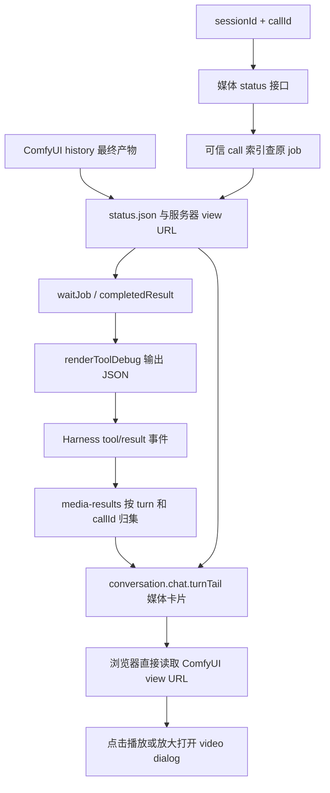

# 研究：从开始会话到成片返回会话的完整链路

日期：2026-09-10。主责仓库：`llm-dsh-plugins`；关联：`llm-ai-model`、`llm-ai-brain`。

## 1. 范围与结论

本报告按 `.claude/research.md` 调查现有实现，只新增研究报告，不修改实现或生成任务。既有职责概览见 [工具执行链路](tools-execution-chain.md)，本报告补充逐入口分支、会话回传机制和本次验证记录。

当前会话媒体主链是：**Harness 会话 → 注册工具 → 参数校验 → 会话绑定的持久任务 → 后台 worker → 包内 ComfyUI 图 → 远端执行/导出 → history 产物描述 → 工具结果 → 原轮次媒体卡片 → 浏览器读取服务器 URL。**

以下“链路存在”指当前源码可追踪；“本地测试通过”指模拟后端/组件测试，不等于真实自然语言会话、GPU 成片或浏览器播放已经端到端验收。

- tools 包负责生成工具、媒体状态接口和播放卡片；ui 包只负责导演设置和提示词读取。
- 单镜头、多镜头、续拍、参考生成、旧参数生成及已有视频复用最终汇入公共视频任务链。
- 图片、角色视图、三视图拼接及独立视频合片使用公共媒体任务链，再汇入同一展示机制。
- 独立短剧编排器和 Qwen 视频反推是相邻流程，没有在所读入口中发现它们自动绑定原 Harness 会话并回传卡片的实现。
- “成功”只确认 history 中有所需最终产物描述；解码、输出规格检查、人工审片均未执行，不能认定成片已验收。

## 2. 当前仓库基线

父目录 `/Users/mac/ai/llm-ai-veo` 不是 Git 仓库。调查开始时：

| 仓库 | HEAD | 已有本地改动 |
| --- | --- | --- |
| llm-dsh-plugins | b3d4292 | 未跟踪 `tests/__pycache__/` |
| llm-ai-model | 73dc441 | 修改 `assets/drama-production/storyboard.json` |
| llm-ai-brain | dd5cd23 | 工作区干净 |

上述已有内容未修改。下文代码路径如无说明，相对 `llm-dsh-plugins/dsh-elysium-tools/src/`。行号以本次读取为准。

## 3. 从会话开始：共同前段

| 步骤 | 当前实现与证据 | 验证边界 |
| --- | --- | --- |
| 创建/打开会话 | Harness 宿主管理会话与用户消息；包内 `.dsh/.agent-presets/elysium/preset.yml` 提供预设元数据，`agent.cordis.yml` 引入人格、规则、技能和原生工具 | 本轮未追踪已安装宿主的创建会话接口、模型请求实现，也未确认运行实例加载了哪个版本 |
| 组装上下文与工具 | `index.js:25` 的 `apply` 注册工具并挂接 `system-prompt/assemble`；`tool-discovery.js` 的 `projectTools` 根据预设与历史工具结果控制通用工具可见性 | Elysium 常规模式延迟加载通用工具；普通预设和含 `run_code` 的模式保留各自协议；工具执行权限仍由宿主管理 |
| 可选导演上下文 | `dsh-elysium-ui/src/index.js` 的 `apply` 注入导演 ID/name/version 索引；`elysium_read_director` 返回选定提示词 | 这是模型上下文，不是自动调用视频引擎的路由器；短视频无需读取导演 |
| 模型选择工具及参数 | 宿主调用工具 `execute(args, exec)`；`exec.agent.session.id` 和 `exec.callId` 提供绑定标识 | 未用真实模型验证选工具、保留提示词或批准流程；自然语言遵循性不能由 JS 单测证明 |
| 工具默认可见性 | `index.js:29`：默认保留所有 workflow/character/resume 工具，以及 `model_generate_image`、`model_concat_video`、`model_job_status/result` | `model_generate_video/long` 和 ComfyUI 原子管理工具需 `enableAtomicTools=true`；不是默认全部开放 |

## 4. 每条生产分支

下表“视频公共链”指第 5 节，“媒体公共链”指第 6 节；两者都接第 7 节的会话展示。

| 编号 | 从会话发起的入口/条件 | 独有执行路径 | 最终去向 |
| --- | --- | --- | --- |
| V1 | `workflow_generate_video`，单个 independent 镜头，无图片 | `validateVideoPlan` → `videoShots` → 单镜头 generate 模板的 text 组件 | 视频公共链 → 成片卡片 |
| V2 | 同工具，单个 independent 镜头，有 `image_path` | 校验 ComfyUI `/view` 图片引用 → image 组件将图片加入 Director 素材 | 视频公共链 → 成片卡片 |
| V3 | 同工具，reference 镜头 | 至少一种图片/视频/音频素材 → reference 组件 → Director timeline 引用；声音参考不构成口型保证 | 视频公共链 → 成片卡片 |
| V4 | 同工具，多个 independent/reference 镜头 | 每个此类镜头须提前有 `image_path`；逐镜完整 prompt、duration、seed → director 模板 → 各镜输出 → 合成 final | 视频公共链 → 一张最终成片卡片；逐镜 URL 保留在结果 `shots` |
| V5 | 同工具，后续镜头 `mode=continue` | 不接受额外参考；`ElysiumSelectFrames` 的前镜末帧 → `MiniMaxH3ImageToVideo.first_frame` → 后镜生成 | 视频公共链 → 成片卡片；不是跨镜角色一致性验收 |
| V6 | 同工具，`mode=reuse`，可与生成镜头混合 | 探测源视频时长/时间戳/音轨 → `in_point` 与 duration 选段 → `LoadVideo/GetVideoComponents` → 统一交付画幅/帧率/音轨 → final | 视频公共链 → 成片卡片；单个 reuse 也用 director 模板 |
| V7 | 同工具，旧 `prompts + duration`，≤15 秒 | 仅一条 prompt → 转单镜头；可用 image_path，或 image_prompt 在图内生成首帧 | 视频公共链 → 成片卡片 |
| V8 | 同工具，旧 `prompts + duration`，>15 秒 | 必须提前提供 image_path；至少两段，均分秒数并分配余数；首镜 independent，后镜 continue，每段≤15秒 | 视频公共链 → 成片卡片；image_prompt 不能替代长视频的 image_path |
| V9 | 同工具，旧 `video_paths + duration` | 每个视频转 reuse 镜头，按源时长复用；总时长须匹配目标 → director → final | 视频公共链 → 成片卡片 |
| V10 | 同工具，仅 `plan_path` | `resolveVideoPlan` 读取 HTTP(S) JSON、处理相对素材引用 → 原样进入以上分支；不允许混入其他参数 | 视频公共链 → 成片卡片；本地/SSH 分镜文件拒绝 |
| V11 | 原子工具 `model_generate_video`，需开启 | text/image/reference 转成一个 shot；duration 默认5，最大15 → `startVideoJob` | 同 V1–V3，走视频公共链及相同卡片 |
| V12 | 原子工具 `model_generate_video_long`，需开启 | image_path + 多 prompts；默认 max(20, 段数×5) → `startVideoJob`；旧 preset 名仅兼容，规格来自模板 | 同 V8，走视频公共链及相同卡片 |
| M1 | `model_generate_image`，无参考图 | `runMediaJob('image-generate')` → `workflow_generate_image` → PNG | 媒体公共链 → 图片卡片；URL 可再作为视频首帧 |
| M2 | 同工具，有 image_path | 同上但选择 `workflow_generate_image_reference` | 媒体公共链 → 图片卡片 → 可接 V2/V3/V4 |
| M3 | `model_character_view`，front | 固定角色描述与正面姿态 → `workflow_character_front` | 媒体公共链 → 图片卡片，等待视觉确认 |
| M4 | 同工具，side/back | 校验成功正面任务和产物身份 → 固定原角色描述 → 复用已有尝试或明确 retry → `workflow_character_view`；每视角最多三次 | 媒体公共链 → 图片卡片；不自动证明视角/人物正确 |
| M5 | `model_character_sheet` | 校验 front/side/back 来自同一角色 → 三份完整人物 crop → `workflow_character_sheet` 拼接，不重新推理 | 媒体公共链 → 图片卡片；三视图档案不能直接作为标注 character-sheet 的视频输入 |
| M6 | `model_concat_video` | 至少两段视频；输入编码、尺寸、fps、音轨参数必须一致 → `workflow_concat_video` → final MP4 | 媒体公共链 → 成片卡片；与 V6 的统一规格/裁切路径不同 |

证据入口：`workflows/workflow-generate-video.js:10`、`video-plan.js:6`、`video-graph.js:13/28/53`、`video-plan-file.js:4`；`functions/endpoint/*.js`；`workflows/character.js:29/74/87`、`media-graph.js:7`。

## 5. 视频公共链：从参数到 ComfyUI 成片

1. `startVideoJob`（`video-jobs.js:13`）先解析分镜文件、校验参数和后端/公开地址，再创建任务。shots 时长之和必须等于 duration；非法输入不进入推理。
2. `createJob`（`jobs/create.js:7`）生成 job_id，保存 `jobs/<id>/input/request.json`；`bindVideoCall`（`jobs/call-index.js:12`）持久化 session_id + call_id → job_id。
3. `launch`（`jobs/launch.js:14`）用 Python 启动锁和 worker.lock 防止重复 worker；写 queued 状态，启动 detached `video-worker.js`。调用等待结束不等于 worker 或 GPU 被取消。
4. `video-worker.js` 对不含 capability 的请求调用 `executeComfyVideo`（`video-execution.js:18`）。输入素材转换为同后端引用；复用视频才读取源时长、时间戳等必要信息。
5. `buildVideoGraph`（`video-graph.js:53`）根据镜头类型选择包内模板并动态展开；生成图和可视化图保留对应节点。运行时不直接读取相邻模型仓库的原始 JSON。
6. 图中执行：加载模型/CLIP/VAE/LoRA → Director 条件与调度 → sampler → 视频/音频 VAE 解码 → ImageScale → ElysiumSelectFrames → 音频补齐/裁剪 → 逐镜 `sN_save` → 图像/音频合并 → `final` 的 DaSiWa 视频封装节点。
7. 当前两份视频模板 settings：生成 480×864、24 fps、4 steps；交付 480×854、30 fps。`frameIndices` 按显示时间选择帧，并非运动插帧。此处是配置与图证据，不是对新成片的测量结果。
8. `prepareComfyWorkflow`（`comfy-execution.js:5`）查询 `/object_info/<class>` 验证节点/输入/连线，保存 `comfyui-workflow.json`；恢复使用保存图并核对原请求和服务地址。
9. `runComfyWorkflow`（同文件:20）→ `submitComfyPrompt`（`jobs/comfy-submission.js:3`）：持久化提交意图，POST `/prompt`，保存 prompt_id；通过 client_id 和 extra_data 中的 job_id 对应插件任务。
10. `ComfyClient.wait` 轮询 `/history/<prompt_id>` 与 `/queue`；区分排队、执行、对账、执行失败及任务丢失。状态不存在不能作为自动重提依据。
11. `collectVideoArtifacts`（`video-artifacts.js:4`）要求 final 和逐镜保存节点均返回 output MP4 描述，构造 `/view?filename=...&subfolder=...&type=output`。此处不读取输出媒体字节，不做完整解码。
12. 保存 `validation.json`、status、diagnostics；`status=succeeded` → `completedResult` → `waitJob` 返回 → 第 7 节。

模型仓库来源：`workflows/video-generate-minimax-h3/*.json` → `scripts/common/comfyui/build_video_workflows.py` → 插件 `templates/`；自定义取帧节点为 `llm-ai-model/scripts/common/comfyui/elysium_media.py:5`。服务器实际引擎/第三方节点部署版本本轮未核验。

## 6. 图片、角色与独立合片公共链

`runMediaJob`（`media-jobs.js:11`）→ `validateMediaPlan` → createJob/会话绑定 → launch → worker 读取 capability → `executeComfyMedia`（`media-execution.js:11`）→ `buildMediaGraph` → 公共 prepare/submit/wait → `collectMediaArtifacts`（`media-artifacts.js:4`）→ status → waitJob → 会话展示。

- 图片/角色输出读取最终节点 `7` 的 PNG；合片读取节点 `7` 的 MP4。
- 角色姿态需要服务器已存在 `elysium/poses/front|side|back.png [input]`；本地模板存在不证明服务器已部署。
- 拼图检查 crop 边界；合片检查输入规格。两者都不能被误写成输出文件已做完整验收。
- 保存的是任务请求、状态和图等元数据，插件不保存生成媒体副本。

## 7. 成片回到原会话：共同后段

- `jobs/query.js:54` 的 `completedResult` 展开 result；`functions/common/tool.js:1` 的 `renderToolDebug` 输出 job_id/status/path/validation/shots 等，并保留可信最终 `comfyui_view_url`。
- `client/index.js` 注册媒体卡片和结果归集；`client/media/results.js` 监听原生 turn/start、tool/call、追加 tool/result，按本轮 callId 收集结果，在 `conversation.chat.turnTail` 展示。刷新通过历史事件重建，防止串到其他轮次。
- `client/media/card.js` 在工具执行区显示进度；成功后执行区改为“作品见本轮回复下方”，底部卡片显示成片。已带成功 URL 的结果可直接播放，无需再轮询状态。
- 未完成或等待中断时，卡片每约3秒查询媒体 status；网络失败退避至最多30秒。由 `http/media-jobs.js` 校验页面凭据，通过 `findVideoCall` 关联原任务，返回摘要。凭据过期允许同源刷新后重试一次。
- 视频卡片预览静音，点击播放/放大后使用带 controls 的 video dialog；加载 URL 失败会提示重试，不回退本地文件。
- `/plugins/dsh-elysium/media/video|image` 是认证后 302 到服务器 URL，不代理媒体字节。浏览器仍必须能访问 publicUrl；仅 Harness 可访问 comfyUrl 不足以保证播放成功。
- 成片列表展示最终结果，不自动把 `shots` 中每个镜头都展开为独立卡片。

## 8. 查询、恢复与非生产支路

| 入口/事件 | 行为与边界 |
| --- | --- |
| `model_job_status` / `model_job_result` | 读取插件任务或完成结果；不生成新视频。这两个查询工具不在媒体卡片注册名单中，不能假设查询会额外创建作品卡片 |
| `workflow_resume_video` | `resumeVideoJob` 保留 job_id，复用已有运行或成功任务，并绑定当前恢复调用；失败恢复需核对原 prompt |
| `model_job_resume` | 媒体任务走 resumeMediaJob；视频任务转 resumeVideoJob；恢复工具在展示名单中 |
| 等待取消/超时 | `jobs/wait.js:4` 报告原 job_id，不取消远端；原卡片可继续查询，不应重新生成 |
| 提交响应丢失 | 通过队列/history 中 job 标识找原 prompt；结果不明则停止重提；只有明确恢复且原 history 确认执行失败时才允许重提交 |
| 原子 ComfyUI queue/status/result/cancel | 需开启原子工具；按原生 prompt 查询或移除指定排队项；不进行全局运行中断，不自动进入会话作品卡片 |

## 9. 相邻流程，不冒充自动会话闭环

- **Qwen 视频反推**：`llm-ai-brain/workflows/qwen38/scripts/run_pipeline.sh:158` 起调用分析、反推打包、validate_artifacts，再发布工作流输入和运行产物。当前入口终点是输入/产物目录，不是插件视频 job 或会话卡片。若要接本报告 V10，仍须证明输出 schema 与 HTTP 素材地址满足 resolveVideoPlan/validateVideoPlan；不能将任意生产包直接当成可执行 plan_path。
- **独立短剧编排器**：`llm-ai-model/workflows/drama-production/drama_orchestrator.py:265` 的 run 负责分镜、角色/QC/人工放行、直接提交 ComfyUI 和状态。函数虽名为 build_harness_request，实际提交见 :400 之后的 ComfyClient `/prompt`，未通过插件 createJob/bindVideoCall。:452 起全部镜头成功后标记完成并打印合片顺序，这个 run 分支自身没有执行最终合片和会话卡片回传。仓库存在独立 episode 工作流，不据此推断此脚本已调用它。
- 这两条链不是缺少生成能力的结论，而是**尚未证明与原会话自动回传连接**。本次不新增桥接或改造架构。

## 10. 本次发现的契约偏差

| 发现 | 静态证据 | 影响判断 |
| --- | --- | --- |
| 工具描述的“服务器校验/解码、时长验证”超出实际结果证据 | workflow-generate-video、concat-video 描述；两份 artifacts 收集器明确返回 full_decode/specification_match/human_review=`not_run` | 已确认描述与验证边界不一致；成功不等于实片合格 |
| 公共输出 schema 仍要求媒体字节信息 | `functions/common/tool.js:47` 必填 size_bytes/sha256；当前两份 artifacts 收集器不返回它们 | 已确认 schema 与返回对象不一致；Harness 是否严格校验并阻断真实调用未确认，单测全通过不能排除 |
| 长视频首帧描述不一致 | workflow 参数 image_prompt/旧描述允许长视频替代；`video-plan.js` 对>15秒旧输入强制 image_path | 可在提交前被拒绝；需要后续计划统一文字与实际边界，不擅自放开限制 |
| 输出未提供实际 media_info | 当前收集器未测量成片尺寸/时长/fps；卡片读取 media_info，缺省用展示比例 | 卡片布局不能作为成片规格证据；实际文件需单独检验 |

以上只记录，未修复。涉及代码或描述调整应先进入 plan 阶段并审批。

## 11. 验证记录与下一阶段验收

| 证据级别 | 本轮执行 | 结果 |
| --- | --- | --- |
| 静态检查 | 阅读入口、参数、图、任务、产物、展示及恢复链；`bash llm-ai-model/scripts/verify-sync.sh` | 视频、图片/角色/合片、短剧三组导出全部一致 |
| 本地测试 | tools 目录 `node --test tests/*.test.js` | 91通过，0失败、0跳过 |
| 本地测试 | ui 目录 `node --test tests/*.test.js` | 9通过，0失败、0跳过 |
| 服务器实际验证 | 未连接服务器，未触发真实模型、构建、部署或重启 | 未验证当前部署、权重、引擎、自然语言会话和新产物 |
| 人工验收 | 未观看本轮新生成成片 | 未验证内容、角色一致性、声音、播放与交付质量 |

本地用例覆盖：图分支、镜头/音轨时序、输入拒绝、HTTP 引用、模拟任务提交和恢复、防重复提交、卡片刷新/凭据/播放状态以及导演读取。组件测试的“可播放”不等于真实浏览器已解码视频。

后续若进行实际闭环验证，按本报告编号逐项建立记录：用户请求 → session_id/turn/call_id → 实际工具参数 → job_id → 保存图/模板版本 → prompt_id → history → 最终 URL → 浏览器加载/播放 → 输出规格测量 → 人工结论。优先用已有任务进行只读对账；任何新 GPU 任务须逐项明确授权。

验收至少覆盖：文本/图片/参考生成、多镜头切换、末帧续拍、复用剪辑、HTTP 分镜文件、图片/角色素材、独立合片、取消等待后恢复、刷新历史回放、浏览器公开地址可达。原子工具只在启用时验收；独立反推和短剧编排器另列接口边界，不能默认为相同会话链。
