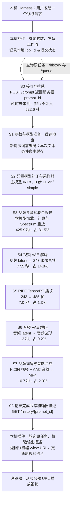
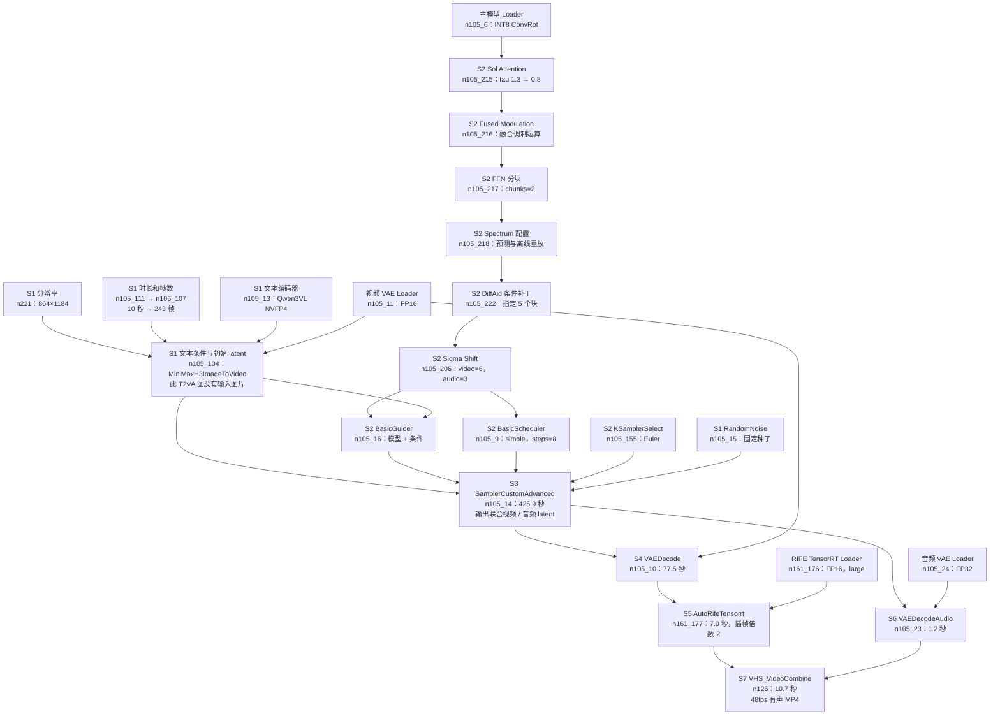
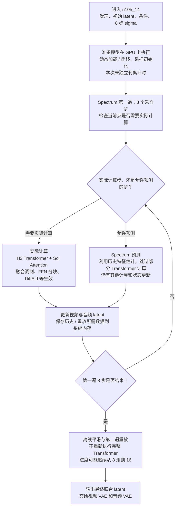

# MiniMax H3 服务器执行流程与耗时

用于逐项分析和调优。阶段编号 **S0–S8** 在流程图、耗时表和调优表中保持一致。

## 1. 阅读范围与测量口径

本文描述 `veo-comfyui` 上的 **T2VA：文字生成有声视频**，以 2026-09-12 已完成的服务器对照测试为基线，不代表每次请求都固定耗时。图片输入、首尾帧、参考视频等工作流需要分别测量，不能直接套用本表。

| 项目 | 本次基线 |
|---|---|
| 服务器 | `ssh veo-comfyui`；ComfyUI 监听 8188 |
| 硬件 | RTX 3090，24GB 显存 |
| 运行环境 | ComfyUI 0.34.6；PyTorch 2.10.0+cu130 |
| 请求 | 篮球场景，10 秒，864×1184，8 步，Euler / simple |
| 生成与输出 | 243 张原始帧；RIFE 补 242 张；最终 485 帧、48fps、10.104 秒 |
| 视频主模型 | `10Eros_Max_h3_TURBO-hybrid_beta3_int8_convrot_skip_edges.safetensors` |
| 文本编码器 | `qwen3vl_32b_heretic_minimax_h3_nvfp4.safetensors` |
| 视频 / 音频 VAE | `minimax_h3_video_vae_fp16.safetensors` / `minimax_h3_audio_vae_fp32.safetensors` |
| 基线种子 | `833238321491843` |
| ComfyUI prompt ID | `b67c0185-63fe-41a5-8907-66cea549d851` |
| 服务执行耗时 | **522.641 秒，约 8 分 43 秒** |

**计时边界：**522.641 秒从服务器 `execution_start` 到 `execution_success`，不包含本机准备、请求传输、排队、结果轮询延迟和浏览器播放缓冲。本次文本条件命中缓存，**没有测得重新编码一条新提示词的独立耗时**。

节点耗时来自 WebSocket 相邻 `executing` 事件；它包含节点内部加载、缓存管理和回调，不等同于纯 GPU 内核时间。本文的“未单测”“缓存命中”“约数”不能视为精确计时。

## 2. 整体请求流程：哪里执行、在哪里等待

图中 S4→S5→S6 是**本次观测到的执行顺序**。逻辑上视频解码和音频解码都依赖 S3，音频解码不依赖插帧；依赖关系见下一图。这不表示两条分支在当前单 GPU 服务中并行运行。

模型加载分两层：Loader 节点建立模型对象／读取权重，实际使用时 ComfyUI 还可能动态把权重放入 GPU。因此“Loader 命中缓存”不等于后续没有加载或显存迁移成本。

## 3. 数据与模型依赖图

这张图回答“每个节点的输入来自哪里”，不是按图中横向位置计算耗时。

### 图里哪些节点不应被重复计时

- Sol、Fused Modulation、FFN、Spectrum、DiffAid、Sigma Shift 是模型补丁／配置链。它们对计算的影响主要在 **S3 内部生效**，不是各自再跑一次完整视频模型。没有测得它们各自占用多少 GPU 时间。
- `n105_91 CreateVideo` 虽然存在于模板，但其输出没有接入本次最终输出链；本次运行没有执行该节点，**不能再加一段“24fps 视频编码时间”**。
- `n224 WildcardProcessor` 没有连接到本次输入提示词，完整对照已去掉该孤立节点；它没有参与这次生成。
- `n137 easy showAnything` 只是辅助显示节点。本次耗时约 0.314 秒，不进行模型推理。
- 输入时长通过公式对齐到模型支持的帧数：`240 + (5 - 240 % 17) % 17 = 243`。RIFE 在相邻帧之间插入一帧，因此 `243 + 242 = 485`，输出时长为 `485 / 48 ≈ 10.104` 秒。

## 4. 最大耗时 S3 内部到底做了什么

**B–J 合计已包含在 425.855 秒中。** 第一遍进度 8/8 的日志时间为 03:13:48.900 UTC，视频解码节点开始约 03:14:05.316 UTC，间隔约 16.4 秒；这是含重放与收尾的时间窗口，不是纯重放内核计时，也不能再加到 425.855 秒之外。

当前配置：`warmup_steps=1`、`tail_actual_steps=1`、`history_storage=system_ram`、`offline_archive_storage=system_ram`、`offline_smoothing_replay=true`。实际计算与预测步的精确分配未独立记录，不能把 8 个采样步当成 8 个等长的完整 Transformer 前向。

所以，界面显示 16 不等于当前配置是 16 个完整推理步；当前 `BasicScheduler.steps` 已经是 **8**。改为 4 后，实际计算步的数量和占比也可能变化，不能保证 S3 恰好减半。

## 5. 单次执行时间线与作用

以下是基线的观测顺序；区间从 `execution_start` 起算，四舍五入到毫秒。WebSocket 与服务器 history 时间存在毫秒级差异。

| 阶段 | 时间区间（秒） | 耗时 | 占总耗时 | 作用与资源 |
|---|---:|---:|---:|---|
| S0 接收、排队 | 不在本计时内 | 未单测 | — | 网络/API/队列；等待 GPU 执行机会 |
| S1/S2 准备与辅助节点 | 0–0.459 | 约 0.46 秒 | 约 0.1% | 本次大量上游缓存命中；包含辅助输出和少量 Loader 工作，**不是冷启动耗时** |
| S3 联合采样 | 0.459–426.314 | 425.855 秒 | 81.5% | GPU 主计算，同时存在 CPU 内存历史存储和权重调度；生成视频与音频 latent |
| S4 视频 VAE | 426.314–503.861 | 77.547 秒 | 14.8% | GPU 解码，将压缩的 latent 转为真实像素帧 |
| S5 RIFE | 503.861–510.812 | 6.951 秒 | 1.3% | TensorRT 插帧，提高播放帧率和平滑度，不增加基础模型生成的独立内容 |
| S6 音频 VAE | 510.812–511.974 | 1.162 秒 | 0.2% | 从联合 latent 解码音频波形 |
| S7 MP4 输出 | 511.974–522.643 | 10.669 秒 | 2.0% | 视频压缩、音频编码、封装及服务器文件写入；各子项未单测 |
| S8 返回结果 | 成功后 | 未单测 | — | 写入 history；本机查询输出信息，浏览器访问媒体 URL |

**S3 + S4 占约 96.3%。** 即使把 S5、S6、S7 全部假设为零，最多也只省约 18.8 秒，而且会失去必要的输出处理。这说明逐项调优应先关注 S3 和 S4。

## 6. 两种“INT8”和调优旋钮分别在哪里

| 调整项 | 所在位置 | 改变什么 | 当前状态 / 已知限制 |
|---|---|---|---|
| 主模型 INT8 → INT4 / W4A8 | S1 `n105_6 UNETLoader` 及对应加载实现 | 权重格式、显存占用，以及适配内核后的计算路径 | 当前为 INT8 ConvRot。需要兼容的模型文件与实现；不是改一个布尔开关。尚未做本机 W4A8 对照 |
| 注意力 INT8 QK | S2 `n105_215.int8_qk`，计算发生在 S3 | 注意力 Q/K 的计算精度 | 默认 false；测试只将它改为 true，主模型权重没有改变 |
| 8 步 → 4 步 | S2 `n105_9.steps`，影响 S3 | 减少采样步数 | 尚未测 4 步；需评估蒸馏模型匹配、动作、画面细节和音频质量 |
| 降低分辨率 | S1 `n221`，影响 S3/S4/S5 | 减少每帧空间规模 | 当前 864×1184；涉及画面规格变化，不能作为同规格性能提升 |
| 缩短时长 | S1 `n105_111` / `n105_107` | 减少帧数，影响 S3/S4/S5/S7 | 当前 243 个生成帧；帧数按公式对齐，不是任意整数 |
| Sol tau | S2 `n105_215`，影响 S3 | 调整注意力近似策略 | 当前 1.3→0.8；单项耗时、质量影响未单测 |
| FFN chunks | S2 `n105_217`，影响 S3 | 调整前馈计算的分块方式 | 当前 2；显存与速度存在取舍，不能假定越小越快 |
| Spectrum 预测 / 重放 | S2 `n105_218`，影响 S3 | 用历史预测减少实际模型计算，并做离线重放 | 当前开启；关闭不是已证明的加速方案 |
| VAE 前卸载主模型 | S3→S4 边界 | 腾出显存，改变解码时模型共存状态 | 缓存 latent 对照 78.248→87.730 秒；本轮未见收益，未部署 |
| 去掉 RIFE | S5 `n161_177` 及输出帧率 | 取消插帧 | 直接节省约 7 秒，但输出帧率与封装参数必须一起匹配 |
| 编码参数 | S7 `n126` | 编码耗时、体积与画质 | 整个节点仅约 10.7 秒；内部细分未测 |
| GPU 功率 / 频率 | 跨 S3/S4/S5 | 改变实际 GPU 执行能力 | 本次功率上限 210–310W 波动，曾触发 SW Power Cap；控制方未确认 |

### 已完成的 INT8 QK 对照

| 指标 | 基线 | INT8 QK |
|---|---:|---:|
| S3 采样 | 425.855 秒 | 403.065 秒 |
| 整体服务器执行 | 522.641 秒 | 502.292 秒 |
| 平均功率上限 | 229.4W | 241.9W |

观测到总耗时减少 **20.349 秒（3.89%）**，但 INT8 组平均功率上限也更高，不能把差值全部归因于参数变化。交替合成内核测试显示约 13.42% 内核耗时下降，也不能直接代表完整视频收益。完整方法、限制和测试 ID 见 [性能对照报告](implement/h3-performance-2026-09-12.md)。

## 7. 网络失败与“重新生成”在哪里分开

这一部分发生在服务调用边界，不是 S3 的采样步。

- **已经取得 prompt_id：**网络请求失败后恢复时继续查原 `prompt_id`。HTTP 超时不证明 GPU 任务失败，不应直接重新提交。
- **POST 已发出但返回丢失：**本机保留“提交中”记录，通过 `/queue` 与 `/history` 中的 `elysium_job_id` 找回原任务；无法确认时停止，不盲目重复 POST。
- **服务器明确执行失败：**只有进入针对失败任务的恢复路径，才可能提交新的服务器执行；本机逻辑视频 `job_id` 与一次服务器执行的 `prompt_id` 是不同层次的 ID。
- 当前客户端正常情况下每次查询后等待约 2 秒，再轮询 history／queue；请求本身也有耗时。页面显示的完成时间可能晚于服务器 `execution_success`。
- 有限自动重连最多 5 次，退避为 2、4、8、16、30 秒。它增加的是连接恢复等待，不应增加新的逻辑视频卡片。

因此，“网络慢”“排队慢”“GPU 采样慢”“页面迟迟没更新”必须分别计时。网络加速不能直接缩短已经在服务器 GPU 上运行的 S3。

## 8. 逐项调优的讨论顺序与验证标准

1. **先建立可比较的基线。**记录 GPU 功率上限、频率、温度、队列以及缓存状态；功率无法固定时，用交替顺序和多次样本报告波动，不承诺固定收益。
2. **S3-A：8 步与 4 步。**先固定权重、种子、提示词、分辨率与时长，只改步数；同时比较动作、细节、时序稳定性和声音。若需要换四步蒸馏权重，应另列实验，不能算成单纯步数对照。
3. **S3-B：INT8 与 W4A8 权重。**固定步数及其他设置，只换兼容权重／加载路径，记录峰值显存、采样耗时、加载耗时和画面质量。先核实支持，不直接替换线上默认模型。
4. **S4：视频 VAE。**先查首次解码与缓存重复解码的差异；本次卸载实验不足以证明所有场景都无效，但没有依据直接加入默认流程。
5. **最后组合有效项。**先证明单项收益，再测组合。不能将单项百分比相加，也不能将 INT4 和四步各自假定为两倍而宣称四倍提速。

每轮记录：原参数、新参数、服务器 prompt_id、S3/S4/S7 耗时、总时间、功率条件、缓存命中项、输出规格和质量结论。修改默认配置前应有能复查的对照结果。

## 9. 代码与原始证据入口

| 内容 | 入口 |
|---|---|
| T2VA 模板、节点连线及默认参数 | [`t2va.json`](../dsh-elysium-tools/src/workflows/templates/minimax-h3/t2va.json) 中的 `graph`、`workflow`、`bindings` |
| 从 RunPod 同步工作流 | [`sync_runpod_video_workflows.py`](../dsh-elysium-tools/scripts/sync_runpod_video_workflows.py) |
| 本机执行、重连及状态记录 | [`video-execution.js`](../dsh-elysium-tools/src/workflows/video-execution.js) |
| 准备原工作流、提交和等待 | [`comfy-execution.js`](../dsh-elysium-tools/src/workflows/comfy-execution.js) |
| 原任务找回与提交去重 | [`comfy-submission.js`](../dsh-elysium-tools/src/jobs/comfy-submission.js) |
| API、参数校验、轮询和媒体 URL | [`client.js`](../dsh-elysium-tools/src/functions/comfyui/client.js) |
| 实测方法和各对照 ID | [性能对照报告](implement/h3-performance-2026-09-12.md) |
| 服务器原始测量 | `/tmp/h3-perf-20260912/` 下的 `full_bf16.json`、`full_int8_qk.json`、`summary.json`、`gpu.csv`；临时目录可能被清理 |

本文只整理流程及已有测量，**没有修改服务器、模型或工作流默认参数，也没有启动新的生成任务**。
