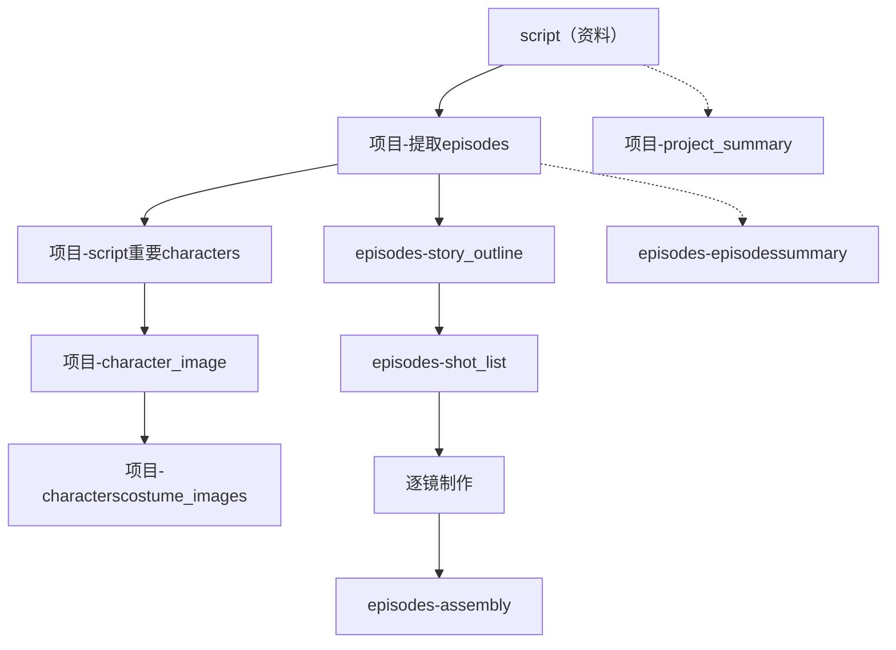
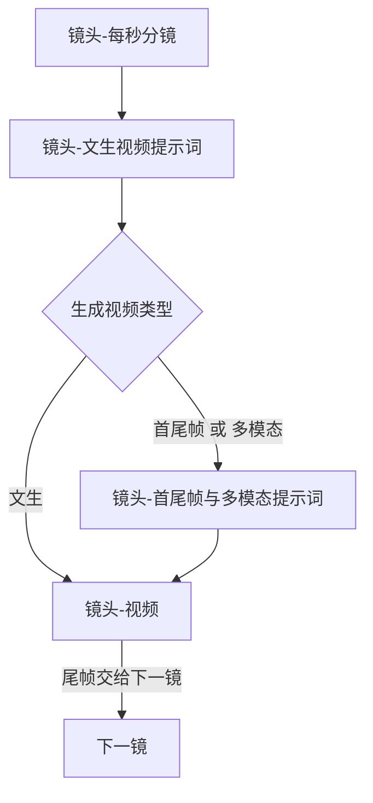

# 制作工作流

从剧本到成片的顺序，以及多个任务如何编组。单个节点的前置条件、生成、返回、保存和下游检查在 [dots](dots/) 对应文件里。字段和状态以 [项目数据结构](项目数据结构.md) 为准；任务轮次和终态以 [任务步骤](任务步骤.md) 为准。

一个业务节点对应一个任务。角色定妆照除外，见下方任务组。

## 主路径

提取剧集之后分成两条：一条做人物和图片，一条按集往下做到合片。项目摘要、剧集摘要不挡住主路径。

虚线是旁路，不挡住实线。多模态视频要用到角色图和本镜服装的定妆照，这两张图没好时，该镜不能按多模态出视频。

## 逐镜

按镜头顺序做。后一镜的视频用前一镜尾帧作为开头画面。尾帧不是独立节点。

类型在进入提示词编排前由程序判定。`文生` 跳过编排，直接用文生视频提示词。`首尾帧` 和 `多模态` 先由程序编好对应提示词，再生成视频。

视频和尾帧是同一个任务：生成视频之后，程序截取并校验尾帧。两个都成功才保存并完成；任一步失败，这一镜的新视频和尾帧都不提交。

## 任务组

角色定妆照按角色编成一组。组内每套服装一个任务，任务数等于该角色 `服装[]` 的条数。每个任务一次图片请求、一张图、只保存自己那一套，做法见 [项目-角色定妆照](dots/项目-角色定妆照.md)。

某个任务失败时，不写入该套新图，也不检查该套下游。尚未执行的后续任务作废。已经成功并保存的定妆照保留。

## 节点文件

| 层级 | 节点 | 谁来做 |
|---|---|---|
| 项目 | [项目-提取剧集](dots/项目-提取剧集.md) | AI 定切点，程序按原文拼接 |
| 项目 | [项目-剧本重要角色](dots/项目-剧本重要角色.md) | AI |
| 项目 | [项目-角色图](dots/项目-角色图.md) | AI |
| 项目 | [项目-角色定妆照](dots/项目-角色定妆照.md) | AI，一个角色一个任务组 |
| 项目 | [项目-项目摘要](dots/项目-项目摘要.md) | AI，不挡主路径 |
| 剧集 | [剧集-故事大纲](dots/剧集-故事大纲.md) | AI |
| 剧集 | [剧集-镜头表](dots/剧集-镜头表.md) | AI |
| 剧集 | [剧集-合片](dots/剧集-合片.md) | 程序 |
| 剧集 | [剧集-剧集摘要](dots/剧集-剧集摘要.md) | AI，不挡主路径 |
| 镜头 | [镜头-每秒分镜](dots/镜头-每秒分镜.md) | AI |
| 镜头 | [镜头-文生视频提示词](dots/镜头-文生视频提示词.md) | AI |
| 镜头 | [镜头-首尾帧与多模态提示词](dots/镜头-首尾帧与多模态提示词.md) | 程序；文生类型跳过 |
| 镜头 | [镜头-视频](dots/镜头-视频.md) | AI 生成，程序截取尾帧 |
