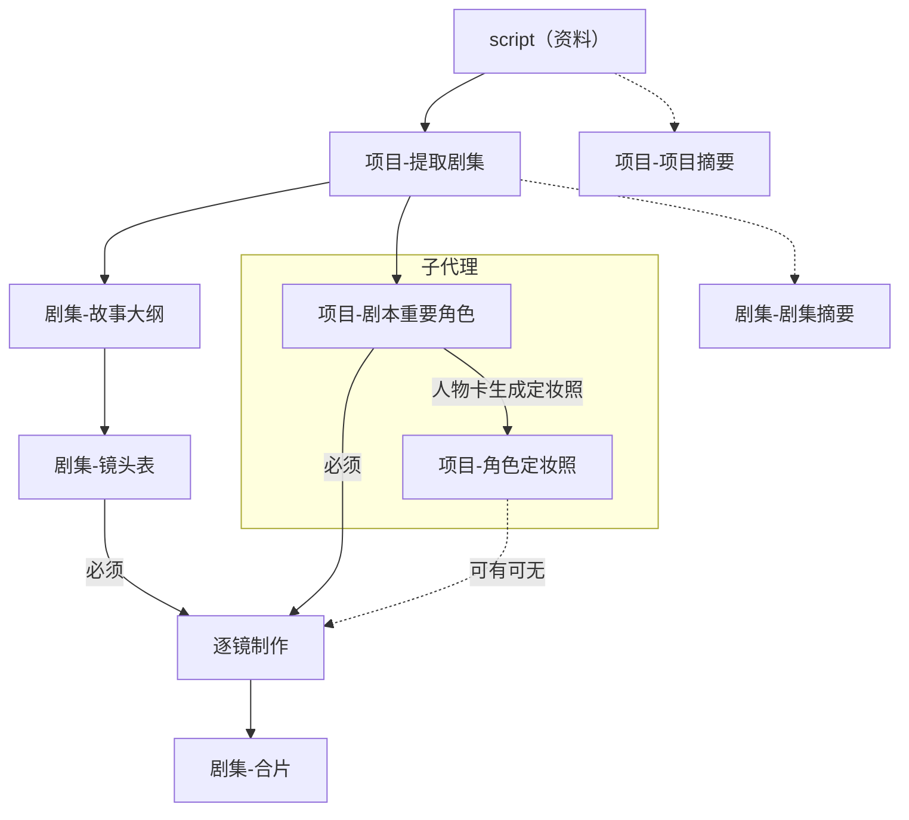
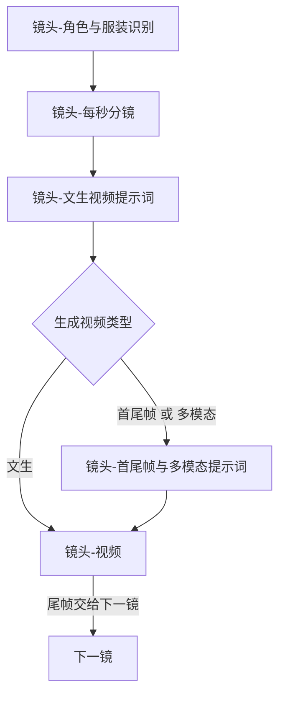
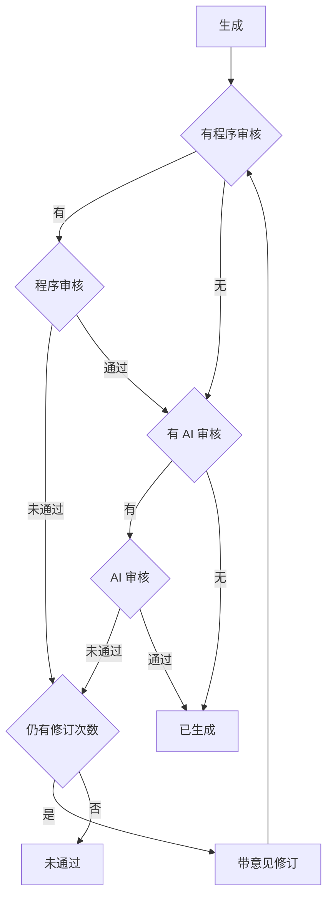

# 制作工作流

从剧本到成片的顺序，以及多个任务如何编组。

## 文档

`dev_docs` 是文档依据，每类文档只记一件事。程序以 [shared/models](../shared/models/) 里的 Model 为依据，按 Model 的字段读写项目、任务组、任务、步骤和节点。两边的字段名和结构保持一致。

文档里改了项目 JSON、任务、任务组、步骤或节点的字段，同一轮改对应 Model。每个 AI 节点在 [节点路由契约](../server/http/nodes/) 定义生成、审核、修订的输入参数及输出格式；[PromptModel](../server/prompts/models/) 保存需要渲染的角色和各动作要求；参数编排直接放在对应节点的 `compose` 中。视频复用已审核三段，由 [video-request.js](../server/http/video-request.js) 做程序编排，不保留未使用的 PromptModel。[render.js](../server/prompts/render.js) 负责公共渲染。输出格式只在路由契约定义，渲染与响应校验共同引用。调用方不传提示词、输出格式或整个项目对象。

HTTP 和任务流程共用 [ai-routes.js](../server/http/ai-routes.js) 的节点执行入口。它读取一次当前模型配置，按来源编排并调用对应 HTTP 单例；切换模型不改变节点输入和输出契约。历史保留当次业务参数、所选模型、实际提示词和脱敏传输记录。

| 文档 | 作用 |
|---|---|
| 本文 | 制作顺序、任务编组、面板按钮 |
| [project_detail.json](project_detail.json) | 项目保存哪些字段。节点内容的字段以这份为准 |
| [step_model.md](step_model.md) | 任务组、任务、步骤的字段和状态。各节点的状态在 `node_state` |
| [dots](dots/) | 每个节点一篇：前置条件、生成或执行规则、返回结构、保存到哪个字段、下游检查 |
| [节点路由契约](../server/http/nodes/) | 各动作输入与输出的唯一代码定义；没有 AI 审核的节点不提供审核动作 |
| [PromptModel](../server/prompts/models/) | 文本/图片节点的角色和生成、审核、按意见重新生成要求 |

`dots/`、节点路由契约和 PromptModel 按节点对应，这里不逐篇说明。节点索引在文末「节点文件」。

### 修改路径

1. 改顺序、编组或按钮：改本文。增删节点时，在 `dots/` 补上或去掉那一篇，并改 `step_model.md` 的组类型和节点位置。
2. 改项目字段：先改 `project_detail.json`，同一轮改 `shared/models/` 里该字段所在的 Model。节点有增减时，同步 `step_model.md` 的节点位置。再改 `dots/` 里用到该字段的依赖资料和数据保存。返回结构跟着变时，最后改该节点的路由输出契约，并同步 PromptModel、参数编排及任务输入提取。
3. 改任务、步骤、组或状态：先改 `step_model.md`，同一轮改 `task_group_model.js`、`task_model.js`、`step_model.js`。按钮或任务组的说法有变时，再改本文。
4. 改某一个节点怎么做：改 `dots/` 里对应那一篇。保存用的字段以 `project_detail.json` 和对应 Model 为准；字段有增减时先走第 2 步。返回结构有变时，再改该节点的路由输出契约，并同步 PromptModel、参数编排及任务输入提取。制作顺序有变时同时改本文。
5. 改提示词结构编排：改该节点的 PromptModel 和节点文件中的参数编排；输入参数变化同步节点路由契约及任务输入提取，输出变化只改路由输出契约。只改措辞时改 PromptModel；公共渲染变化才改 `render.js`。

一个业务节点对应一个任务。一次提交多步时，按下方任务组顺序排进同一组。

## 主路径

提取剧集之后，故事大纲、镜头表、逐镜、合片是主线。剧本重要角色和定妆照放在同一个子代理里：子代理内部先提取角色，再按人物卡生成定妆照。进入逐镜时，镜头表和剧本重要角色必须已有；定妆照可有可无。项目摘要、剧集摘要不挡住主路径。

实线是必须交给下一节点的正式结果。虚线不挡住进入逐镜。多模态视频在已有定妆照时使用：本镜有明确服装时用该服装的定妆照；角色 `costumes` 为空时用 `costume_id` 为空的未绑定定妆照。没有定妆照时逐镜仍可进行；该镜不能按多模态出视频。

故事大纲通过审核并正式保存后，小段时长总和（保留小数秒）回写剧集参考时长，再更新依赖状态；镜头表生成与程序审核以此为基准。未通过候选不改参考时长。人工编辑成功及人工放行通过程序审核后也同步回写。

## 逐镜

按镜头顺序做。先识别本镜已有角色与服装，再生成每秒分镜和文生提示词；三者都要求有效角色库，文本不要求定妆照。识别可参考上一镜有效绑定；没有参考时独立识别，不阻断识别任务。每秒分镜非首镜必须读取上一镜有效且已审核的结束状态、未完成动作、未结束对白、持续声音与末尾完整节拍；前镜无效时阻断该镜每秒任务。详细交接在每秒阶段产出，镜头表仅保留总体衔接意图。前镜交接变化使后镜每秒分镜及相关下游过期；明确换场由本镜剧情决定继承范围。只有生成视频类型为 `首尾帧` 时，后一镜用前一镜尾帧作为开头画面。`文生` 和 `多模态` 不用上一镜尾帧开场。尾帧不是独立节点；每条视频仍截取尾帧，供后面的首尾帧镜头使用。

类型在视频任务即将执行、上游识别和文本已有效完成后判定并写入；不会在受理时把尚未识别的空数组当作无人。程序在同一事务把适用编排插入同组视频之前，调整尚未开始任务的顺序。缺图不改类型，停止后可补图继续；继续重新判型，不复制旧类型编排任务。`文生` 跳过编排，直接用文生视频提示词。`首尾帧` 和 `多模态` 先由程序编好对应提示词，再生成视频。

视频和尾帧是同一个任务：生成视频之后，程序测量实际时长并截取、校验尾帧。视频生成、文件读取或尾帧截取失败时按失败处理、不覆盖旧结果。成片可用后做程序审核：实测时长超出该节点误差时长时，带原因修订；修订次数用尽后保留最后一轮视频和实测时长，节点进入未通过，不更新下游。时长与尾帧都通过后才标为已生成。

## 审核

生成之后先做程序审核，再做 AI 审核。时长只在程序审核里判定，允许的差值是该节点的误差时长。本节点没有对应审核时，这一步跳过。误差时长和重试轮次写在各节点文档开头。节点文档中的“重试轮次 N”指首次生成之后最多再修订 N 次；首次生成也计入总生成次数，因此最多生成 N+1 轮。程序审核和 AI 审核共用同一个修订次数，不分别累计。

程序审核或 AI 审核未通过，且仍有修订次数时，把原因作为修改意见，带原内容重新生成，再从程序审核做起。修订次数用尽仍未通过，才保留最后一轮产出，节点进入未通过，不更新下游。两步都通过才标为已生成。没有产出的前置检查、接口或解析错误仍是失败，不覆盖节点内容。

## 任务组

一个任务组对应面板上的一次提交。组里任一任务失败、未通过或取消，后面还没执行的任务也记为已取消。已经成功并保存的结果保留。项目摘要、故事大纲、镜头表各自独立提交，每次创建 `single` 组。项目摘要不挡住主路径。`episode-seconds` 只保留单项和历史任务，面板不再单独成组；接口提交 `episode-seconds` 时逐镜安排识别→每秒分镜；面板通过成片组执行。

### 提取剧集

1. [项目-提取剧集](dots/项目-提取剧集.md)：一个任务，确定各集切点并写入剧情。
拆分成功并写入剧情后本任务组完成，不自动创建或调用每集摘要任务。剧集摘要保留独立操作，不属于拆分流程。剧集卡使用节点标题栏：没有剧集时是 AI生成，已有剧集时是重新生成，旁边是任务历史；排队或生成中改为取消。本次执行意见只留在当前页面，随本次拆分提交；任务成功后清空，失败或未通过时保留，刷新后消失。空意见不写入提示。

### 提取人物角色

1. [项目-剧本重要角色](dots/项目-剧本重要角色.md)：一个任务。

提取只保存人物及服装资料，不派生图片。项目详情里这是一张文本节点卡，标题为提取人物，下面是人物格子（头像和名字，点进详情）。格子上没有节点标题栏，这张卡也不提供继续。首次生成和重新生成使用同一提示词，只按剧本提取，不提交已有角色库。保存时按姓名合并，未返回的旧角色不删除。本次返回的角色不再保留定妆照地址，图片槽位清空；未返回角色的定妆照不动。用过这些照片的视频先标为已过期。

### 人物定妆照

项目详情在提取人物卡后面单独放一张生成定妆照组卡，不重复人物格子。点生成定妆照为全部人物各建一组，按服装数组顺序逐套生成。人物详情页仍可只生成该人物。一套服装一次图片请求；无服装资料生成一张未绑定服装定妆照，不补写服装资料。

第一套定妆照作为默认人物角色图，不保存独立角色图节点。首套可选用户参考图；后续各套以首套定妆照为唯一参考。没有指定服装的视频引用默认图；指定服装的视频引用对应定妆照。首套变更使后续定妆照及实际引用视频过期。

组中途失败、未通过或取消，后续任务记为已取消；组卡片上的“继续”从停点建立新组，保留已有图片和旧任务记录。任务历史列表和任务组详情只展示，不放继续，也不放取消。详情只保留查看提示词、查看 HTTP 和复制。生成补齐无效图，重新生成重跑全部服装。

### 成片

按该集镜头表顺序，为每个镜头依次编排以下任务；每个节点各对应一个任务：

1. [镜头-角色与服装识别](dots/镜头-角色与服装识别.md)
2. [镜头-每秒分镜](dots/镜头-每秒分镜.md)
3. [镜头-文生视频提示词](dots/镜头-文生视频提示词.md)
4. [镜头-首尾帧与多模态提示词](dots/镜头-首尾帧与多模态提示词.md)。生成视频类型为文生时不建这一任务。
5. [镜头-视频](dots/镜头-视频.md)。尾帧在这个任务里截取，不是独立任务。

后一镜只有在生成视频类型为 `首尾帧` 时才用前一镜尾帧作为开头画面。多模态使用对应定妆照：有明确服装时使用本镜服装的定妆照；角色 `costumes` 为空时使用 `costume_id` 为空的未绑定服装定妆照。

成片组默认 `action: generate`，只补齐未有效完成的节点；判断是否可跳过时，也要考虑本组前面重新生成会使后面失效。`action: regenerate` 重跑所选镜头的逐镜节点。`shot_id` 只限制逐镜生成范围，不代生成其他镜头。

所选逐镜任务全部完成后，若本集所有镜头视频均有效，且本集没有其他未结束的成片组任务，则在最后完成的成片组末尾追加唯一的 [剧集-合片](dots/剧集-合片.md) 任务；已有合片有效且依赖未变时不重复生成。不同单镜组可以按序排队，较早完成的组不抢先合片。即使只选一镜，其他镜头已齐备也可合片；其余视频未齐时，本组完成，不合片。重复请求不重复派生，其他组已有的合片任务不能被挪入本组。合片失败后继续，新组只重建合片，不重跑已完成的视频。

## 项目执行状态

项目不存储暂停开关。任务管理器 `current(model)` 从历史任务中筛选 queued/running 并按 queue_order 排序，得到当前任务数组；有 running 为运行中，只有 queued 为待执行，数组为空为空闲。这些状态按需推导，不写入项目 JSON 或单独持久化。

没有运行执行槽时自动调度队首，面板与会话提交一致。取消一次性将本项目全部未结束任务/步骤结算为已取消，中止当前请求，保留历史和已有内容，当前数组自然清空。新提交等待旧请求退出后自动执行，迟到结果不得写回。执行失败或审核耗尽未通过时保留当前任务真实状态与原因，剩余排队任务全部取消；其他项目不受影响。删除 start-queued/remove-queued 命令。

数据库 v14 删除 projects.queue_stopped 列，保留项目、任务、步骤、幂等与通知记录；启动恢复取消遗留未结束任务。runtime 中 revision、requests、outbox 仍属持久化事务/通知元数据，不控制是否调度。

## 任务状态与操作按钮

面板顶部导航在“片库”前展示 GPU 利用率，格式为“GPU：30%”，首次打开立即读取，页面可见时每 5 秒更新一次；页面隐藏或卸载暂停查询，恢复可见立即更新。数据来自 llm-server 的远端 GPU 采样，不从项目任务状态推测。查询总时限为 60 分钟（在途不重复发起），查询失败显示“GPU：暂不可用”，设备不支持利用率时显示“--”，不把错误当成 0%。

状态取值见 [step_model.md](step_model.md)。节点状态没有排队中。该节点已有排队或生成中任务时，不再显示生成类按钮。

### 任务组

状态不单独存储，按组内任务计算：未通过、失败、已取消优先，并显示该任务的原因；否则有生成中就是生成中，有排队中就是排队中；全部已通过就是已通过。旧的已作废记录也显示已取消。

组标题栏：状态和操作按钮同一排，下面是失败或未通过的节点原因。没有本次执行意见。状态不放在卡片标题旁。

| 按钮 | 何时出现 |
|---|---|
| 一键生成 | 这一组还没有结果 |
| 重新生成 | 已有结果，再跑整组；文本首轮不带上次结果 |
| 继续 | 组中途停下，且尚未全部完成。从停下的任务起新建一组，已完成的不进入新组。停在未通过时，这一任务带上对应节点的未通过原因 |
| 取消 | 组内有排队或生成中的任务。一次点选取消当前项目全部运行中和排队任务 |
| 任务历史 | 始终可看 |

### 任务节点

数据状态读项目，仅有未生成、已生成、未通过、已过期。数据状态放在卡片标题右侧，留出间距，用带背景和边框的标签显示状态名，不写“数据状态：”。操作按钮和“最新任务：…”同一排，按钮在左，任务文字在最右。这一块状态区上下留 12px，不留左边距，最新任务右边留 16px；优先当前关联任务，否则使用数据库最近记录，从未执行则不显示这行文字。任务失败在同一行追加“，原因：…”。下一排是本次执行意见，再下一排仅在有未通过原因时显示。入队、开始、失败、取消均保留原数据状态和审核原因。没有内容时按钮是 AI生成，已有内容时是重新生成。

App 重新加载时暂不承接旧执行：首次读取当前项目后，通过任务取消命令结算全部运行中和排队任务，先保存项目节点为已取消、保留已有内容，再读取 Model 渲染；旧请求中止，晚到结果不得写回。取消失败时显示错误，不在浏览器伪造节点状态。该处理每次挂载只成功执行一次，普通数据刷新、事件通知和后台标签恢复可见不取消新任务。当前队列清空，任务历史保留。服务端支持任务缓存和恢复后再调整此策略。

程序审核或 AI 审核在修订次数用尽后仍未通过时，保留本轮候选内容并正式写入对应节点；节点进入未通过，原因写入 `node_state.reason`，任务结束原因也记录该原因。本节点保留原成功 hash，不主动更改下游状态、hash 或媒体。重新提交时把节点原因作为修改意见带入新任务及其模型输入。只有一份正式内容，新任务仍按执行时的资料判断前置有效性，依赖已变化时说明阻断原因，不回退历史正文。无产出的前置检查、接口或解析错误按失败处理，不覆盖节点内容。`项目-提取剧集` 是项目级 AI 任务，由 AI 生成切点、程序审核并拼接原剧本；它没有持久化项目节点，因此未通过原因和候选记录在任务历史，不写项目 `node_state`，也不替换现有剧集。

节点标题栏：标题右侧是数据状态标签。操作按钮与最新任务同一排，然后是本次执行意见，再是未通过说明。本次执行意见只留在当前页面，任务成功后清空，刷新后消失，不写入节点。项目摘要和本集摘要没有人工编辑、人工放行。合片、首尾帧和多模态是程序任务，只保留对应生成按钮和任务历史，不放意见框。尾帧画在视频卡里，当作步骤，不用这套标题栏；失败时显示重新提取，用已有视频重新截帧。

| 按钮 | 何时出现 |
|---|---|
| AI生成 | 还没有内容 |
| 重新生成 | 已有内容 |
| 原结果修订 | 文本节点已有结果、没有排队或运行任务时显示；未通过时默认带入原因。非空意见写在新任务上，多轮 assistant 带上次完整结果 |
| 人工编辑 | 文本改内容；图片和视频改为导入文件。项目摘要和本集摘要不提供 |
| 人工放行 | 仅未通过。跳过 AI 审核，结构和本节点程序审核仍须通过；成功后改为已生成，原因清空。项目摘要和本集摘要不提供 |
| 取消 | 生成中或排队中；停止当前项目全部未结束任务 |
| 任务历史 | 始终可看 |

### 步骤

状态为等待中、执行中、完成、未通过、失败、已跳过、已取消。程序审核或 AI 审核未通过时，这一步显示未通过，原因用审核原因。所有步骤结果默认收起展示两行，展开显示全文。起止时间、未通过/失败原因、查看提示词和查看 HTTP 入口始终展示；复制结果与复制原因分别复制完整内容。旧的已作废步骤也显示已取消。

| 按钮 | 说明 |
|---|---|
| 收起 / 展开 | 仅切换步骤结果的两行预览与全文，其他信息固定展示 |
| 提示词 | 打开本次提示词，可复制。没有提示词时说明没有 |
| 查看 HTTP | 请求发出后即可查看请求，返回后可查看响应；多次调用可切换 |

## 节点文件

| 层级 | 节点 | 谁来做 |
|---|---|---|
| 项目 | [项目-提取剧集](dots/项目-提取剧集.md) | AI 定切点，程序按原文拼接 |
| 项目 | [项目-剧本重要角色](dots/项目-剧本重要角色.md) | AI |
| 项目 | [项目-角色定妆照](dots/项目-角色定妆照.md) | AI，在人物卡单独提交的定妆照组内，每套明确服装一个任务；服装数组为空时，仍有一个未绑定服装的定妆照任务 |
| 项目 | [项目-项目摘要](dots/项目-项目摘要.md) | AI，不挡主路径 |
| 剧集 | [剧集-故事大纲](dots/剧集-故事大纲.md) | AI |
| 剧集 | [剧集-镜头表](dots/剧集-镜头表.md) | AI |
| 剧集 | [剧集-合片](dots/剧集-合片.md) | 程序 |
| 剧集 | [剧集-剧集摘要](dots/剧集-剧集摘要.md) | AI，不挡主路径 |
| 镜头 | [镜头-角色与服装识别](dots/镜头-角色与服装识别.md) | AI |
| 镜头 | [镜头-每秒分镜](dots/镜头-每秒分镜.md) | AI |
| 镜头 | [镜头-文生视频提示词](dots/镜头-文生视频提示词.md) | AI |
| 镜头 | [镜头-首尾帧与多模态提示词](dots/镜头-首尾帧与多模态提示词.md) | 程序；文生类型跳过 |
| 镜头 | [镜头-视频](dots/镜头-视频.md) | AI 生成，程序截取尾帧 |

## 当前接入进度

角色识别、逐秒文本、按类型程序编排及视频内尾帧处理已接入。视频前按实际识别结果确定类型，文生不创建编排任务；多模态缺图则停止等待补图，文本可完成。角色子代理仍是后续阶段。视频阶段不迁移或清空项目数据。

### 文本提示词编排

生成、重新生成与审核使用 system/user；重新生成首轮只带当前资料及本次要求，不带旧结果。原结果修订提交独立 revise 动作，使用 system → user（原始任务与资料）→ assistant（上一轮完整结果）→ user（本轮修改任务与意见）。同任务自动修订使用最近一次已完成生成或修订的原始返回；跨任务修改使用当前节点内容。基稿只在 assistant 出现一次，本轮意见只在最后 user。system 只保留规则、语言与输出格式，不再附加角色声明。提示词详情按实际 messages 顺序展示与复制；已有历史只读展示原记录。图片继续使用原生图片请求。

AI生成、重新生成、原结果修订都携带公共输入框的本次执行意见。原结果修订还由服务端合并节点未通过原因，弹窗内容不能移除该原因；已有相同完整原因时不重复追加。修订沿用四条消息，原结果放 assistant，原因与本次意见放最后 user。

### 项目本地JSON同步
项目创建或Model任意字段提交变化后，统一同步到 `projects/<项目ID>/project.json`，包括剧集参考时长、剧情、镜头和节点状态。该文件保存完整项目对象，不包含任务历史或模型连接配置；SQLite仍为权威数据来源。启动会补齐已有项目镜像，文件以临时文件原子替换，数据库事务失败不覆盖镜像；镜像写入失败明确报告，后续幂等重试或重启修复。

## GPT（Codex 套餐）文本来源

设置的文本模型增加 GPT（Codex 套餐），保存值为 `codex-gpt`。制作任务经 `textBaseUrl` 指向本地 llm-server，使用已通过 ChatGPT 登录的 Codex App Server；无需 CloudGPU。固定规则、语言与输出约束放入 developer；用户任务及意见在 user，背景资料在其末尾以 JSON 边界呈现。修订保持 user/assistant/user 的真实历史，重新生成不携带上次结果；节点规则与输出校验仍共用。

该选项只切换制作文本。左侧 Harness 工具会话保持此前配置，因为 Codex 制作桥接仅接受非流式文本，不承担 Harness 工具调用。切回其他文本模型时沿用原聊天同步行为。Codex 订阅登录、默认可用模型、取消与超时由 llm-server 负责，应用不保存 Codex 登录令牌。仅修改设置不会重新生成或覆盖项目内容。

图片模型可另选 GPT（Codex 套餐），保存值为 `gpt-image`。定妆照经同一个 `textBaseUrl` 调用 `POST /v1/images/generations`，使用占位密钥，不发送媒体网关密钥。接口的 `size` 固定为 `auto`，项目画幅 `1344x768` 与 `768x1344` 分别写入提示词为横版 16:9、竖版 9:16。参考图以 data URL 放入 `images`，最多 5 张；定妆照节点仍最多一张。返回的 PNG 在 `data[0].b64_json`。`elysium-image` 继续走媒体网关的像素尺寸。默认配置仍是 `elysium-image`。
