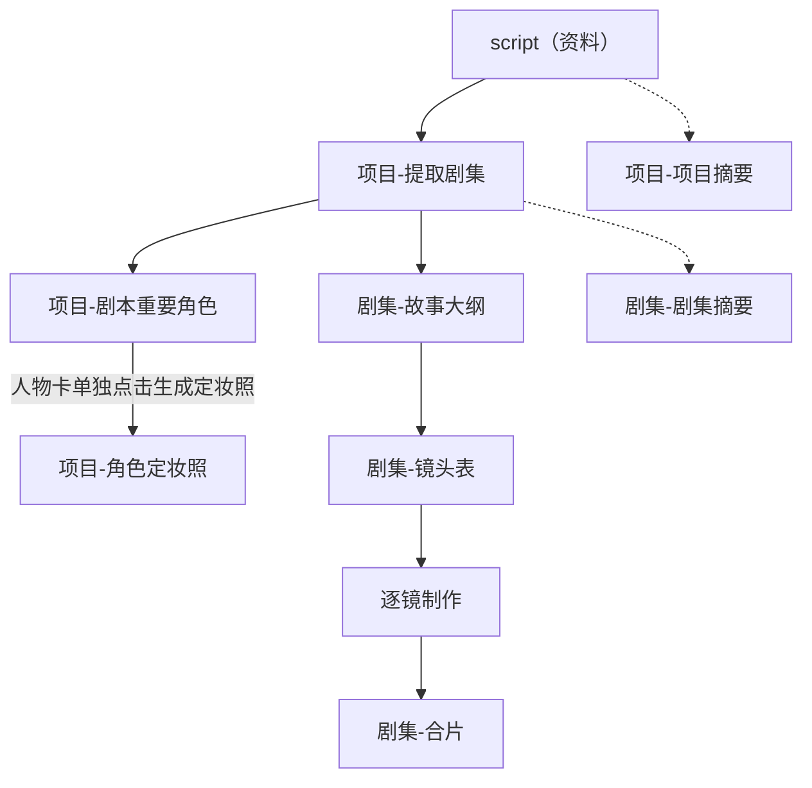
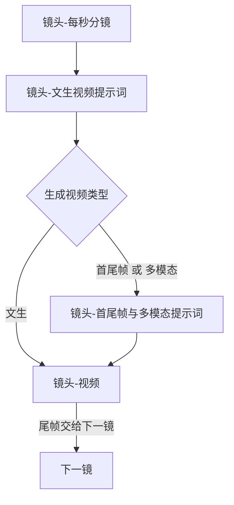
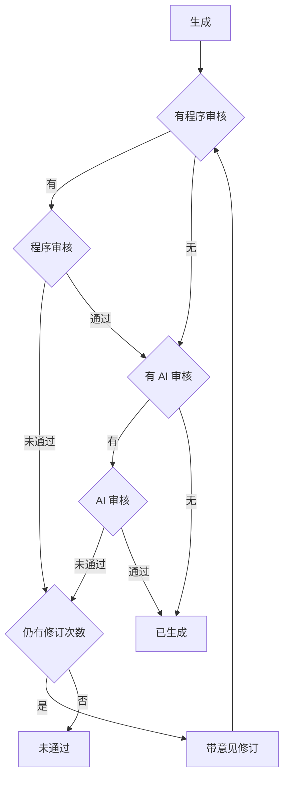

# 制作工作流

从剧本到成片的顺序，以及多个任务如何编组。

## 文档

`dev_docs` 是文档依据，每类文档只记一件事。程序以 [shared/models](../shared/models/) 里的 Model 为依据，按 Model 的字段读写项目、任务组、任务、步骤和节点。两边的字段名和结构保持一致。

文档里改了项目 JSON、任务、任务组、步骤或节点的字段，同一轮改对应 Model。`in_puts/` 里每个 AI 节点有自己的 YAML，这是该节点的提示词结构编排。[yaml-prompts.js](../server/prompts/yaml-prompts.js) 只加载、校验和渲染公共外壳，不保存单个节点的结构。改某个节点的占位或返回结构时，改该节点的 YAML，并改给它填占位符的程序：文本节点在 [text-handler.js](../server/handlers/text-handler.js) 的 `promptValues`，图片和视频在 [media-handler.js](../server/handlers/media-handler.js)。公共外壳变了才改 `yaml-prompts.js`。改规格时按下面的路径从前到后改，后面的文档沿用前面已经写定的名称和结构。

| 文档 | 作用 |
|---|---|
| 本文 | 制作顺序、任务编组、面板按钮 |
| [project_detail.json](project_detail.json) | 项目保存哪些字段。节点内容的字段以这份为准 |
| [step_model.md](step_model.md) | 任务组、任务、步骤的字段和状态。各节点的状态在 `node_state` |
| [dots](dots/) | 每个节点一篇：前置条件、生成或执行规则、返回结构、保存到哪个字段、下游检查 |
| [in_puts](in_puts/) | 提示词结构编排。生成、AI 审核、修订按节点分文件。模型返回结构分别对应节点文档中的生成返回结构或审核返回结构；没有 AI 审核的节点不要求审核返回结构 |

`dots/` 和 `in_puts/` 按节点对应，这里不逐篇说明。节点索引在文末「节点文件」。

### 修改路径

1. 改顺序、编组或按钮：改本文。增删节点时，在 `dots/` 补上或去掉那一篇，并改 `step_model.md` 的组类型和节点位置。
2. 改项目字段：先改 `project_detail.json`，同一轮改 `shared/models/` 里该字段所在的 Model。节点有增减时，同步 `step_model.md` 的节点位置。再改 `dots/` 里用到该字段的依赖资料和数据保存。返回结构跟着变时，最后改该节点的 `in_puts/` YAML，并改给它填占位符的程序。
3. 改任务、步骤、组或状态：先改 `step_model.md`，同一轮改 `task_group_model.js`、`task_model.js`、`step_model.js`。按钮或任务组的说法有变时，再改本文。
4. 改某一个节点怎么做：改 `dots/` 里对应那一篇。保存用的字段以 `project_detail.json` 和对应 Model 为准；字段有增减时先走第 2 步。返回结构有变时，再改该节点的 `in_puts/` YAML，并改给它填占位符的程序。制作顺序有变时同时改本文。
5. 改提示词结构编排：改该节点的 `in_puts/` YAML，并改给它填占位符的程序。只改措辞、占位符不变时，只改 YAML。公共外壳变了才改 `yaml-prompts.js`。

一个业务节点对应一个任务。一次提交多步时，按下方任务组顺序排进同一组。

## 主路径

提取剧集之后分成两条：一条做人物和图片，一条按集往下做到合片。项目摘要、剧集摘要不挡住主路径。

虚线是旁路，不挡住实线。多模态视频使用定妆照：本镜有明确服装时用该服装的定妆照；角色 `costumes` 为空时用 `costume_id` 为空的未绑定定妆照。所需图片没好时，该镜不能按多模态出视频。

## 逐镜

按镜头顺序做。只有生成视频类型为 `首尾帧` 时，后一镜用前一镜尾帧作为开头画面。`文生` 和 `多模态` 不用上一镜尾帧开场。尾帧不是独立节点；每条视频仍截取尾帧，供后面的首尾帧镜头使用。

类型在进入提示词编排前由程序判定。`文生` 跳过编排，直接用文生视频提示词。`首尾帧` 和 `多模态` 先由程序编好对应提示词，再生成视频。

视频和尾帧是同一个任务：生成视频之后，程序测量实际时长并截取、校验尾帧。视频生成、文件读取或尾帧截取失败时按失败处理、不覆盖旧结果。成片可用后做程序审核：实测时长超出该节点误差时长时，带原因修订；修订次数用尽后保留最后一轮视频和实测时长，节点进入未通过，不更新下游。时长与尾帧都通过后才标为已生成。

## 审核

生成之后先做程序审核，再做 AI 审核。时长只在程序审核里判定，允许的差值是该节点的误差时长。本节点没有对应审核时，这一步跳过。误差时长和重试轮次写在各节点文档开头。节点文档中的“重试轮次 N”指首次生成之后最多再修订 N 次；首次生成也计入总生成次数，因此最多生成 N+1 轮。程序审核和 AI 审核共用同一个修订次数，不分别累计。

程序审核或 AI 审核未通过，且仍有修订次数时，把原因作为修改意见，带原内容重新生成，再从程序审核做起。修订次数用尽仍未通过，才保留最后一轮产出，节点进入未通过，不更新下游。两步都通过才标为已生成。没有产出的前置检查、接口或解析错误仍是失败，不覆盖节点内容。

## 任务组

一个任务组对应面板上的一次提交。组里任一任务失败、未通过或取消，后面还没执行的任务作废。已经成功并保存的结果保留。项目摘要、故事大纲、镜头表各自独立提交，每次创建 `single` 组。项目摘要不挡住主路径。`episode-seconds` 只保留单项和历史任务，面板不再单独成组；每秒分镜排在成片组里。

### 提取剧集

1. [项目-提取剧集](dots/项目-提取剧集.md)：一个任务，确定各集切点并写入剧情。
拆分成功并写入剧情后本任务组完成，不自动创建或调用每集摘要任务。剧集摘要保留独立操作，不属于拆分流程。

### 提取人物角色

1. [项目-剧本重要角色](dots/项目-剧本重要角色.md)：一个任务。

提取只保存人物及服装资料，不派生图片。角色卡仅显示最新提取组状态；提取中途停止可继续。

### 人物定妆照

在每张人物卡点击“生成定妆照”，单独建立该人物的 workflow 组，按服装数组顺序逐套生成。一套服装一次图片请求；无服装资料生成一张未绑定服装定妆照，不补写服装资料。

第一套定妆照作为默认人物角色图，不保存独立角色图节点。首套可选用户参考图；后续各套以首套定妆照为唯一参考。没有指定服装的视频引用默认图；指定服装的视频引用对应定妆照。首套变更使后续定妆照及实际引用视频过期。

组中途失败、未通过或取消，后续任务作废；通过任务历史“继续”从停点建立新组，保留已有图片和旧任务记录。生成补齐无效图，重新生成重跑全部服装。

### 成片

按该集镜头表顺序，为每个镜头依次编排以下任务；每个节点各对应一个任务：

1. [镜头-每秒分镜](dots/镜头-每秒分镜.md)
2. [镜头-文生视频提示词](dots/镜头-文生视频提示词.md)
3. [镜头-首尾帧与多模态提示词](dots/镜头-首尾帧与多模态提示词.md)。生成视频类型为文生时不建这一任务。
4. [镜头-视频](dots/镜头-视频.md)。尾帧在这个任务里截取，不是独立任务。

后一镜只有在生成视频类型为 `首尾帧` 时才用前一镜尾帧作为开头画面。多模态使用对应定妆照：有明确服装时使用本镜服装的定妆照；角色 `costumes` 为空时使用 `costume_id` 为空的未绑定服装定妆照。

成片组默认 `action: generate`，只补齐未有效完成的节点；判断是否可跳过时，也要考虑本组前面重新生成会使后面失效。`action: regenerate` 重跑所选镜头的逐镜节点。`shot_id` 只限制逐镜生成范围，不代生成其他镜头。

所选逐镜任务全部完成后，若本集所有镜头视频均有效，且本集没有其他未结束的成片组任务，则在最后完成的成片组末尾追加唯一的 [剧集-合片](dots/剧集-合片.md) 任务；已有合片有效且依赖未变时不重复生成。不同单镜组可以按序排队，较早完成的组不抢先合片。即使只选一镜，其他镜头已齐备也可合片；其余视频未齐时，本组完成，不合片。重复请求不重复派生，其他组已有的合片任务不能被挪入本组。合片失败后继续，新组只重建合片，不重跑已完成的视频。

## 任务状态与操作按钮

状态取值见 [step_model.md](step_model.md)。排队中或生成中不再显示生成类按钮。

### 任务组

状态不单独存储，按组内任务计算：未通过、失败、已取消优先，并显示该任务的原因；否则有生成中就是生成中，有排队中就是排队中；全部已通过就是已通过；其余有已作废则显示已作废。

| 按钮 | 何时出现 |
|---|---|
| 一键生成 | 这一组还没有结果 |
| 重新生成 | 已有结果，再跑整组 |
| 继续 | 组中途停下，且尚未全部完成。从停下的任务起新建一组，已完成的不进入新组。停在未通过时，这一任务带上对应节点的未通过原因 |
| 查看任务历史 | 始终可看 |

### 任务节点

节点状态读项目，不从历史任务推算。未通过、失败、已取消、已过期都显示原因。没有内容时按钮是 AI生成，已有内容时是重新生成。

程序审核或 AI 审核在修订次数用尽后仍未通过时，保留本轮候选内容并正式写入对应节点；节点进入未通过，原因写入 `node_state.reason`，任务结束原因也记录该原因。本节点保留原成功 hash，不主动更改下游状态、hash 或媒体。重新提交时把节点原因作为修改意见带入新任务及其模型输入。只有一份正式内容，新任务仍按执行时的资料判断前置有效性，依赖已变化时说明阻断原因，不回退历史正文。无产出的前置检查、接口或解析错误按失败处理，不覆盖节点内容。`项目-提取剧集` 是项目级 AI 任务，由 AI 生成切点、程序审核并拼接原剧本；它没有持久化项目节点，因此未通过原因和候选记录在任务历史，不写项目 `node_state`，也不替换现有剧集。

| 按钮 | 何时出现 |
|---|---|
| AI生成 | 还没有内容 |
| 重新生成 | 已有内容 |
| 按意见修订 | 仅未通过。默认带入节点未通过原因，可补充意见；意见写在新任务上，任务组不记 |
| 人工编辑 | 文本改内容；图片和视频改为导入文件 |
| 人工放行 | 仅未通过。跳过 AI 审核，结构和本节点程序审核仍须通过；成功后改为已生成，原因清空 |
| 取消 | 生成中或排队中 |
| 开始、移除 | 仅排队中 |
| 查看任务历史 | 始终可看 |

### 步骤

状态为等待中、执行中、完成、未通过、失败、已跳过、已取消、已作废。程序审核或 AI 审核未通过时，这一步显示未通过，原因用审核原因。失败或未通过默认展开。

| 按钮 | 说明 |
|---|---|
| 收起 / 展开 | 切换本步详情 |
| 提示词 | 打开本次提示词，可复制。没有提示词时说明没有 |
| 查看 HTTP | 打开本次请求和响应，多次调用可切换 |

## 节点文件

| 层级 | 节点 | 谁来做 |
|---|---|---|
| 项目 | [项目-提取剧集](dots/项目-提取剧集.md) | AI 定切点，程序按原文拼接 |
| 项目 | [项目-剧本重要角色](dots/项目-剧本重要角色.md) | AI |
| 项目 | [项目-角色定妆照](dots/项目-角色定妆照.md) | AI，在人物卡单独提交的定妆照组内，每套明确服装一个任务；服装数组为空时，仍有一个未绑定服装的定妆照任务 |
| 项目 | [项目-项目摘要](dots/项目-项目摘要.md) | AI，不挡主路径 |
| 剧集 | [剧集-故事大纲](dots/剧集-故事大纲.md) | AI |
| 剧集 | [剧集-镜头表](dots/剧集-镜头表.md) | AI |
| 剧集 | [剧集-合片](dots/剧集-合片.md) | 程序 |
| 剧集 | [剧集-剧集摘要](dots/剧集-剧集摘要.md) | AI，不挡主路径 |
| 镜头 | [镜头-每秒分镜](dots/镜头-每秒分镜.md) | AI |
| 镜头 | [镜头-文生视频提示词](dots/镜头-文生视频提示词.md) | AI |
| 镜头 | [镜头-首尾帧与多模态提示词](dots/镜头-首尾帧与多模态提示词.md) | 程序；文生类型跳过 |
| 镜头 | [镜头-视频](dots/镜头-视频.md) | AI 生成，程序截取尾帧 |
