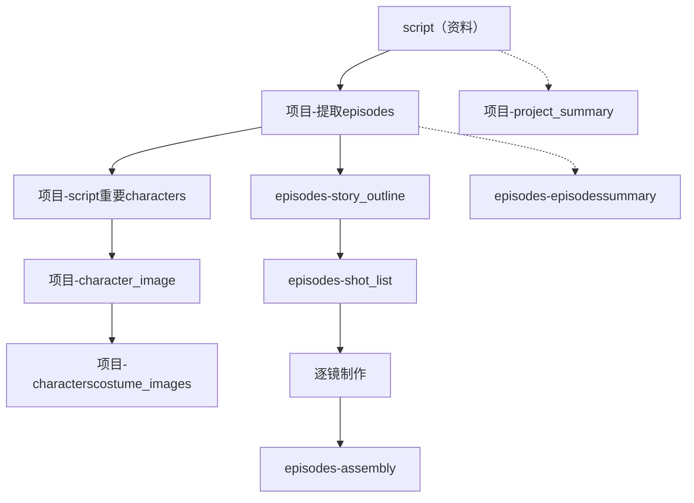
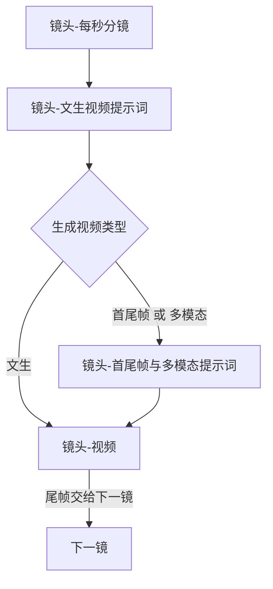

# 制作工作流

从剧本到成片的顺序，以及多个任务如何编组。

## 文档

`dev_docs` 里每类文档只记一件事。改规格时按下面的路径从前到后改，后面的文档沿用前面已经写定的名称和结构。

| 文档 | 作用 |
|---|---|
| 本文 | 制作顺序、任务编组、面板按钮 |
| [project_detail.json](project_detail.json) | 项目保存哪些字段。节点内容的字段以这份为准 |
| [step_model.md](step_model.md) | 任务组、任务、步骤的字段和状态。各节点的状态在 `node_state` |
| [dots](dots/) | 每个节点一篇：前置条件、生成或执行规则、返回结构、保存到哪个字段、下游检查 |
| [in_puts](in_puts/) | 发给模型的提示词。生成、审核、修订按节点分文件。模型要返回的结构与对应节点文档一致 |

`dots/` 和 `in_puts/` 按节点对应，这里不逐篇说明。节点索引在文末「节点文件」。

### 修改路径

1. 改顺序、编组或按钮：改本文。增删节点时，在 `dots/` 补上或去掉那一篇，并改 `step_model.md` 的组类型和节点位置。
2. 改项目字段：先改 `project_detail.json`。节点有增减时，同步 `step_model.md` 的节点位置。再改 `dots/` 里用到该字段的依赖资料和数据保存。模型输出跟着变时，最后改 `in_puts/`。
3. 改任务、步骤、组或状态：先改 `step_model.md`。按钮或任务组的说法有变时，再改本文。
4. 改某一个节点怎么做：改 `dots/` 里对应那一篇。保存用的字段以 `project_detail.json` 为准。返回结构有变时，再改该节点的 `in_puts/`。制作顺序有变时同时改本文。
5. 只改提示词措辞：改 `in_puts/` 里对应文件。

一个业务节点对应一个任务。一次提交多步时，按下方任务组顺序排进同一组。

## 主路径

提取剧集之后分成两条：一条做人物和图片，一条按集往下做到合片。项目摘要、剧集摘要不挡住主路径。

虚线是旁路，不挡住实线。多模态视频要用到角色图和本镜服装的定妆照，这两张图没好时，该镜不能按多模态出视频。

## 逐镜

按镜头顺序做。后一镜的视频用前一镜尾帧作为开头画面。尾帧不是独立节点。

类型在进入提示词编排前由程序判定。`文生` 跳过编排，直接用文生视频提示词。`首尾帧` 和 `多模态` 先由程序编好对应提示词，再生成视频。

视频和尾帧是同一个任务：生成视频之后，程序测量实际时长并截取、校验尾帧。视频生成或文件读取失败且没有可用成片时，按 `failed` 处理、不覆盖旧结果；成片可用但实测时长未通过程序阈值时，保留本轮视频候选和实测时长，将视频节点标为 `rejected` 并保存原因，不更新下游 hash。时长与尾帧都通过后才标为 `generated`。

## 任务组

一个任务组对应面板上的一个按钮。组里任一任务失败、未通过或取消，后面还没执行的任务作废。已经成功并保存的结果保留。项目摘要、故事大纲、镜头表各自单独提交，不组成任务组。项目摘要不挡住主路径。

### 提取剧集

1. [项目-提取剧集](dots/项目-提取剧集.md)：一个任务，确定各集切点并写入剧情。
2. 为每个剧集各建一个 [剧集-剧集摘要](dots/剧集-剧集摘要.md) 任务。

剧集摘要不挡住人物、大纲和成片。

### 提取人物角色

1. [项目-剧本重要角色](dots/项目-剧本重要角色.md)：一个任务。
2. 为每个角色各建一个 [项目-角色图](dots/项目-角色图.md) 任务。
3. 为每个角色的每套服装各建一个 [项目-角色定妆照](dots/项目-角色定妆照.md) 任务。任务数等于该角色 `服装[]` 的条数。每个任务一次图片请求、一张图，只保存自己那一套。某一套的定妆照排在该角色的角色图之后。

### 成片

按该集镜头表顺序，为每个镜头排一条任务：

1. [镜头-每秒分镜](dots/镜头-每秒分镜.md)
2. [镜头-文生视频提示词](dots/镜头-文生视频提示词.md)
3. [镜头-首尾帧与多模态提示词](dots/镜头-首尾帧与多模态提示词.md)。生成视频类型为文生时不建这一任务。
4. [镜头-视频](dots/镜头-视频.md)。尾帧在这个任务里截取，不是独立任务。

后一镜的视频用前一镜尾帧作为开头画面。多模态还要该角色的角色图和本镜服装的定妆照。全部镜头的视频都完成后，再建一个 [剧集-合片](dots/剧集-合片.md) 任务。

## 任务状态与操作按钮

状态取值见 [step_model.md](step_model.md)。排队中或生成中不再显示生成类按钮。

### 任务组

状态不单独存储，按组内任务计算：未通过、失败、已取消优先，并显示该任务的原因；否则有生成中就是生成中，有排队中就是排队中；全部已通过就是已通过；其余有已作废则显示已作废。

| 按钮 | 何时出现 |
|---|---|
| 一键生成 | 这一组还没有结果 |
| 重新生成 | 已有结果，再跑整组 |
| 继续 | 组中途停下，且尚未全部完成。从停下的任务起新建一组，已完成的不进入新组。停在未通过时，这一任务带上对应节点的未通过原因 |
| 查看任务历史 | 始终可看 |

### 任务节点

节点状态读项目，不从历史任务推算。未通过、失败、已取消、已过期都显示原因。没有内容时按钮是 AI生成，已有内容时是重新生成。

AI 审核或程序业务校验（包括时长阈值）未通过时，保留本轮候选内容并正式写入对应节点；节点状态设为 `rejected`，校验原因写入 `node_state.reason`，任务结束原因也记录该原因，不更新下游依赖 hash。重新提交时把节点原因作为修改意见带入新任务及其模型输入；无产出的前置检查、接口或解析错误按 `failed` 处理，不覆盖节点内容。

| 按钮 | 何时出现 |
|---|---|
| AI生成 | 还没有内容 |
| 重新生成 | 已有内容 |
| 按意见修订 | 仅未通过。默认带入节点未通过原因，可补充意见；意见写在新任务上，任务组不记 |
| 人工编辑 | 文本改内容；图片和视频改为导入文件 |
| 人工放行 | 仅未通过。结构校验通过后改为已生成，原因清空 |
| 取消 | 生成中或排队中 |
| 开始、移除 | 仅排队中 |
| 查看任务历史 | 始终可看 |

### 步骤

状态为等待中、执行中、完成、未通过、失败、已跳过、已取消、已作废。AI 审核或程序业务校验未通过时，这一步显示未通过，原因用审核或校验原因。失败或未通过默认展开。

| 按钮 | 说明 |
|---|---|
| 收起 / 展开 | 切换本步详情 |
| 提示词 | 打开本次提示词，可复制。没有提示词时说明没有 |
| 查看 HTTP | 打开本次请求和响应，多次调用可切换 |

## 节点文件

| 层级 | 节点 | 谁来做 |
|---|---|---|
| 项目 | [项目-提取剧集](dots/项目-提取剧集.md) | AI 定切点，程序按原文拼接 |
| 项目 | [项目-剧本重要角色](dots/项目-剧本重要角色.md) | AI |
| 项目 | [项目-角色图](dots/项目-角色图.md) | AI |
| 项目 | [项目-角色定妆照](dots/项目-角色定妆照.md) | AI，在提取人物角色组内，每套服装一个任务 |
| 项目 | [项目-项目摘要](dots/项目-项目摘要.md) | AI，不挡主路径 |
| 剧集 | [剧集-故事大纲](dots/剧集-故事大纲.md) | AI |
| 剧集 | [剧集-镜头表](dots/剧集-镜头表.md) | AI |
| 剧集 | [剧集-合片](dots/剧集-合片.md) | 程序 |
| 剧集 | [剧集-剧集摘要](dots/剧集-剧集摘要.md) | AI，不挡主路径 |
| 镜头 | [镜头-每秒分镜](dots/镜头-每秒分镜.md) | AI |
| 镜头 | [镜头-文生视频提示词](dots/镜头-文生视频提示词.md) | AI |
| 镜头 | [镜头-首尾帧与多模态提示词](dots/镜头-首尾帧与多模态提示词.md) | 程序；文生类型跳过 |
| 镜头 | [镜头-视频](dots/镜头-视频.md) | AI 生成，程序截取尾帧 |
