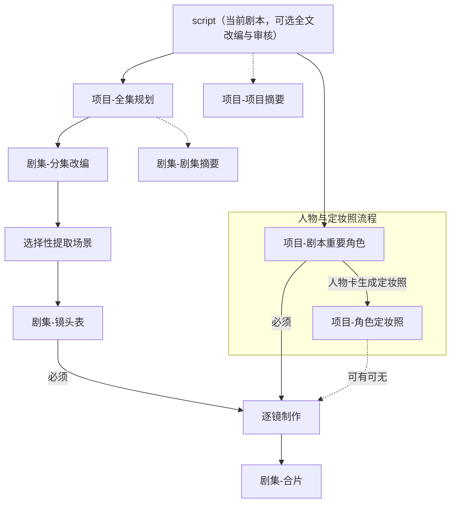
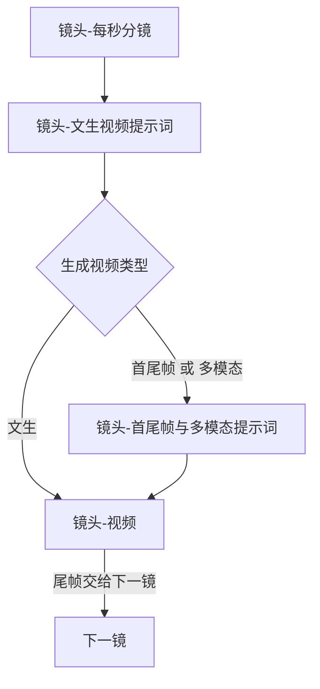
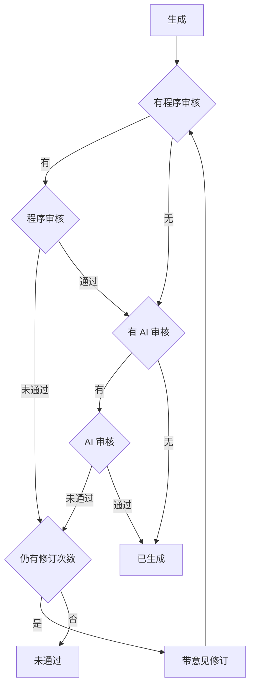

# 制作工作流

从剧本到成片的顺序，以及多个任务如何编组。

## 文档

`dev_docs` 只给开发者阅读，程序不读取。每类内容只写在一处，其他位置只放链接：

| 内容 | 唯一位置 |
|---|---|
| 制作顺序、任务编组、审核与修订流程、项目执行状态、面板按钮、删除规则 | 本文 |
| 项目字段 | [project_detail.json](project_detail.json)；代码为 [shared/models](../shared/models)，两边字段名和结构保持一致 |
| 任务组、任务、步骤的字段与状态 | [step_model.md](step_model.md) |
| 节点目录：目标类型、保存字段、程序/AI 审核开关、重试轮次、前置检查 | [node-definitions.js](../shared/node-definitions.js) |
| 节点依赖与过期传播 | [node-dependencies.js](../shared/node-dependencies.js) |
| 时长目标与容差 | [duration-policy.js](../server/prompts/duration-policy.js) |
| 各动作输入参数、参数编排（`compose`）与输出格式 | [节点路由契约](../server/http/nodes)；视频编排在 [video-request.js](../server/http/video-request.js) |
| 发给 AI 的生成、修订、审核规则 | [PromptModel](../shared/prompt-models)，多节点共用句在 `common.js`；审核问题定位在 [review-policy.js](../server/prompts/review-policy.js) |
| 开发约束、模块、存储与迁移、提示词渲染与模型接入、测试 | [meiji-dev.md](../.agents/meiji-dev.md) |
| 某次改动的过程与取舍 | `docs/plans/`、`docs/implement/` |

单个节点如何执行以上述代码为准，本文只写跨节点的流程与约定。

HTTP 和任务流程共用 [ai-routes.js](../server/http/ai-routes.js) 的节点执行入口。它读取一次当前模型配置，按来源编排并调用对应 HTTP 单例；切换模型不改变节点输入和输出契约。历史保留当次业务参数、所选模型、实际提示词和脱敏传输记录。

### 修改路径

1. 改顺序、编组、审核流程或按钮：改本文。增删节点时同步 `node-definitions.js` 和 `step_model.md` 的组类型与节点位置。
2. 改项目字段：先改 `project_detail.json`，同一轮改 `shared/models/` 里该字段所在的 Model，再改用到该字段的依赖（`node-dependencies.js`）、任务输入提取和路由契约。
3. 改任务、步骤、组或状态：先改 `step_model.md`，同一轮改 `task_group_model.js`、`task_model.js`、`step_model.js`。按钮或任务组的说法有变时，再改本文。
4. 改某一个节点怎么做：改该节点的代码——前置、重试和审核开关在 `node-definitions.js`，输入输出在节点路由契约，AI 规则在 PromptModel。返回结构有变时同步路由输出契约、参数编排及任务输入提取；制作顺序有变时同时改本文。
5. 改提示词：只改措辞时改该节点的 PromptModel；同一句用于多个动作或节点时定义为常量引用，不复制（`tests/prompt-rules.test.js` 守护）。公共渲染变化才改 `render.js`。

改规则时改它所属位置的原文，不在文末追加补丁段落；改动经过写入实施记录。

一个业务节点对应一个任务。一次提交多步时，按下方任务组顺序排进同一组。

## 主路径

剧本导入后可直接进入全集规划和提取人物，不以剧本审核状态拦截制作。项目详情展示基本信息与剧本优化卡，基本信息可编辑项目名称、画幅、创作要求和参考单集时长，并可展开原始剧本。剧本优化卡直接展示当前优化稿及操作，箭头可进入剧本详情；详情页移除项目摘要卡，既有摘要后台任务与历史暂保留。需要调整全文设定时，在剧本详情的“本次执行意见”填写要求并点击“按意见改编”，改编后自动审核；“审核剧本”只审核当前正文，未通过也不自动改写。全文改编是可选步骤，不在导入时自动执行。全集规划一次确定全部集数、每集核心事件与跨集安排，分集改编逐集输出可拍摄的故事小段，之后选择性提取场景、镜头表、逐镜、合片。先提取剧本重要角色，再通过独立定妆照任务组按人物卡生成图片。进入逐镜时，镜头表和剧本重要角色必须已有；定妆照可有可无。项目摘要、剧集摘要不挡住主路径。

实线是必须交给下一节点的正式结果。虚线不挡住进入逐镜。多模态视频在已有定妆照时使用：本镜有明确服装时用该服装的定妆照；角色 `costumes` 为空时用 `costume_id` 为空的未绑定定妆照。人物、服装与场景图均为可选素材：只纳入地址非空且状态为已生成的对应图片，缺图不阻断，不用其他服装图替代。部分有图时仍可多模态，文字资料和出镜绑定照常保留。可见人物允许未绑定，包括具名人物；镜头正文交代其姓名或称谓及可见表演，视频模型按文字推断。既有绑定仍校验人物ID及服装归属，缺少绑定本身不作为未通过原因。

本集 duration_seconds 是由切集或人工编辑确定的固定参考，大纲保存、修订和人工放行不自动回写。大纲合计与镜头表合计均须在同一本集参考±30秒内；镜头表还须接近大纲累计取整目标，两项容差取交集，不逐层叠加。确需改预算时，先人工编辑本集参考时长。

全集规划返回 `剧集[{序号、本集规划、预估时长秒}]`，集号连续，时长在参考单集±30秒内。不再输出起止段落或排除段落，不按原文拼接。各集 `plot` 保存核心事件、开场、阶段性结果、结尾钩子与前后集交接。规划决定集数，分集改编不自行增减集数；界面“本集规划 / 编辑规划”可调整本集安排和参考时长。

分集改编读取原始剧本、全部分集规划、本集序号与要求、前集已生成的实际剧情；前集无有效改编时只参考前集规划。建议按集顺序生成。允许改写对白、增删合并局部事件和支线，保持核心人物设定、主线因果、结局及前后集边界；每集应有推进、有因果、有阶段性回应。`story_outline.segments` 的结构不变，各段 `body` 按序拼接即本集改编正文，不另存副本。原文场景描述不足时，结合上下文、时代与设施功能补齐可拍摄的布局、材质、色彩、陈设和基础光源；保留用途、埋设或外露、开口朝向、出入与装载方式，不能将专用设施套成普通物件。首次出场或结构变化的小段正文自然交代动作所需的空间，后续沿用，不把视觉推测说成原文事实。人物完整外貌、声线和服装继续由角色库统一维护，正文只写本段可见且影响行动的特征，不必抄入整份档案。审核不要求逐字覆盖原剧本，镜头表以改编小段为剧情依据。时长在范围内且能自然呈现时，不因没有精确接近目标而强制加戏；规划审核只检查可展开的关键因果，不要求提前完成逐集正文。

新建与编辑项目的画幅统一选择MiniMax H3固定比例：21:9、16:9、4:3、1:1、3:4、9:16，默认9:16。场景图、定妆照和生成视频使用项目比例；首尾帧视频接口按参考图使用adaptive，新视频下载后按项目比例归一化。项目存比例而非像素尺寸；旧横竖尺寸通过v25显式迁移，已有媒体及历史记录保留。视频统一请求768P，新输出按精确比例、短边至少768、偶数像素归一化，合片使用同一画幅。

剧本改编与审核复用 `script-review` 业务：submit的generate/regenerate仅审核，revise按非空执行意见改编完整全文并自动审核，最多自动修订三轮。明确获准的实体、用途或技术设定变化优先于旧文相应设定，关联的结构、操作、动作和对白一并调整，审核不要求恢复获准修改的旧设定。其余剧情和人物关系保持，必要环境可合理补全，不默认联网查证。

导入原稿独立保存在 `basic_info.original_script`，改编全文保存到 `script_revision.body`，本次意见保存到 `script_revision.opinion`。不再保存剧本版本、更新时间和修改记录字段；执行资料仍由任务和步骤记录。审核不改正文。按原任务规则，改编模型问题耗尽重试时保留最后候选并标未通过，不推进下游；上游/规则问题或异常不覆盖原稿。通过后按实际依赖使人物、摘要、分集改编及相关制作结果过期，保留剧集ID、旧正文和媒体，不自动重做或强制重规划。后续制作优先读取非空优化稿，否则读取原始剧本；优化始终保留原始剧本。

## 选择性提取场景

大纲后执行提取场景（`episode-scenes`），只收录反复出现、重要或用户明确要求固定的地点。一次性不重要地点留在镜头正文，没有符合条件的场景时允许空结果并继续镜头表。项目共用一份场景文字和一张按需参考图，跨集复用，不因镜头、机位、昼夜、天气拆资产；不自动批量生成图片。场景资料只记录静态环境，不写人物出场、站位或动作。参考图采用能交代整体布局的无人静态背景总览，不出现主要角色、群演、人群、人体局部、人物剪影或倒影；剧情、资料或原图有人物也不画入，修改原图时移除人物并还原背景。按项目画幅拉远机位，呈现主要分区、出入口、通路与地标关系；主体设施与关键边界保留构图余量，避免局部特写。修改旧图可保留空间设定并拉远重新构图，不被原裁切范围锁定。

场景资料挂在项目 `scene_library.scenes[]`，剧集 `scene_catalog.scene_ids` 只记录本集用到的场景 ID。普通生成或重新提取时，已有地点（按 ID 或唯一同名）直接取用项目资料，AI 候选中的改写不生效；只有新地点生成资料并加入项目。提取新地点时沿用改编阶段的场景补全规则，将必要空间落实成统一静态资料。修改已有场景设定可使用提取场景的“原结果修订”并填写意见，或人工编辑；保留原ID，未涉及场景不改，保存时只有资料实际变化的场景使其参考图及引用镜头过期。

场景图读取真实原始剧本、引用该场景的分集规划和实际改编正文，分别标明来源，规划不能冒充原文；无关剧集不传入。原图只作环境参考，事实或明确修正意见与旧图冲突时纠正结构，未冲突的补全设定保持。上述资料与图片依赖指纹使用同一份输入，原文或相关改编变动会使旧图需重新生成。

剧情页中提取场景节点紧跟分集改编，本集已选场景以卡片横向排列在该节点内，一屏两张，可左右滑动或用鼠标拖动；每张卡片展示场景文字和该场景的参考图节点；参考图按项目视频画幅显示为缩略图（竖版高 180px，横版占满卡宽），原图比例不同时居中裁切，点击放大查看原图。本集没有场景时只显示节点说明，不显示空列表。

镜头表绑定scene_id，scene_state描述本镜状态，scene_transition区分连续接拍/切换机位/换场。文字链继承同一场景资料，普通地点不强制配图。角色库中的国籍、身高、面部特征及其余稳定外貌、服装文字持续注入镜头表、每秒分镜和最终提示词；最终提示词按本镜可见人物和实际说话人选取资料，未回填剧情正文或没有人物图也能使用。只在可见范围内转写特征，不为展示档案另加动作或改变构图。多模态先按出镜顺序上传实际可用的人物服装图，再上传场景图；本镜为同场景同状态连续接拍、前镜视频及尾帧均有效时，在末尾追加前镜尾帧。包含衔接尾帧合计最多9张，超限明确拒绝，不静默丢图；按实际上传顺序生成连续图片编号及说明。无参考图时，明确同场景同状态连续接拍且已有有效尾帧才用首尾帧；其他情况使用文生。缺少场景图或定妆照不要求补图后才能继续。

## 逐镜

连续平移、推拉、摇移和跟拍均可属于同一拍摄镜头，摄影位置变化不等于剪辑；camera明确实际运动或实际剪辑，最终提示词仅在实际剪辑时新增Shot。整镜背景与摄影安排在镜头表的既有正文、景别、连续性衔接、参考锚点和音频字段中确定；每秒分镜读取继承，按节拍细化变化：一个节拍是一个主要动作或一段持续状态，长度不固定，总长等于镜头参考时长。每秒卡片在节拍时间线前展示来自当前镜头表的整镜设定。最终分镜提示词的输入同样携带该派生资料，先建立整镜背景与开场构图，再忠实转写已审核的节拍时间线；不在每秒节点另存一份设定。

镜头表将分集改编落实为完整画面：在现有正文、background_characters、空间锚点与衔接字段中交代本镜可见的主要人物、必要背景人员、建筑和物件的相对位置、朝向、视线、通道及遮挡。可依据已有场景和场景功能补足不改变剧情的群演及非剧情陈设，不新增身份关系、独立事件、台词或关键道具。连续场景保留群体规模和分区，机位裁切只改变可见部分；镜外在场不等于本镜可见。首镜从已有事件的可见变化、反差或未决行动选择吸引点，与后续因果接续，景别与节奏按故事设计。每秒分镜与提示词继承这些决定，不在下游另选人口或换位。

镜头表先确定卡内人物与服装ID，以及不具名群演和可见表演；其生成要求有效角色库。成片按镜头顺序直接做每秒分镜、文生提示词及视频，不再调用独立识别节点。文本不要求定妆照。每秒分镜非首镜必须读取上一镜有效且已审核的结束状态、未完成动作、未结束对白、持续声音与末尾完整节拍；前镜无效时阻断该镜每秒任务。待续对白只记录尚未说出且明确需要跨镜继续的原话；被打断不代表必须补完，破折号或省略号不单独构成续说依据。前镜已说对白不能在下镜重播，也不能作为待续标记，程序在镜末审核与下镜前置检查中核对明确引用的已说原话。AI审核必须对照本次dialogue_text，不能沿用旧意见误报已存在的字句或标点。详细交接在每秒阶段产出，镜头表仅保留总体衔接意图。前镜交接变化使后镜每秒分镜及相关下游过期；明确换场由本镜剧情决定继承范围。本镜明确同地点同状态连续接拍时，`首尾帧` 用有效前镜尾帧作为接口首帧；已有资产图的 `多模态` 将有效前镜尾帧加入参考图，由程序写明“本镜首帧衔接参考 <Picture N>”，作为开场状态引导，不等同于接口强制首帧。尾帧只提供开场人物位置、朝向、姿态、持物及动作进度；身份服装以人物图为准，固定布局以场景图为准，机位和可见范围以本镜已审核分镜为准，后续继续动作与摄影。文本阶段保留开场状态，不猜图片编号；图片引用及职责由程序补入，不新增AI调用、不改已审核三段。首镜、换场、切换机位、场景或状态不同及无效尾帧不附衔接图。前尾帧变化或失效使连续后镜编排及视频过期，换场不连带。尾帧不是独立节点；每条视频仍截取尾帧，供后续镜头衔接。

类型在视频任务即将执行、镜头表和文本已有效完成后判定并写入；不会在镜头表无效时执行视频任务。程序在同一事务把适用编排插入同组视频之前，调整尚未开始任务的顺序。类型按实际可用素材确定，有参考图选多模态，无参考图时按连续尾帧条件选首尾帧或文生；继续时重新判型，不复制旧类型编排任务。`文生` 跳过编排，直接用文生视频提示词。`首尾帧` 和 `多模态` 先由程序编好对应提示词，再生成视频。

对白默认采用自然交流语速的约1.1倍，略快、清晰连贯，保持正常音调与人物声线；这是生成目标，不是精确音频变速。每秒分镜先按该目标安排发声，在既有audio写清每句或连续语句的开始和结束，画面拍长可大于发声时长；余下用已有动作、反应或有依据的安静承接，不拖字填满镜头。文本提示词以自然语言明确保留发声起止，第一段不加剪辑时间戳并不禁止写对白相对秒数；画面停留与说话时长须区分，平静或低沉不等于慢说。三动作审核同口径，不按字数硬算秒数，也不要求精确测出倍率。

视频请求另从有对白的原节拍直接读取time_range、audio与说话人，作为时序依据附在已审核三段之前；time_range只标画面拍范围，发声起止以audio已有说明为准，未明确时不推算或强行占满拍。不再次复制台词、不改三段正文，文生、首尾帧和多模态均适用；无对白不附时序段。时序输入与video依赖hash使用同一投影，原声音安排变化会使视频依赖变化。时序资料及规则纳入最终提示词长度校验，不截断或绕过限制。基础规则直接读取当前代码，无需手动同步；已有视频不自动变速或重做。

视频和尾帧是同一个任务：生成视频之后，程序测量实际时长并截取、校验尾帧。视频生成、文件读取或尾帧截取失败时按失败处理、不覆盖旧结果。视频不做程序审核、AI审核或自动修订。下载、文件解码、实测时长和尾帧保存完成后直接标为已生成；实测与计划时长的差异不会触发重新生成。

## 审核

文本自动修订预算统一为3次：首次生成后最多再修订3轮，程序和AI审核共用预算；真实上游、规则、其他阻断及确定性无进展仍按既有边界提前停止。

生成之后先做程序审核，再做 AI 审核。时长只在程序审核里判定，允许的差值是该节点的误差时长。本节点没有对应审核时，这一步跳过。误差时长和重试轮次写在各节点文档开头。节点文档中的“重试轮次 N”指首次生成之后最多再修订 N 次；首次生成也计入总生成次数，因此最多生成 N+1 轮。程序审核和 AI 审核共用同一个修订次数，不分别累计。

程序审核或 AI 审核未通过，且仍有修订次数时，只把原因作为修改意见，位置、依据和建议直接写在原因里，带原内容重新生成，再从程序审核做起。修订次数用尽仍未通过，才保留最后一轮产出，节点进入未通过，不更新下游。两步都通过才标为已生成。可解析JSON缺少必填字段时，原始候选保存在任务步骤中，由程序审核判为未通过并按节点原有轮次修订；结构始终不完整时不写入正式内容，保留原内容和hash，仅记录节点未通过状态与原因。没有产出的前置检查、网络、接口或JSON解析错误仍是失败，不覆盖节点内容，异常原因不自动加入模型提示词。

### 修订携带的意见

内容组装中的业务校验同样携带原候选进入修订，修改意见去重。

自动修订遇到程序审核拒绝且本轮AI审核未执行时，继续携带同一任务最近一次AI拒绝意见，并明确要求针对最新候选核查、已解决项不重复修改；不能让字段错误覆盖尚未复审的业务意见。不同任务的旧意见不混入本次自动修订。

AI生成、重新生成、原结果修订都携带公共输入框的本次执行意见。原结果修订仍在原始任务意见中保存节点未通过原因及本次意见，已有同一完整原因不重复追加。发送模型时将可识别的旧拒绝原因标为待核查历史诊断，将本次执行意见单独标明；后续轮次只带最近诊断及本次要求，不把已解决或错误旧意见当新事实。场景拆并历史仍按序提供作为核查记录。修订沿用四条消息，原结果放 assistant，原因与本次意见放最后 user。

### 问题定位与无进展

布尔审核统一只返回 `是否通过`、`类型`、`原因`，不再返回问题数组。通过时类型和原因为空；拒绝时类型必须为 `上游资料问题`、`模型问题`、`规则问题`、`其他`，原因一次写清全部具体对象、位置、依据及处理方向。实际请求、校验与skill规则页共用最终编排契约，skill展示完整输出结构。新返回不兼容缺类型及旧问题数组，历史原始记录只读保留。

先不看候选，仅核对指定上游来源是否能同时成立。上游资料问题指仅凭上游原文即可证明的互斥事实或缺少本节点不能合法补全的必需信息，原因需指明来源、位置及实际原文；模型问题指被审候选偏离有效输入/规则或自身矛盾，不能以必须保留错误候选为由要求修改自洽上游；规则问题指执行要求有真实冲突、含糊或无法同时满足；无法明确归类的具体问题归其他。多类同时出现时优先规则、上游、其他、模型，原因仍列全真实问题。上游、规则、其他均以rejected结束，停止本节点自动修订，不自动修改上游或规则，不提交当前候选；原内容和成功hash保留，候选及三字段审核留历史。模型问题按原预算修订；审核协议错误不触发人物或剧情内容修订，网络/接口异常仍为执行失败。

修订后候选与上一轮完全一致时，在审核步骤结果写 `修订进展`。同一确定性程序错误再次出现则提前结束，不继续无效重试且不覆盖旧正式内容；AI重复拒绝不按原因文字直接判无解，而把针对最新候选的定向提示传给下一次修订，仍最多使用本节点原修订额度。候选仍在变化时不误停。

### 明确对白的程序检查

节拍节点对镜头表中成对引号明确给出的对白，按节拍顺序拼接结构化原话逐字核对，保留标点，允许跨拍拆句。只有发声来源完整可确定且没有额外旁白时才要求整个对白序列完全相等，以识别漏句、重复和倒序；存在来源歧义时不猜测补写，交由AI语义审核。

最终提示词按既有 `<d>...</d>` 协议拼接画面段全部对白片段，与结构化节拍原话序列精确对照；一句台词不可拆成多个标签；同一人物连续说多句台词时可整体保留或在完整句子之间分开，不能改标点、漏句、重复或倒序。明确对白差异沿候选程序拒绝/修订通路，人工放行仍检查。不按字数推算时长，不把叙事转成旁白。

## 任务组

一个任务组对应面板上的一次提交。组里任一任务失败、未通过或取消，后面还没执行的任务也记为已取消。已经成功并保存的结果保留。项目摘要、分集改编、镜头表各自独立提交，每次创建 `single` 组。项目摘要不挡住主路径。`episode-seconds` 只保留单项和历史任务，面板不再单独成组；接口提交 `episode-seconds` 时逐镜安排每秒分镜；面板通过成片组执行。

### 剧本审核与修改

项目-剧本（script-review）为可选全文改编与审核，不在导入时自动审核，也不作为全集规划或人物提取的前置。generate/regenerate仅执行程序前置与AI审核，未通过不自动改写；revise依据非空意见改编全文后审核，模型问题最多再修订3次。通过后保存script_revision.body与opinion，保留basic_info.original_script；阻断或耗尽按统一任务规则处理。界面保留改编、审核、人工编辑、历史及状态查看。

### 全集规划

1. 项目-全集规划（script-split）：AI一次确定全部集数、各集核心事件、冲突转折、阶段性结果及前后交接，保存为各集plot规划，分集正文由后续outline展开。
先按正常表演容量分配各集预算，不按字数估时；原文独立声明总时长时遵守总预算，否则按剧情容量定集数。每集在参考时长±30秒范围内，必要时调整集数及相邻集内容，不通过只改数字、空等或异常语速凑数。允许按已确认改编规则调整局部叙述与支线，核心设定、主线因果和结局保持。程序与AI审核共用3次修订预算，错误定位到实际集次与规划，不要求不存在的原文段落编号。

拆分成功并写入剧情后本任务组完成，不自动创建或调用每集摘要任务。剧集摘要保留独立操作，不属于拆分流程。剧集卡使用节点标题栏：没有剧集时是 AI生成，已有剧集时是重新生成，旁边是任务历史；排队或生成中改为取消。最新任务未通过且有原因时，原因下方单独一排放「修复（再给 3 轮）」：不弹框，直接以 revise 提交，意见带上未通过原因和本次执行意见。顶栏同时有「人工放行」：收下最近一次未通过任务的切分候选，必须通过段落覆盖和参考时长上下30秒的程序校验；没有候选、覆盖错误或时长越界则任务未通过，不改剧集。候选在任务历史，不要求已有正式剧集。失败只显示原因，不提供修复和人工放行。排队或生成中若已进入自动修订，状态行追加「自动修订 当前轮/上限」。本次执行意见只留在当前页面，随本次拆分提交；任务成功后清空，失败或未通过时保留，刷新后消失。空意见不写入提示。

### 提取人物角色

生成、修订、审核共用人物纳入、可空国籍与服装配件语义。position概括核心身份及已有剧情作用；群体服饰只适用明确成员，个体服装细化同一次造型，头饰等服饰配件可放props。审核引用最新候选与完整上下文，不以精简偏好、未重述静态关系或可能误读拒绝。

1. 项目-剧本重要角色（`project-characters`）：一个任务。

提取只保存人物及服装资料，不派生图片。剧本未描写服装时只设计一套默认造型；只明确一套则补齐该套，不另加默认套。大致相同的服装统一归为一套，只有剧本明确该角色实际换装或不同套穿着才增加造型，不按职业、场景或剧情用途自行扩充。每个人物和每套服装首次建档时各分配一个唯一ID，不另设编号；镜头表、人工编辑、每秒分镜与成片直接引用这些ID，服装仍须属于所选人物。项目详情里这是一张文本节点卡，标题为提取人物，下面是人物格子（头像和名字，点进详情）。格子上没有节点标题栏，这张卡也不提供继续。名单审核先核对原文姓名，再核对实际出镜/发声和独立剧情作用；三条件缺一不可。无名人物不建卡，不能因其重要或群体人数明确反报遗漏。每条遗漏须指出原文具体姓名和作用，历史补无名人物的错误意见不沿用。纳入口径与资料提取、补全和优化规则见 [project-characters.js](../shared/prompt-models/project-characters.js)。保存时按人物姓名及服装名称增量合并，未返回的旧角色与旧服装不自动删除；新提取规则不追溯清理历史造型。本次返回的角色不再保留定妆照地址，图片槽位清空；未返回角色的定妆照不动。用过这些照片的视频先标为已过期。

人物详情的定妆照缩略图支持点击放大查看，使用原图地址；关闭按钮或 Escape 返回原页面。服装名称仍进入服装详情。

角色卡按最新提取任务组（含续作组）显示聚合状态和原因；中途停止时提供继续。面板继续组在无其他未结束任务时直接启动，有其他排队或运行任务则冲突；会话来源仍按队列规则排队。

### 人物定妆照

定妆照的姓名、性别、年代、定位、年龄段、身材、发型、签名道具、不可改特征任一项去除首尾空白后非空即可生成；全部为空时拒绝。首套可有或没有用户参考图；后续定妆照固定且唯一地引用首套定妆照，所有生成/修订动作一致。

项目详情在提取人物卡后面单独放一张生成定妆照组卡，不重复人物格子。点生成定妆照为全部人物各建一组，按服装数组顺序逐套生成。人物详情页仍可只生成该人物。一套服装一次图片请求；无服装资料生成一张未绑定服装定妆照，不补写服装资料。

第一套定妆照作为默认人物角色图，不保存独立角色图节点。首套可选用户参考图；后续各套以首套定妆照为唯一参考。没有指定服装的视频引用默认图；指定服装的视频引用对应定妆照。首套变更使后续定妆照及实际引用视频过期。

组中途失败、未通过或取消，后续任务记为已取消；组卡片上的“继续”从停点建立新组，保留已有图片和旧任务记录。任务历史列表和任务组详情只展示，不放继续，也不放取消。详情只保留查看提示词、查看 HTTP 和复制。生成补齐无效图，重新生成重跑全部服装。

### 成片

按该集镜头表顺序，为每个镜头依次编排以下任务；每个节点各对应一个任务：

1. 镜头-每秒分镜（`seconds`）
2. 镜头-文生视频提示词（`storyboard`）
3. 镜头-首尾帧与多模态提示词（程序编排）。生成视频类型为文生时不建这一任务。
4. 镜头-视频（`video`）。任务内先取得服务端地址，再下载到本地，然后测量时长并截取尾帧。尾帧不是独立任务。项目同时保存 `video.server_address` 与本地 `video.address`；旧项目的服务端地址为空，已有本地文件保留。

成片列表卡片上的视频可以点击，在面板内弹框播放。

后一镜只有在生成视频类型为 `首尾帧` 时才用前一镜尾帧作为开头画面。多模态使用对应定妆照：有明确服装时使用本镜服装的定妆照；角色 `costumes` 为空时使用 `costume_id` 为空的未绑定服装定妆照。

成片组默认 `action: generate`，只补齐未有效完成的节点；判断是否可跳过时，也要考虑本组前面重新生成会使后面失效。`action: regenerate` 重跑所选镜头的逐镜节点。`shot_id` 只限制逐镜生成范围，不代生成其他镜头。

“逐镜头成片”整集汇总卡已有视频但仍有镜头未完成、视频过期或尾帧缺失时提供“继续”，不要求最近一次任务组失败或取消。点击按当前本集全部镜头提交 `episode-film/action=generate`，依镜头顺序补齐缺失节点，保留有效结果；最近任务组已通过但本集未齐时显示“未完成”。本集成片任务仍在排队或运行时不再提供继续；全部镜头完成后不显示补齐继续。既有停止组的继续和合片失败恢复规则保持。

所选逐镜任务全部完成后，若本集所有镜头视频均有效，且本集没有其他未结束的成片组任务，则在最后完成的成片组末尾追加唯一的剧集-合片（`assembly`）任务；已有合片有效且依赖未变时不重复生成。不同单镜组可以按序排队，较早完成的组不抢先合片。即使只选一镜，其他镜头已齐备也可合片；其余视频未齐时，本组完成，不合片。重复请求不重复派生，其他组已有的合片任务不能被挪入本组。合片失败后继续，新组只重建合片，不重跑已完成的视频。

每镜视频完成后记录 FFprobe 实测的实际时长秒（保留一位小数），人工导入视频同样测量；写回视频或替换镜头集合时，剧集实际时长立即累加各镜实测值。合片文件的实测值留步骤结果，不覆盖该累计值；参考预算不变。现有未测量的镜头暂不展示实际时长，不追溯重写已有媒体。

## 项目执行状态

项目不存储暂停开关。任务管理器 `current(model)` 从工作快照中筛选 queued/running 并按 queue_order 排序，得到当前任务数组；有 running 为运行中，只有 queued 为待执行，数组为空为空闲。这些状态按需推导，不写入项目 JSON 或单独持久化。工作快照仅保留未结束整组，组全部结束后历史按ID查数据库；项目顶层最近任务/组关联用于恢复面板状态，查询和记录事件见[任务与步骤](step_model.md)。

没有运行执行槽时自动调度队首，面板与会话提交一致。取消一次性将本项目全部未结束任务/步骤结算为已取消，中止当前请求，保留历史和已有内容，当前数组自然清空。新提交等待旧请求退出后自动执行，迟到结果不得写回。执行失败或审核耗尽未通过时保留当前任务真实状态与原因，剩余排队任务全部取消；其他项目不受影响。删除 start-queued/remove-queued 命令。

数据库 v14 删除 projects.queue_stopped 列，保留项目、任务、步骤、幂等与通知记录；启动恢复规则见下方任务节点的 App 重新加载说明。runtime 中 revision、requests、outbox 仍属持久化事务/通知元数据，不控制是否调度。

项目内执行串行；完成后自动下一项；failed/rejected/cancelled 停止队列。面板再次生成最新任务为失败、未通过、取消或作废的同一节点时，创建新任务并保留旧终态；有内容时 `generate` 按 `regenerate` 受理；首次无内容失败仍允许 `generate`。若该重试已排队则复用；无其他未结束任务时直接启动；有其他等待/运行任务时明确冲突，不误启动其他任务。开始/移除排队项、人工操作与删除只能从面板发起。

## 删除

删除任务 precheck→impact→apply。被镜头出镜/对白或素材库引用的角色不能删除；默认/素材库引用服装不能删除；其他服装删除同次重绑为默认并使相关视频过期。

删除整个项目不受制作进度限制，概要与片库的删除入口不随运行任务冻结。TaskService 删除入口先封闭该项目新增任务、取消全部未结束任务，abort 当前执行并等待本地清理完成，再串行删除项目及清除绑定；不等待项目制作完成，不影响其他项目。远端视频取消能力沿用网关现状。

## 过期范围

按项目数据结构的过期表传播。全集规划整表替换剧集；修改任一集规划时按全集上下文检查各集改编，前集改编变化使后集改编及其下游过期，已有正文和媒体保留。改编正文变化使本集摘要过期，摘要优先读取改编正文。输出语言、画幅、声音、默认服装配置只影响后续步骤，不使已有资源过期。图片依赖使用本节点实际提示资料：首套定妆照读取人物描述、服装和可选参考图，其余套另依赖首套定妆照；未参与提示的资料不触发图片过期。

## 任务状态与操作按钮

面板顶部导航固定显示“片库”和“设置”。“片库”打开项目与素材列表，“设置”进入设置页；没有打开项目时也可以进入这两页。导航在“片库”前展示 GPU 利用率，格式为“GPU：30%”，首次打开立即读取，页面可见时每 5 秒更新一次；页面隐藏或卸载暂停查询，恢复可见立即更新。数据来自 llm-server 的远端 GPU 采样，不从项目任务状态推测。查询总时限为 60 分钟（在途不重复发起），查询失败显示“GPU：暂不可用”，设备不支持利用率时显示“--”，不把错误当成 0%。

没有打开项目时，右侧是空白面板，中间的加号创建项目，不自动打开片库。从项目概要删除当前项目后回到这个空白面板。

状态取值见 [step_model.md](step_model.md)。节点状态没有排队中。该节点已有排队或生成中任务时，不再显示生成类按钮。

### 任务组

状态不单独存储，按组内任务计算：未通过、失败、已取消优先，并显示该任务的原因；否则有生成中就是生成中，有排队中就是排队中；全部已通过就是已通过。旧的已作废记录也显示已取消。

组标题栏：状态和操作按钮同一排，下面是失败或未通过的节点原因。没有本次执行意见。状态不放在卡片标题旁。成片列表按原组各节点的最新任务汇总当前状态与原因，后续单节点重试、放行或导入成功后不继续展示旧组的取消/失败原因；仍有未恢复节点时保留其停止状态。历史任务组只按该组原任务汇总，终态不改写。

| 按钮 | 何时出现 |
|---|---|
| 一键生成 | 这一组还没有结果 |
| 重新生成 | 已有结果，再跑整组；文本首轮不带上次结果 |
| 继续 | 组中途停下，且尚未全部完成。从停下的任务起新建一组，已完成的不进入新组。停在未通过时，这一任务带上对应节点的未通过原因 |
| 取消 | 组内有排队或生成中的任务。一次点选取消当前项目全部运行中和排队任务 |
| 任务历史 | 始终可看 |

### 任务节点

数据状态读项目，仅有未生成、已生成、未通过、已过期。数据状态放在卡片标题右侧，留出间距，用带背景和边框的标签显示状态名，不写“数据状态：”。操作按钮和“最新任务：…”同一排，任务文字紧邻按钮，窄屏可换行。提交后任务管理器返回该任务组快照，节点立即用其中对应任务更新状态；项目正文变化时才重新读取整份项目。这一块状态区上下留 12px，不留左边距，最新任务右边留 16px；优先当前关联任务，否则使用数据库最近记录，从未执行则不显示这行文字。状态行显示任务状态；排队或生成中且已经进入自动修订时，追加「自动修订 当前轮/上限」。下一排是本次执行意见，再下一排显示最新任务的失败原因；节点有未通过原因时另行保留展示，不将失败改为未通过。入队、开始、失败、取消均保留原数据状态和审核原因。没有内容时按钮是 AI生成，已有内容时是重新生成。

App 重新加载只读取当前业务任务快照，不自动取消任务。每个 AI 步骤以自己的 step.id 作为服务端任务 ID 与幂等键，发送前将异步标志和完整请求地址保存在既有 step.http 中。App 后端关闭只中止本地等待，meiji-server 继续执行并保存结果；后端启动后接回具有该记录的未结束业务组。恢复时 queued/running 继续查询，succeeded 取回原结果并继续原有校验、审核、下载和事务保存；网络故障仅继续查询。failed/cancelled/interrupted、记录缺失或结果未保留明确结束并展示原因，不自动再生成。已结束旧任务不复活，无恢复记录的旧运行任务仍按旧规则取消。明确用户取消或删除项目时另发服务端停止请求；远端供应商是否终止计费沿用其能力。

程序审核或 AI 审核在修订次数用尽后仍未通过时，保留本轮候选内容并正式写入对应节点；节点进入未通过，原因写入 `node_state.reason`，任务结束原因也记录该原因。本节点保留原成功 hash，不主动更改下游状态、hash 或媒体。重新提交时把节点原因作为修改意见带入新任务及其模型输入。只有一份正式内容，新任务仍按执行时的资料判断前置有效性，依赖已变化时说明阻断原因，不回退历史正文。可解析JSON的结构及业务契约错误（含人物ID与服装归属）由程序审核判为未通过；修订耗尽不保存不完整候选，保留旧正式内容和hash。业务前置检查、JSON解析和审核协议错误记为未通过，保留旧正式内容；HTTP、网络、超时等执行异常记为失败，不覆盖节点内容。生成和修订中的业务契约错误携带原始候选及原因进入现有修订轮次。`项目-全集规划` 是项目级 AI 任务，由 AI 设计全部剧集安排，程序审核序号、非空规划及时长；它没有持久化项目节点，因此未通过原因和候选记录在任务历史，不写项目 `node_state`，也不替换现有剧集。人工放行可以收下该候选并写入剧集，规划结构和参考时长上下30秒均为硬条件，人工放行不能绕过。候选改写后若审核意见仍是上一轮已经指出的问题，停止自动修订，不提交该候选。

节点标题栏：标题右侧是数据状态标签。操作按钮与最新任务同一排，然后是本次执行意见，再是失败原因和未通过说明，最后单独一排放修复按钮和人工放行（各自按条件显示）。超过 80 字的未通过原因收成两行，可展开。除剧本优化外，本次执行意见只留在当前页面，任务成功后清空，刷新后消失，不写入节点。剧本优化意见写入script_revision.opinion，刷新与重启后保留。项目摘要和本集摘要没有人工编辑、人工放行。视频不提供审核修复入口；顶栏重新生成仍重跑该镜成片链。合片、首尾帧和多模态是程序任务，不放意见框；未通过且已有产出时提供人工放行，重新执行把节点原因写入意见。定妆照、成片和分镜组已取消时展示停下任务的结束原因。尾帧画在视频卡里，当作步骤，不用这套标题栏；失败时显示重新提取，用已有视频重新截帧。

AI 节点的公共操作栏提供“查看规则”，运行中仍可查看，分为生成、修订、审核三个标签。每个标签先显示可编辑的补充规则卡，再用一张只读基础规则卡完整展示代码基础规则、语言、任务与固定输出约束；内容随页面展开，不在卡片内部滚动，各卡复制包含完整内容。界面不提供同步按钮或基础规则编辑，服务端也拒绝base写入和同步命令。基础规则以代码为唯一来源，查看、文本/图片/视频执行及依赖hash共用代码base与保存supplement；直接AI入参中的base也不能覆盖代码。节点仍保留 rules.{generate,review,revise}.{base,supplement} 文本结构，全集规划在 story_segments.rules、剧本优化审核在 script_revision.rules；base只作创建/迁移时快照，supplement由界面按动作独立编辑并参与执行，冲突请调整补充规则。无需覆盖已有快照或历史请求；代码更新加载后按新基础规则执行，受影响的旧结果由依赖指纹识别需重生成，不自动批量重做。输出结构和程序硬校验仍由代码维护，不可被补充文本绕过；无AI审核的图片/视频仍保持原流程。本次执行意见不是持久补充规则；剧本优化意见另存script_revision.opinion，其余意见仅在当前页面和任务保留。

| 按钮 | 何时出现 |
|---|---|
| AI生成 | 还没有内容 |
| 重新生成 | 已有内容 |
| 原结果修订 | 文本节点已有结果、没有排队或运行任务且节点非未通过时显示。非空意见写在新任务上，多轮 assistant 带上次完整结果，不自动携带网络或接口失败原因 |
| 修复 | 文本节点未通过且没有排队或运行任务时显示，放在原因说明下方独立一排，文案带「再给 N 轮」（N 为该节点自动修订上限）。点击不弹框，直接携带未通过原因及公共本次执行意见。文本有正式结果时修订原结果，无正式结果时重新生成。不将缺字段候选作为正式内容 |
| 人工编辑 | 文本改内容；图片和视频改为导入文件。项目摘要和本集摘要不提供 |
| 人工放行 | 仅未通过。跳过 AI 审核，结构和本节点程序审核仍须通过；成功后改为已生成，原因清空。项目摘要和本集摘要不提供。合片、首尾帧、多模态在已有产出时提供。全集规划没有节点，放行收下任务历史里的规划候选，仍校验规划结构及时长上下限 |
| 取消 | 生成中或排队中；停止当前项目全部未结束任务 |
| 任务历史 | 始终可看 |

### 步骤

任务历史的任务组列表与组详情显示完整任务组 ID，详情中每张任务卡显示任务 ID，每张步骤卡显示步骤 ID；步骤收起时 ID 仍可见。每个 ID 旁放小复制按钮，只复制对应完整 ID，不触发卡片跳转或展开。长 ID 允许折行，不省略内容。

状态为等待中、执行中、完成、未通过、失败、已跳过、已取消。程序审核或 AI 审核未通过时，这一步显示未通过，原因用审核原因。所有步骤结果默认收起展示两行，展开显示全文。起止时间、未通过/失败原因、查看提示词和查看 HTTP 入口始终展示；复制结果与复制原因分别复制完整内容。旧的已作废步骤也显示已取消。

| 按钮 | 说明 |
|---|---|
| 收起 / 展开 | 仅切换步骤结果的两行预览与全文，其他信息固定展示 |
| 提示词 | 仅调用AI的生成、修订、AI审核步骤显示，可打开并复制本次提示词。前置检查、程序审核、人工操作、合片、尾帧提取及参数编排等程序步骤不显示此按钮；AI步骤尚无提示词时说明没有 |
| 查看 HTTP | 请求发出后即可查看请求，返回后可查看响应；多次调用可切换 |

## 节点文件

| 层级 | 节点 | 业务类型 | 谁来做 |
|---|---|---|---|
| 项目 | 剧本改编与审核 | `script-review` | AI，可选全文改编或仅审核；当前正文用于全集规划与人物提取，不设审核前置 |
| 项目 | 项目-全集规划 | `script-split` | AI 一次设计全部集数与分集安排，程序保存规划 |
| 项目 | 项目-剧本重要角色 | `project-characters` | AI |
| 项目 | 项目-角色定妆照 | `costume-image` | AI，在人物卡单独提交的定妆照组内，每套明确服装一个任务；服装数组为空时，仍有一个未绑定服装的定妆照任务 |
| 项目 | 项目-项目摘要 | `project-summary` | AI，后台兼容与历史保留，详情页不展示 |
| 剧集 | 剧集-分集改编 | `outline` | AI |
| 剧集 | 剧集-提取场景 | `episode-scenes` | AI，选择性提取，可为空；图片另行按需生成 |
| 项目 | 场景参考图 | `scene-image` | 图片任务，每场景一张，可人工导入 |
| 剧集 | 剧集-镜头表 | `shots` | AI |
| 剧集 | 剧集-合片 | `assembly` | 程序 |
| 剧集 | 剧集-剧集摘要 | `episode-summary` | AI，不挡主路径 |
| 镜头 | 镜头-每秒分镜 | `seconds` | AI |
| 镜头 | 镜头-文生视频提示词 | `storyboard` | AI |
| 镜头 | 镜头-首尾帧与多模态提示词 | 程序编排 | 程序；文生类型跳过 |
| 镜头 | 镜头-视频 | `video` | AI 生成，程序截取尾帧 |

各节点的代码：AI 规则在 `shared/prompt-models/<业务类型>.js`，输入输出在 `server/http/nodes/<业务类型>.js`，前置、重试与审核开关在 `shared/node-definitions.js`。
